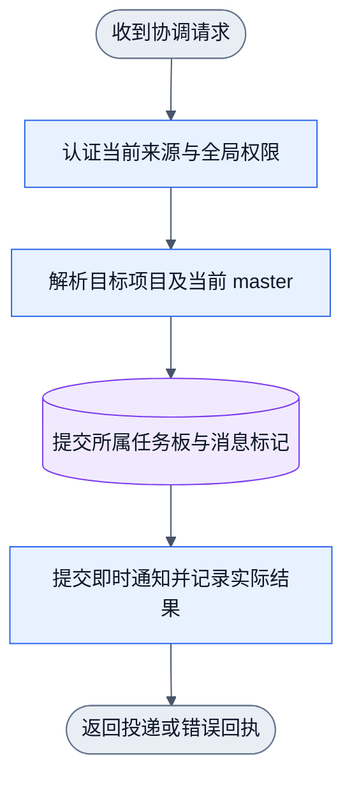
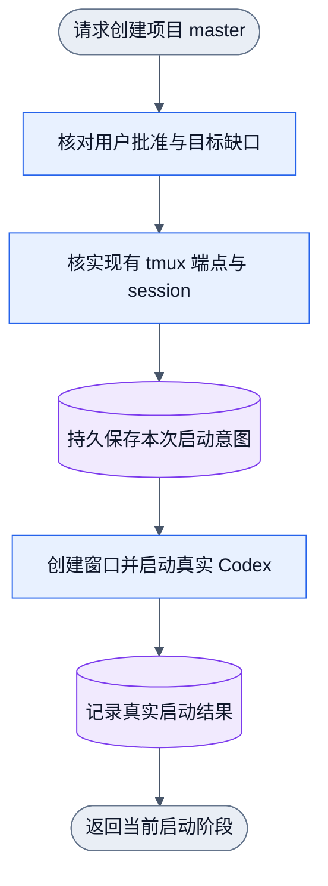

# 全局 CEO 与项目 master 协作

状态：设计已闭合，机制实施中；全局运行时尚未启用。项目内 master、peer 合同保持原义。

## 目标与唯一归属

CEO 是全局唯一的跨项目协调者。每个项目的 master 继续拥有本项目目标、任务拆解、
peer 分工、验收、交付和资源清理。CEO 可以追加任务、要求进度及接收回报；不能因
工作角色名为 `ceo` 而获得全局权限，也不能借追加任务改写已有任务负责人或硬约束。

全局授权与启动过程记录由 resident daemon 的 host state/journal 维护。项目 runtime
中的 GlobalState 不是真正跨项目 CEO 权威。CEO 的 workspace 是已注册身份所属的
项目根目录：显式复用用户选择的已有目录，未配置时提示默认 `~/.collab/workspace`。
本机已有 `/Users/fanzhang/Documents/collab`，不自动迁移、覆盖或初始化这个目录。
workspace 保存工作上下文；typed grant 保存权限，目录存在不代表已授权 CEO。

CEO 授权通过非空用户批准显式授予或撤销，绑定项目、app scope 与稳定名字。会话是
执行载体，正常同名续接按现有名字 owner 规则解析，不依赖旧 session 继续在线。
项目 reset 只处理其项目；全局 CEO 不由其他项目的 reset 隐式撤销。CEO workspace
身份丢失时授权不得被其他身份借用，必须显示当前无法解析的事实。

## 协调请求闭环

图文件：`docs/dagpipe/collab-ceo-coordination.graph.json`，5 节点、4 边。
下面展示同一对象流。请求失败时携错误走到统一回执，后续动作不产生副作用。



唯一任务账本仍为目标项目的 board。追加任务将目标 master 作为 owner，并将任务条件、
通知和待回复标记写入目标 journal 的同一事务。新请求不会取消目标 master 原有任务，
也不会绕过指定执行者、必需 reviewer 或验收要求。master 接单后实际安排，并回复 CEO。

消息使用既有 durable mailbox。daemon 保存需要回复/完成后回复标记，idle 时复用既有
提醒。普通进度回复不清除完成后回复要求；带原请求 ID 的实际完成回信，必须由正确
项目的当前 master 发给当前 CEO，才消除精确原请求标记。跨两个 journal 提交时，先
保证回信持久，再清原标记；部分失败明确返回已提交结果，不能伪造成功或自动重发。

CEO 的进度查询只读当前注册 route、master、项目 board 与回复标记。不再维护跨项目
业务任务表。队列接受、master 安排、交付和回复是不同事实。

## 无 master 的启动闭环

图文件：`docs/dagpipe/collab-ceo-master-bootstrap.graph.json`，6 节点、5 边。
一次调用返回一次结果。新 Codex 的注册和握手是后续请求，属于外层状态推进，不在
DAG 中添加循环。未握手时只报告 launched/pending，不报告 ready。



CEO 先向用户说明项目路径、profile（默认 gcm）、现有 tmux 端点和新 session 的用途。
收到本次明确批准后才启动。CLI 使用已存在的 socket/session 创建自有窗口；AppSDK
不拥有 tmux server 生命周期。启动命令使用 Codex YOLO 模式，并移除继承的父会话锚点。
不生成 CODEX_SESSION_ID，不直接伪造注册、master grant 或收信事实。

新 Codex 先从真实宿主环境执行 `collab context`，再按批准原文获取项目 master 权限，
然后执行 `collab ceo bootstrap-ready`。daemon 只接受该目标项目当前 master 的握手，
持久回信送达 CEO 后才记 ready。CEO 收到握手后，继续发送尚待派发的任务或协作请求。
同一启动 operation 不重复建窗口；启动结果未知时保留现场和当前操作，不自动重试。

## 公开命令与集中 Skill

```sh
collab ceo status
collab ceo promote --approval '<本次用户批准>' --workspace '<已注册 workspace>'
collab ceo clear --approval '<本次用户批准>'
collab ceo progress
collab ceo send --project '<项目根目录>' --subject '<主题>' --reply-required '<正文>'
collab ceo append-task --project '<项目根目录>' --id '<任务ID>' --title '<标题>' --description '<范围>' --delivery-condition '<交付条件>' --test-condition '<验收条件>'
collab ceo reply --subject '<主题>' --in-reply-to '<原请求ID>' '<实际结果>'
collab ceo bootstrap-master --project '<项目根目录>' --approval '<本次启动批准>' --profile gcm --tmux-socket '<已有socket>' --tmux-session '<已有session>' --op '<本次operation>'
collab ceo bootstrap-ready --op '<本次operation>' --subject '<就绪主题>' '<真实注册与通信结果>'
```

只有同一个 Collab Skill。context 在保持项目 identity.role/authority 的前提下，派发
CEO 的额外职责和操作卡；项目 master 获得上游 CEO 联系及回复规则。基础 master/peer
模板仍为两种项目身份，CEO 是独立全局授权，不是新增项目权限等级。

## 验收与运行边界

公开入口验证 grant/clear/replay、同名续接、伪 token/非 CEO 拒绝、多项目 master
通信、追加任务的原子性与 owner、精确回复标记、无 master 零任务副作用，以及 bootstrap
批准/profile/安全引用/启动去重/真实注册握手。测试使用自有 daemon、目录和 tmux
socket；不启动生产 Codex，不操作现有用户窗口。fake consumer 的证据只证明协议与
启动机制，不能宣称生产模型已工作。图验证、源码测试、Skill 安装、全局 binary 安装、
daemon 启用分别报告；本轮不管理用户全局 daemon。
