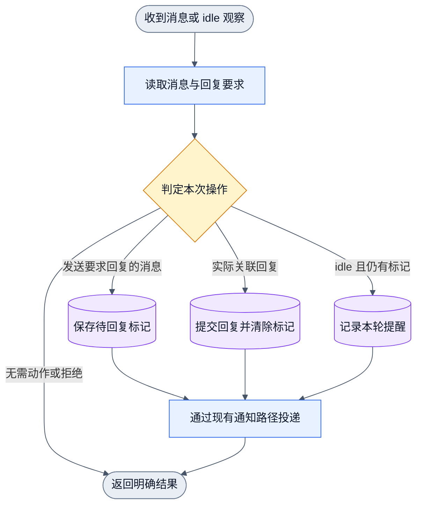

# 协作请求回复与 idle 提醒

状态：源码与隔离公开入口已验证，独立整体审查无 finding。正式安装和运行时激活另验。

执行顺序：先验收既有跨项目 master 通信，再补角色/回复提醒，最后核对 Skill。
跨项目基础设施保留既有合同；公开 CLI 用例覆盖目标 master 查询、双向发送与消费、
非 master 拒绝且不入队。Skill 明确跨项目 `worker@project` 不适用项目内回复命令。

回复标记增量只补项目内普通 `sendmessage`，CLI 的 `--reply-required` 和
`--reply-on-completion` 互斥，MCP 对应 `reply_required` / `reply_on_completion`。
无选项默认不标记，关联回复使用既有 `--in-reply-to`。跨项目 `master send` 本轮未接入。
全局 CEO 是后续独立设计，旧 master/peer 合同保持。
回复要求是消息的控制标记，不是新任务、业务完成记录或自动答复机制。

## 基础通信路径与权限

源项目当前 master 在自己的 cwd 执行 `collab context`。已知目标路径后，通过
`(cd '<target>' && collab master status)` 只读取得 `master.worker_id`，再在自己的
cwd 执行 `collab master send --project '<target>' --to '<worker-id>' --subject '<topic>' '<body>'`。
daemon 校验源项目当前 grant 和目标项目当前 master，持久保存后按既有 adaptor 投递。
拒绝在持久化前结束；投递失败不伪造消费。目标通过非 DSH 的 `recv` 或 DSH gateway
独占接收流消费，完成 action 后以
同一跨项目命令向原 `from` 的源项目和 worker 回信。每次发送有一个结果出口，回信是
新操作，不在原操作图制造回边。当前 CLI 尚无跨项目关联回复参数或回复标记。

普通 peer 交本项目 master 处理跨项目请求；工作专长不扩大权限。只读查询失败、
unknown 或不可达均不等于没有 master。仅确认没有 master 且用户同意后，才创建
具名 tmux Codex session（默认 gcm profile、用户确认的 YOLO 模式）并授予 master。
全局 CEO 的注册和控制入口未实现，不借 CEO 称呼重释现有权限。

## 执行与接续

收到通知后读取完整原文。有已授权 action 就落实并回复原请求方；只有问题则回答问题，
普通信息且未要求回复时不自动回“收到”。交回协作结果后接续本人未完工作；核对当前
可做的回复、协作请求和本人任务后，无可执行事项才 idle。peer 默认向委托者或 master
回报，只有用户直接要求、需要用户决定或影响用户的重大异常才向用户说明。

## daemon 标记的操作 DAG

对应 [正式 DAGpipe 图](../../../docs/dagpipe/collab-reply-obligation.graph.json)。
发送、关联回复和 idle 观察分别是一次新操作，错误或无需动作也返回同一结果出口。
同一图不产生回边，后续 idle 观察不重放原任务。

发送方可声明需要回复或完成后回复，默认不建立强制回复义务。完成后回复只给 agent
时机要求，daemon 不从正文、任务进度或模型输出猜测任务是否完成。消息消费、ACK、
任务进度和向用户汇报都不清标记。正确接收者向原发送者持久提交关联回复后才清除；
回复已入队与通知已被宿主接收分别记录，不因此声称业务或回复已被对方实际读取。

idle 提醒只引用原消息 ID、发件人和回复要求，要求 agent 查看原文；不自动执行或代答。
忙或状态 unknown 时不提醒。同一 idle episode 去重，继续工作后再次 idle 而仍欠回复
时可再次提醒。提醒和结果回复默认不要求对方再回复，防止递归互答。

## 验收边界

- 发送回复要求后消费原通知，标记仍存在；关联回复成功持久提交后标记清除。
- 完成后回复的时机要求在消息读入口可见；重放和压缩保存未清标记。
- 错收件人、错回复对象或错误关联不能消除别人的待回复要求。
- 真实 idle 且仍欠回复触发提醒，busy/unknown/已清标记均不触发；同轮不刷屏。
- peer 的执行提示明确回请求方、交回后接续本人任务、默认不例行向用户报告。

源码、隔离公开入口、正式安装和用户运行时分别报告；本轮不管理全局 daemon 生命周期。
