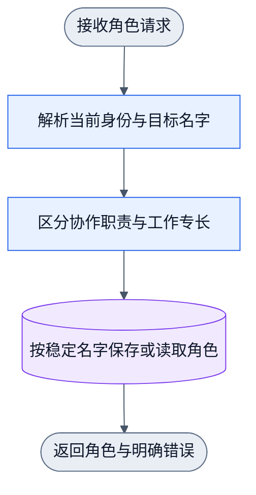
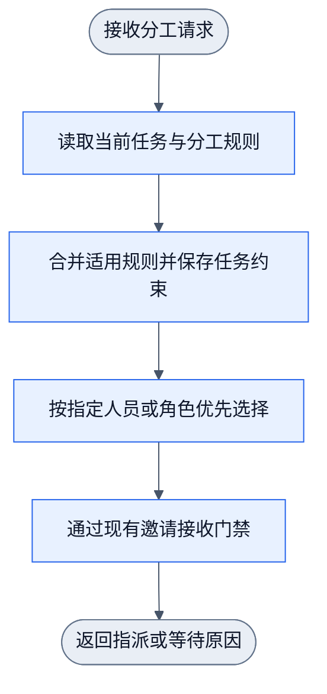
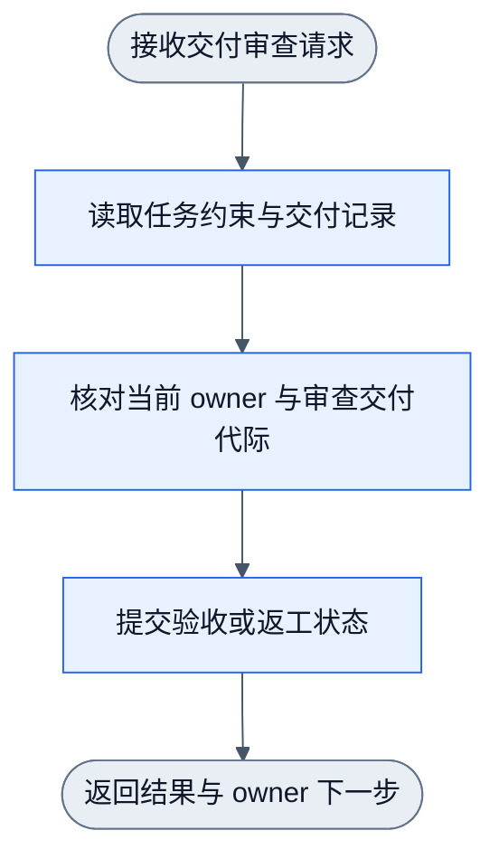

# 工作角色、分工和独立审查

状态：源码实现与隔离公开接口已验证。图校验、安装和用户 live 状态分别计证据，图本身不表示运行已生效。

用户可给 peer 指派 `designer`、`reviewer` 等多个工作角色。角色随稳定名字保存，
不改变 master/peer 的协作职责和授权。master 将用户在任务中提出的自然语言要求
保存为明确的分工字段。daemon 只处理这些字段，不从任务正文猜测分类或分工。

项目默认和任务明确字段逐项覆盖。保存到任务后的有效约束沿原任务使用。
指定执行者是硬约束，工作角色是优先选择条件。Jenny 负责 Collab 指派。
每位 owner 用独立 Codex 编排完成自己的任务、审查和集成。

## 角色更新

基础 master/peer 关系和可复制的派单模板见
[Collab 操作手册](../../skills/collab/operations.md#任务交付生命周期)。
普通 peer 无需先声明专长或配置 policy。master 复用或发布已有授权任务，再 dispatch
或 invite；peer 接受后才承担该子目标。未指定执行者时，先按专长偏好，再优先无未结
任务及待接邀请的 peer，最后按稳定名字排序。指定执行者不受该排序改变。

新普通名字占用向现有 master 通知一次；同名恢复与重复 context 保持静默。
真实专长变化通知相对方，真实模板更新/重置只通知适用 peer。同值更新无副作用。
首次注册与之后的专长变更分别通知。变更和邮件在同一持久事务提交。
消息沿稳定名字的 mailbox 交接。
投递由既有通知 owner 在锁外执行。收件人离线或拒绝唤醒时仍保留邮件，变更回执
返回通知失败，已提交角色不回滚。通知只提示读取当前事实，不从正文重建控制状态。
只有职责、依赖或交接受影响时才调整分工/模板；普通注册不触发例行用户汇报。

本图对应 [角色操作图](../../../docs/dagpipe/collab-work-role-registration.graph.json)。
未提供角色字段表示保留，明确空集合表示清空。用户指派其他 peer 的角色时，
master 使用同一持久化 owner。角色更新不修改通信绑定或 master 授权。

`collab context` 在 `work_roles` 返回当前调用者的最新专长，在 `peers` 返回其他名字的
专长。`role_brief` 给出 Jenny 的指派边界和 peer 的独立任务责任。
`operations` 应只返回当前可行动事实，不重复静态职责。已有有效任务视图直接复用，
缺字段或已知失效时才补查。动态角色和任务条件复用已有字段，不在提示正文中保存第二份状态。
角色替换或清空后，下一次 Context 读取最新值。已有任务保留执行归属和实际证据。
实际资源争用由相关 owner 直接协调。项目授权和任务归属决定交 Jenny。

## 规则与分派

本图对应 [分派操作图](../../../docs/dagpipe/collab-role-assignment.graph.json)。
图内每一阶段传递成功、等待或拒绝结果。收到失败后，后续阶段不执行写入或通知。
角色偏好无匹配时可选择其他可用 peer，但须保存原因；指定人不可用时只能等待。
邀请已保存与目标已接受是两个事实。接受前不转移执行责任。

## 独立审查与交付

本图对应 [审查交付操作图](../../../docs/dagpipe/collab-required-review.graph.json)。
`delivered` 表示 owner 已交付。独立 Codex Reviewer 按该次交付取证。
Owner 从任务状态读取 `review.subject_revision`，将审查结果与该值一起登记。
返工和实质合同变化会使旧审查失效。代码任务还需记录 main 集成。
只读任务在记录验收和清理后关闭。

三个图分别为单源单汇，拓扑无环。等待、拒绝和返工是本次操作的结果；下一次操作
使用新的请求重新进入。所有可修改任务状态的入口均须执行对应约束，包括直接邀请、
认领、普通状态更新和旧分派入口。人工终止、清理完成与验收交付分别投影，不能互相替代。

## 必要验证

- 公开 CLI 注册、master 指派角色、省略保留、明确清空与稳定名字恢复。
- 角色偏好、无匹配原因、指定人不可用、项目默认与任务覆盖、邀请前后的归属。
- 指定执行者不能被认领、直接邀请或旧入口绕过。
- Owner 登记独立审查证据。返工、合同变化和再交付使旧代际的结果失效。
- 原有代码集成、只读交付和人工终止语义。重启和换绑保留已提交证据。

安装和用户 daemon 生效需要另外的证据。源码与隔离测试不证明当前全局 daemon 已加载新实现。
