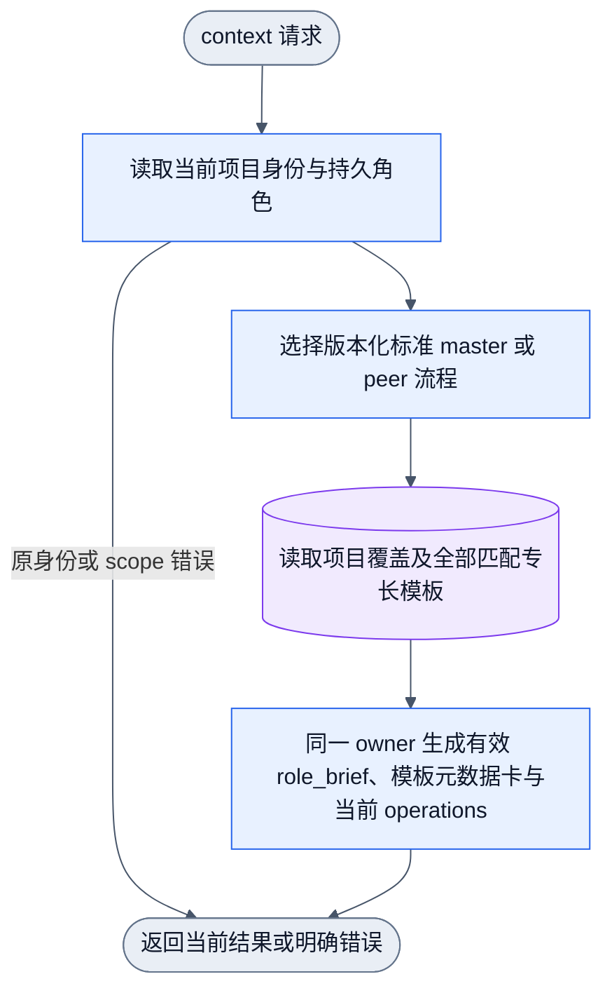

# 单一 Collab Skill 与工作流程模板

状态：源码与隔离公开入口的既有验证沿用任务记录，组合变更的整里程碑独立审查已 PASS，
本项 P2 已在本地核对；代码/安装/live 仍分别独立，本轮不声明已安装与源已对齐。
本机唯一 Skill 与基础资源的历史同步仅作为基线证据；当前候选源、已安装副本与
live 运行态相互独立，本轮不声明已安装与源已对齐。
基础模板与项目覆盖是同一 Skill 的资源。全局二进制与 daemon 尚未更新，本轮不声明
全局运行时已启用；图闭合不代表功能已经交付。

## 需求与边界

用户要求：Collab 只有一个集中 Skill；每个 master/peer 管理自己的目标、任务和流程。
未更新时使用标准身份流程；master 调整角色关系时，更新受影响角色的任务及执行模板，
由 `collab context` 按当前身份和工作角色派发。新 peer/角色变化后，master 在已有授权内
自动安排并报告生效规则，用户可随时修改。peer 完工或停止前向现有 master 交回结果并
申请下一步或 idle；设计师/reviewer 也遵守同一规则。无 master 不制造审批者，master
不向自己申请 idle。全局 CEO 入口不属于本轮。

不新建角色 Skill，不把工作角色当作 master 权限。模板选择不自动修改已发布任务的
scope、owner、指定执行者或必需 reviewer，也不替 agent 执行任务。

## 唯一维护位置

- 静态入口：`collab/skills/collab/SKILL.md`。
- 基础模板：同一 Skill 的 [references/workflow-templates.json](../../skills/collab/references/workflow-templates.json)，`base_version: 1`，
  只有 `master`、`peer`。不内置 designer/reviewer 等固定岗位流程。
- 安装入口：`~/.agents/skills/collab/`，宿主 Skill 路径链接到这里。分发源码与安装产物
  是同一个 Skill；基础 JSON 与正文一起嵌入 binary，并由既有 Skill installer 分发。
- 动态覆盖：当前项目 daemon journal 的 typed 模板记录；daemon 不从日志、模板正文或
  宿主 Skill 文件猜测控制状态，不调用模型自动生成分工。

## 模板内容与选择

模板包含 `role_task`、`responsibilities`、`next_action`、`completion_action`。模板目标为
`master`、`peer`，或 `role:<规范化工作角色>`。显式前缀避免工作专长 master 与身份 master
混同。只有当前项目 master 能更新/重置项目模板；普通 peer 设置自己的专长仍沿既有授权。

context 从当前身份选择标准 master/peer 模板；存在项目覆盖则读取覆盖。再按当前稳定
名字的工作角色，按序返回全部匹配的已配置专长模板。未配置的工作角色使用标准身份流程，
不制造缺配置故障。有效流程正文只在 `role_brief` 的 `role_task`、`responsibilities`、
`next_action`、`completion_action` 组合输出一次；模板卡只保留目标、来源、基础版本与
revision，不重复导出正文。`operations` 只返回当前适用命令，
`next_actions` 只返回当前任务或本次恢复产生的动作。旧身份与 authority 字段继续由
原权限 owner 决定。master 的 context 同时列出项目覆盖目标的更新元数据，供其读取后
调整；不导出其他名字的原始模板正文。

有效动作只组合已选身份模板及匹配专长；不在组合后追加固定的 next/completion 指令，
以免覆盖当前项目模板。默认澄清路由为：常规选择自行决定，事实问所属 peer，设计问
设计师，范围、资源和协作冲突问 master。只有人类专属事实、未覆盖授权或显式硬约束
变化才询问用户。已有授权直接复用；等待内部答复时继续不受影响的工作。



正式图复用 `collab-context.graph.json` 的现有快照节点和
`collab-work-role-registration.graph.json` 的单次更新链，无新业务入口或回边。

## 更新与执行

master 分别更新角色、角色模板和任务分工，不把三种动作当成一次隐式事务。更新模板：

```sh
collab context --workflow-target 'role:designer' --workflow-template '{"role_task":"负责已授权设计","responsibilities":["核对任务范围并准备交付"],"next_action":"推进设计并提交指定 reviewer","completion_action":"交回结果并向当前 master 申请后续安排或 idle"}'
collab context --workflow-target 'role:designer' --reset-workflow-template
```

角色/模板写入后，同一次 CLI 回执及后续 context 返回当前流程，不留下旧静态镜像。
身份查询不得夹带模板写入，互斥或缺少目标的参数在变更前拒绝。模板重置删除项目覆盖，
恢复标准身份流程；不因模板更新让 peer 自行放弃当前工作。authoring 仍是完整替换、
reset、replay，不新增按正文部分导出的入口。

master 对角色变化进行一次受影响安排：仅当用户决策需要、存在实质结果或用户明确要求
报告时，按“变化、当前分工、交付接力、实际安排、执行状态”向用户报告；其余情况仅
安排受影响职责并通知相关接收者，然后继续。已授权技术自主与“人类专属/未覆盖授权/
显式硬约束”边界保持不变；仅授权之外的 scope、显式硬约束变化或人类专属关键事实
缺失才需用户确认。通知已运行 peer 立即读取新流程时，使用现有消息/派单入口，不新增周期轮询。

## 验收

公开入口覆盖默认基础版本、master 更新及重置、非 master 拒绝、多角色选择、角色变化
后的同次输出和后续输出、role_brief 有效正文唯一输出、模板卡只含元数据、operations
只含当前命令、活动任务与指定 reviewer 保持。
重放/压缩、同名续接和项目 reset 由持久状态及必要公开 consumer 验证。Skill 安装测试
验证 JSON 资源随唯一 Skill 分发。临时私有 daemon 只用于隔离测试，不操作全局 daemon。
