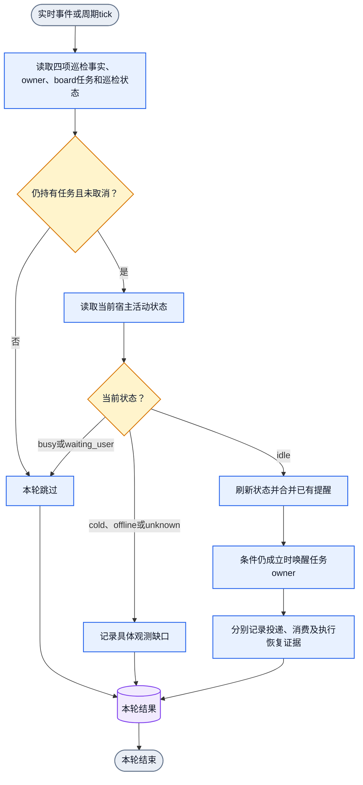

# Board idle 巡检、取消与 CEO 进度回报

状态：2026-10-25 用户确认的设计契约。安装版本、源码状态和 live 行为分别验收；
不要把读到本文件当作 runtime 修复，也不要把源码提交当作安装完成。

`collab notify cancel --event board-idle`、`collab notify subscribe --event board-idle`
与 `collab notify status` 的 board-idle 入口已在当前源码实现。本轮隔离公开入口/native
与有限 timer 兼容验收已通过；这不等于生产 daemon 启用或生产 peer 消费或恢复推理
已验证。使用前先按运行 daemon 的实际构建核实 `collab notify methods` 和
`collab notify status`；其能力或状态不满足时只停受影响自动巡检。巡检的调度、每次
判定和投递实际由 daemon 触发，本 Skill 只固定 agent 行为与命令入口；目标机制唯一
owner 是 core 实现与项目 DAG。

## 默认责任与触发

- 每个项目的 Jenny（当前获授权 master）负责本项目 worker 巡检。初始化或恢复本人
  longhorizon 后，须确保本人常驻项目巡检已 armed；复用有效订阅，不重复创建。
  这条常驻巡检是当前 master 的 `master-idle` 订阅，subject `project-patrol`、目标
  interval `1500000` 毫秒（20-30 分钟窗口，默认 25 分钟）。反复 ensure/renew 复用
  同一订阅，续期其 TTL 与有限出现预算，不并排新建第二份。`900000` 只兼容已存在的旧
  订阅；`collab notify status` 的 `project_patrol.cadence_runtime_gap` 为
  `PATROL_CADENCE_RUNTIME_GAP` 时，运行节奏未达目标，须如实报告。
  `appsdk longhorizon show` 是只读投影，读取成功不证明已 arm。有限
  goal/task 定时器按各自生命周期到期关闭；单个 goal 结束不得因此关闭这条常驻项目
  巡检义务。若项目巡检被显式取消，按已实现控制保持取消，不由 ensure 自动恢复；
  当前 master 可用 `collab notify cancel --event master-idle` 显式取消，详见下文
  「Master 取消与恢复项目巡检」。
- Jenny 每次巡检提醒都先检查四项：未解决的 P0/P1；未完成任务或 ready 工作；自有
  worktree 与资源释放；peer/worker 的 busy/idle 及 idle 原因是否合理。随后检查本
  项目 worker 的活动状态、未关闭 board 任务、当前绑定及按任务取消状态。busy 的
  worker 跳过；idle 且仍持有未取消任务的 worker 应收到继续本人任务的提醒。没有
  未关闭任务时不发 board idle 提醒。
- board 任务的持有关系由任务板 owner 决定，不依赖 `active_task` 单个投影字段。
  blocked 或等待依赖的任务仍可能持有。提醒让 peer 自己复核阻塞与下一步；
  daemon 不解释业务依赖，也不将唤醒等同于任务可执行或完成。
- 实时状态事件可用且已接通时，在进入 idle 或 idle 时获得任务后及时判断并提醒。
  同一持续 idle 阶段中重复的实时事件可合并为一次提醒；已有待处理提醒时不叠加
  同批内容。当前 `collab notify status` 返回 `realtime_connected: false`，说明实时
  事件流尚未接通；以下周期 tick 就是当前实际行为。master 常驻巡检目标是 25 分钟，
  仍可按兼容记录 15 分钟 tick；board idle 按任务兜底为 15 分钟 tick。
- 周期 tick 只负责发现 due，不单独
  构成推送理由。首次提醒要求可信连续空闲严格超过 1,800,000 ms：29m59s 不推，恰好
  30m00s 也不推，30m00s+1ms 才可首次推。同一空闲阶段首次推送后，后续推送以最后一次
  已持久提交的提醒时间为准，间隔至少 1,800,000 ms；恰好 1,800,000 ms 可再推。tick
  晚到就直接按当前事实判断，不补发漏掉的周期。busy 时跳过本次，不排队等它空闲后
  补发；下个周期重新判断。`observed_ms` 只是采样时间，不能充当空闲起点；旧 journal
  缺可信空闲起点时不回填，系统从首次可靠 idle 观测重新开始计时。
- 两种触发共用一套 owner、取消状态、可信空闲阶段和投递判断，不同时创建两份巡检。
  Jenny 的兜底调度不依赖 Jenny 正在推理；调度 owner 必须在其 idle 时仍可运行。
- 只有 durable 消息、wake binding 与调度事件成功持久提交后，才推进本阶段最后提醒
  时间。检测、宿主采样、busy/unknown skip、传输尝试和读取 `collab notify status`
  都不推进它。rearm、新任务或业务自动恢复不把旧空闲时长重置成新提醒即刻 due，也不
  越过 30 分钟门禁。
- 存活与活动分开。只有新鲜的正态确认（`presence == online` 且 `activity == idle`）
  才产生合格唤醒；缓存、`idle_since` 未刷新或 unknown→idle 的推断都不算 idle。
  `waiting_user` 不当作 idle 自动确认；cold、offline、unknown 显式报告观测或绑定
  缺口，不盲目输入。发送前刷新状态；使用既有绑定适配器，不切换传输绕过失败。
  事件能力不等于常驻事件订阅；没有真实当前状态时用周期 tick 检查，不用缓存推断。

## Peer 何时与如何取消

peer 可以取消本人 board idle 巡检，无需先结束任务或取得 master 的重复批准。
适用情况包括：正在等待用户决定、真实外部依赖或结果事件；用户要求暂停；当前
目标不需要自动继续；提醒会重复打断既定等待。取消不转移任务责任。

取消时记录对应任务、原因和恢复条件。若仍有未完任务，保留真实任务状态；不得
为停止提醒伪造完成。完成、取消或转交任务后，该任务的巡检应由任务生命周期结束。
基本 direct-message 接收始终单独保留。

取消状态按任务粒度和当前稳定 owner 持久保存。已取消任务在 peer 获得新任务时仍保持
取消，只对未取消的新任务启用巡检；ownership 变化不把旧 owner 的取消带给新 owner。
同稳定名字换会话保留取消状态；`collab context` 恢复身份不重置已取消任务。

公开入口（当前源码实现）：

```text
collab notify cancel --event board-idle [--task-id <task-id> ...] [--reason <text>] [--resume-condition <text>]
collab notify cancel [--event board-idle] [--reason <text>] [--resume-condition <text>]
collab notify subscribe --event board-idle [--task-id <task-id> ...]
collab notify status
```

`notify cancel` 的 `--event` 默认就是 `board-idle`；这里显式写出，避免把其他事件
误当成可取消对象。`--event master-idle` 是另一条独立入口，只作用于当前 master 的
常驻项目巡检，规则见下一节。

- `collab notify cancel --event board-idle` 只作用于调用者本人持有的未关闭 board
  任务的巡检。省略 `--task-id` 时取消调用者当前持有的全部未关闭 board 任务的巡检；
  指定 `--task-id` 时仅取消指定任务的巡检。未指定任务时不做隐式全局关闭。
- 指定任务时先校验全部 ID 均属于本人当前持有的未关闭任务；任一非本人任务返回
  `BOARD_PATROL_TASK_OWNER_REQUIRED`，整次不写入任何取消记录（原子失败）。
- 尝试取消 `direct-message`、`deadline` 或 `resource-released` 返回
  `NOTIFY_CANCEL_SCOPE_FORBIDDEN`。基础 direct-message 租约由 daemon 独占管理，
  有限 goal 调度用 `appsdk goal cancel`，任务 deadline 随任务关闭。
- `collab notify subscribe --event board-idle` 是明确的恢复入口：指定 `--task-id` 时
  只移除调用者本人这些未关闭任务的取消状态；省略 `--task-id` 时恢复调用者当前全部
  已取消且仍未关闭的任务。新任务按新任务范围初始化，不借新任务恢复已取消的旧任务
  巡检。
- 取消记录绑定当前稳定 `owner_key`（稳定名字，不是会话载体）。同一稳定名字换会话
  或 `collab context` 恢复身份时保留取消；任务转交其他 owner 时旧取消不带给新
  owner（该任务对新 owner 可巡检）。新任务有新的 task-id，不会清除旧任务的取消。
- `collab notify status` 返回调用者本人的 `board_patrol` 投影，当前字段为
  `owner_key`、`cancelled_tasks`、`eligible_task_ids`、`interval_ms`（900000）、
  `periodic_fallback`（当前 true）和 `realtime_connected`（当前 false）。当前没有
  `armed_tasks` 字段，`collab context` 也没有 `board_patrol` 投影；只有
  `notify status` 返回它。没有该投影时报告安装或运行差异，不手工改控制状态。
- 取消后，同任务范围的事件、15 分钟时钟、Jenny 巡检、注册恢复和 daemon replay
  均不得自动重新 arm。本人明确恢复后才恢复。
- 当前获授权 master 的 `collab notify status` 还返回 `project_board_patrol`。它按当前
  持有者列出 `worker_id`、`owner_key`、`eligible_task_ids` 和 `cancelled_tasks`；取消记录
  含 `task_id`、`reason`、`resume_condition`、`cancelled_ms`。Jenny 用这份只读视图检查
  项目内 peer 的取消状态。普通 peer 只收到本人视图，不能读取项目总表。
- peer 的按任务取消由 daemon 在选任务时应用。master 的读取权限不授予替其他 owner
  取消、恢复或覆盖取消的权限。

## Master 取消与恢复项目巡检

当前 master 可以取消本人的常驻项目巡检。这与 peer 的按任务 board idle 取消是两条
独立控制，互不清除对方的取消记录。

公开入口（当前源码实现）：

```text
collab notify cancel --event master-idle [--reason <text>] [--resume-condition <text>]
collab notify subscribe --event master-idle --subject project-patrol --every-ms 1500000 --repeat-count <n> --ttl-seconds <n>
collab notify status
```

- 只有当前 master 能取消本项目精确的项目巡检，即 `master-idle`、subject
  `project-patrol`、目标 interval `1500000`（兼容旧 `900000`）的订阅。其他 owner、
  其他项目或旧会话载体调用
  返回 `PROJECT_PATROL_MASTER_REQUIRED`。没有可取消的精确订阅返回
  `PROJECT_PATROL_NOT_FOUND`。
- `--event master-idle` 不接受 `--task-id`。带任务 ID 的取消属于 board idle，
  误用会被拒绝。
- 取消要求项目已写入可持久审计的进度：`ceo_report_state.projects[<canonical project>]
  .revision >= 1`。没有该进度返回 `PROJECT_PATROL_PROGRESS_NOT_RECORDED`。项目内还有
  closed/cancelled 以外、且不具备有效 `TaskRec.wait` 的未关闭任务时返回
  `PROJECT_PATROL_WORK_REMAINS`；两者都属于 `PROJECT_PATROL_CANCEL_NOT_ELIGIBLE`，
  回执列出阻塞任务与等待任务。
- 合格判断只把 `TaskRec.wait` 存在且任务状态为 waiting 的未关闭任务当作等待；不把
  `waiting_user` 等投影字段当作阻塞豁免。仍有需要推进的任务时不能取消。取消成功会
  写入原因、恢复条件和取消时间，并结束该订阅尚未接受的 pending 唤醒。
- 取消成功返回同一订阅 ID、`status=cancelled`、`changed=true`。重复取消幂等：
  返回同一 ID、`status=cancelled`、`changed=false`，原因、恢复条件和时间不变，也不
  写入新事件。
- 显式精确订阅是恢复入口：同一 `master-idle`、subject `project-patrol`、目标
  interval `1500000`（兼容旧 `900000`）的订阅把 cancelled 记录重新置为 armed，
  返回原 ID 和 `status=rearmed`，
  不新建第二条记录。其他 subject 或 interval 不匹配该记录。
- 取消后，新增项目任务、任务重新变为可执行或 `TaskRec.wait` 释放会触发 daemon 自动
  rearm 同一订阅。真实恢复由项目工作变化驱动，不由 ensure 或 `longhorizon show`
  无条件重建。
- 同稳定名字换会话或 `collab context` 恢复身份时，cancelled 项目巡检随当前 master
  的载体搬迁并保持 cancelled；新载体继承原记录，不丢失也不自动变为 armed。
- direct-message 租约始终独立保留。取消项目巡检不影响直发消息的收发。
- `collab notify status` 在 master 视图返回 `project_patrol`，字段含 `status`
  （`armed`、`cancelled` 或 `missing`）、`subscription_id`、`reason`、
  `interval_ms`、`target_interval_ms`、`cadence_runtime_gap`、`eligibility` 等。
  它只投影状态，不改变控制记录。`collab master status` 与 `collab ceo progress`
  的 `workspace` 使用当前 master 绑定注册的 canonical project root。

## Jenny 每次巡检的检查项

daemon 负责产生真实的合格唤醒：按 owner、按任务取消状态和新鲜 idle 选择对象并投递。
Jenny 只在提醒到达时检查下列事实，不自行造一条手写唤醒循环，也不替 peer 重新 arm
其取消。

1. 读取当前项目未关闭 board 任务与 owner，结合按任务取消状态得出待巡检集合。
2. 读取每个 owner 的当前宿主状态；busy 跳过，unknown/offline/cold 记录缺口。
3. 对正态 idle 且仍有未取消任务的 owner，daemon 会产出继续提醒；Jenny 核对任务与
   取消入口，不重复 arm，也不覆盖 peer 的取消。
4. 存在 CEO 且本项目有实质进展或阻塞变化时，向 CEO 回报项目进度。
5. busy 跳过不补发；unknown 不产生传输输入；无未关闭任务时不发 board idle 提醒。

## CEO 进度回报与用户报告边界

- 项目 master 通过现有项目 master 到 CEO 路由回报事实：目标、已验收结果、剩余工作、
  具体阻塞、下一动作及需要用户决定的事项。无 CEO 时不假造接收者，继续本项目工作。
- 目标入口为 `collab ceo reply --subject '<主题>' '<普通进度或具体阻塞>'`，
  紧急回报加 `--urgent`。紧急只由该 typed 参数或用户明确指定决定；`--urgent` 是
  唯一 typed 紧急入口，正文关键词、普通 P1 阻塞或 ACK 都不升级。
- 不带 `--in-reply-to` 的普通进度走非紧急汇总：按项目与实质业务进展去重合并，
  普通心跳、重复文本、更新时间或仅 ACK 不产生用户报告。带 `--in-reply-to` 的
  请求回复保留原消息的真实持久投递、关联去重和回复义务清除语义；进度只在回复本身
  持久后附加。
- 非紧急汇报默认每小时至多一次，默认安静窗口为 `Asia/Shanghai`
  每日 00:00（含）至 08:00（不含）。该时区按固定 UTC+8 计算，无夏令时。
  窗口内仍接收、去重并积累，08:00 后合并为一次，不逐条补发。`--urgent` 可立即
  穿透限流与安静窗口。小时间隔固定为 3600000 毫秒。
- 安静窗口由全局 `[ceo_report]` typed 配置：`quiet_window_start_minute` 与
  `quiet_window_end_minute`，取值 `0..1439`；两者相等表示禁用安静窗口。
  `[ceo_report]` 只允许在全局配置，项目级覆盖被拒绝；`min_interval_ms` 不是可配项。
- 四阶段事实分开：`queued`、`accepted`、`consumed` 与 `reported_to_user`。
  每次主动报告前读取当前 `collab ceo progress`，只使用被允许的 `report` 批次；等待或
  断线后重新读取，不以旧批次或完整项目查询视图绕过当前静默与小时限制。
  CEO 向用户实际输出后由 CEO 本人执行显式确认：
  `collab ceo report-ack --batch-id <batch-id>`。
  读取 `collab ceo progress`、准备批次、入队或传输接受都不是向用户汇报，不能改写成
  `reported_to_user`。该确认是调用者在宿主可见输出后的声明，不独立证明用户实际
  收到或已读。确认只覆盖该 `batch_id` 所含的项目版本；确认旧批次不得清除汇报期间
  新到达的项目进度。未确认状态跨 daemon 重启保留。
- 当前回执字段与源码一致：`collab ceo reply` 的无引用结果返回 `project`、`recorded`、
  `deduplicated`、`urgent`、`revision`，并标注 `notified: false`、`reported: false`
  （本调用不发送用户报告，调度器稍后负责）；有引用回复在持久投递回执上合并同一组
  progress 字段。`collab ceo progress` 的返回在 `report` 对象下给出
  `batch_id`、`coverage`、`projects`、`last_actual_report_ms`、`suppressed`、
  `suppression`、`next_eligible_ms`、`excluded_project_count`；读取只准备批次，不
  推进已报告水位。`collab ceo report-ack` 返回 `batch_id`、`reported_ms`、
  `last_actual_report_ms`、`pending_revision_count`、`remaining_batch_count`。
- CEO workspace 的默认偏好与写作/汇报风格指引由 `collab ceo promote` 非破坏性写入
  或更新 `<workspace>/AGENTS.md` 受管段落，保留全部已有内容，引用权威偏好源
  `~/.codex/USER.md` 而不复制其内容或个人信息，也不新建第二套 CEO Skill。CEO 先读取
  该权威源，只对用户明确确认的稳定偏好与风格习惯去重、小量更新；不沉淀单次情绪、
  项目进度或秘密。目录、
  符号链接、损坏目标或其他非法目标显式失败，不跟随链接改写共享文件，也不写备选
  文件。若 grant 已持久但受管段落写入失败，回执标记部分成功并保留
  `CEO_GRANT_RECORDED_BUT_WORKSPACE_GUIDANCE_FAILED`，不掩盖失败。

## 单次巡检 DAG（设计态）

周期由图外调度。每次触发单独走完单入口、单出口；图不包含循环。



## 待验收行为

真实入口需覆盖：持有任务的 idle peer 被唤醒；busy 周期跳过且不补发；实时事件
只产生一次有效提醒；peer 取消后任务保留且同范围不自动 rearm；新任务不恢复旧取消
任务；同稳定名字换会话保留取消；任务转交后新 owner 不受旧取消影响；其他 owner
提交取消原子失败；基本消息仍可收到；Jenny 初始化或恢复后本人项目巡检确实 armed；
`master-idle` / subject `project-patrol` / 目标 interval `1500000`（兼容 `900000`）
的常驻巡检幂等续期且不因
单个 goal 结束被关闭；Jenny idle 时调度仍运行；每次巡检检查 worker idle；关闭或转交
任务结束对应巡检；unknown 不产生终端输入；`collab notify status` 的 `board_patrol`
字段为 `owner_key`/`cancelled_tasks`/`eligible_task_ids`/`interval_ms`/
`periodic_fallback`/`realtime_connected`，且不虚构 `armed_tasks` 或 context 投影；
master 取消项目巡检后返回原 ID 且 `status=cancelled`，重复取消幂等，`notify status`
的 `project_patrol` 同步为 cancelled；未上报进度或有可执行任务时取消被拒并给出具体
错误码；显式精确订阅恢复原 ID；新项目任务或等待释放自动 rearm；同稳定名字换会话
保留 cancelled；peer board idle 取消不受 master 项目巡检 rearm 影响；
CEO 去重、小时限制、安静窗口与紧急穿透；`report-ack` 只由 CEO 在向用户输出后提交；
重启保留未确认批次。
