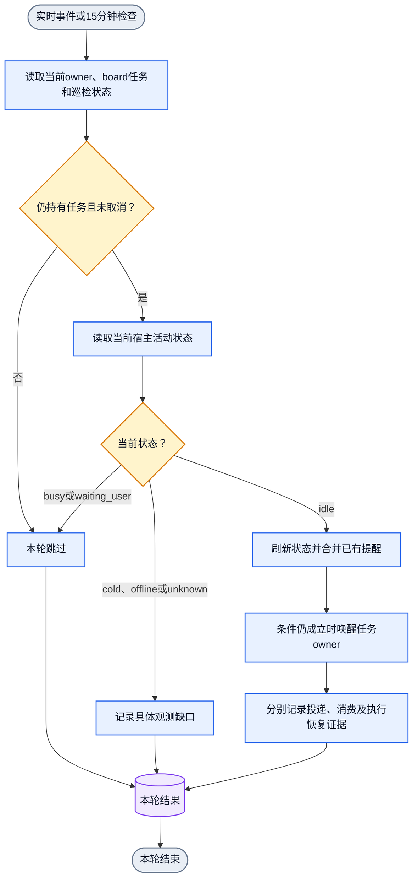

# Board idle 巡检、取消与 CEO 进度回报

状态：2026-10-25 用户确认的设计契约。本节记录目标行为和稳定接口，未证明已安装
runtime 已实现。安装版本、源码状态和 live 行为分别验收；不要把读到本文件当作
runtime 修复，也不要把源码提交当作安装完成。核心实现未通过公开 CLI 验证前，不运行
下面标为拟定的命令，不宣称新 runtime 已 live。

目标机制唯一 owner 是 core 实现与项目 DAG。本 Skill 只固定 agent 行为与命令入口。

## 默认责任与触发

- 每个项目的 Jenny（当前获授权 master）负责本项目 worker 巡检。初始化或恢复本人
  longhorizon 后，须确保本人巡检已 armed；复用有效订阅，不重复创建。
  `appsdk longhorizon show` 当前是只读投影，不能把读取成功当作 arm 成功。
  已有限订阅消耗或不续期时，重新 arm，不静默停止。
- Jenny 每次巡检提醒都检查本项目 worker 的活动状态、未关闭 board 任务、当前绑定及
  按任务取消状态。busy 的 worker 跳过；idle 且仍持有未取消任务的 worker 应收到
  继续本人任务的提醒。没有未关闭任务时不发 board idle 提醒。
- board 任务的持有关系由任务板 owner 决定，不依赖 `active_task` 单个投影字段。
  blocked 或等待依赖的任务仍可能持有。提醒让 peer 自己复核阻塞与下一步；
  daemon 不解释业务依赖，也不将唤醒等同于任务可执行或完成。
- 实时状态事件可用且已接通时，在进入 idle 或 idle 时获得任务后及时判断并提醒。
  同一持续 idle 阶段中重复的实时事件可合并为一次提醒；已有待处理提醒时不叠加
  同批内容。
- 没有接通实时事件时，默认每 15 分钟检查一次。只要仍正态 idle 且持有未取消任务，
  每个周期都是一次新的有效巡检机会；不能因为 `idle_since` 未变化或上一次提醒已被
  传输接受但尚未消费，就永久停止后续周期。每次仍先读取当前真实状态。busy 时跳过
  本次，不排队等它空闲后补发；下个周期重新判断。
- 两种触发共用一套 owner、取消状态和投递判断，不同时创建两份巡检。
  Jenny 的兜底调度不依赖 Jenny 正在推理；调度 owner 必须在其 idle 时仍可运行。
- 存活与活动分开。只有正态确认 `presence == online` 且 `activity == idle` 才唤醒。
  `waiting_user` 不当作 idle 自动确认；cold、offline、unknown 显式报告观测或绑定
  缺口，不盲目输入。发送前刷新状态；使用既有绑定适配器，不切换传输绕过失败。
  事件能力不等于常驻事件订阅；没有真实当前状态时用 15 分钟检查，不用缓存推断。

## Peer 何时与如何取消

peer 可以取消本人 board idle 巡检，无需先结束任务或取得 master 的重复批准。
适用情况包括：正在等待用户决定、真实外部依赖或结果事件；用户要求暂停；当前
目标不需要自动继续；提醒会重复打断既定等待。取消不转移任务责任。

取消时记录对应任务、原因和恢复条件。若仍有未完任务，保留真实任务状态；不得
为停止提醒伪造完成。完成、取消或转交任务后，该任务的巡检应由任务生命周期结束。
基本 direct-message 接收始终单独保留。

取消状态按任务粒度和当前稳定 owner 持久保存。已取消任务在 peer 获得新任务时仍保持
取消，只对未取消的新任务启用巡检；ownership 变化不把旧 owner 的取消带给新 owner。
同稳定名字换会话保留取消状态；`collab context` 恢复身份不重置已取消任务。

拟定的公开入口如下，核心实现与公开 CLI 黑盒验收未完成前不要执行：

```text
collab notify cancel --task-id <task-id> [--task-id <task-id> ...] [--reason <text>] [--resume-condition <text>]
collab notify cancel [--reason <text>] [--resume-condition <text>]
collab notify subscribe --event board-idle --task-id <task-id> [--task-id <task-id> ...]
collab notify status
```

- `collab notify cancel` 只作用于调用者本人持有的未关闭 board 任务的 board idle
  巡检。省略 `--task-id` 时取消调用者当前持有的全部未关闭 board 任务的巡检；
  指定 `--task-id` 时仅取消指定任务的巡检。未指定任务时不做隐式全局关闭。
- 传入任何非本人持有的任务返回 `BOARD_PATROL_TASK_OWNER_REQUIRED`。
- 尝试取消 `direct-message`、`deadline`、`resource-released` 或 `master-idle` 返回
  `NOTIFY_CANCEL_SCOPE_FORBIDDEN`。基础 direct-message 租约由 daemon 独占管理，
  有限 goal 调度用 `appsdk goal cancel`，任务 deadline 随任务关闭。
- `collab notify subscribe --event board-idle` 是明确的恢复入口，把调用者本人指定的
  未关闭任务从取消状态移除。省略 `--task-id` 时恢复调用者当前全部已取消且仍未关闭
  的任务。新任务按新任务范围初始化，不借新任务恢复已取消的旧任务巡检。
- `collab notify status` 与 `collab context` 返回 `board_patrol` 投影，含
  `armed_tasks`、`cancelled_tasks` 与 `interval_ms`（目标值 900000）。投影以当前
  稳定 owner 和任务为准；没有该投影时报告安装或运行差异，不手工改控制状态。
- 取消后，同任务范围的事件、15 分钟时钟、Jenny 巡检、注册恢复和 daemon replay
  均不得自动重新 arm。本人明确恢复后才恢复。

## Jenny 每次巡检的检查项

1. 读取当前项目未关闭 board 任务与 owner，结合按任务取消状态得出待巡检集合。
2. 读取每个 owner 的当前宿主状态；busy 跳过，unknown/offline/cold 记录缺口。
3. 对正态 idle 且仍有未取消任务的 owner 唤醒本人继续推理，说明任务与取消入口。
4. 存在 CEO 且本项目有实质进展或阻塞变化时，向 CEO 回报项目进度。
5. busy 跳过不补发；unknown 不产生传输输入；无未关闭任务时不发 board idle 提醒。

## CEO 进度回报与用户报告边界

- 项目 master 通过现有项目 master 到 CEO 路由回报事实：目标、已验收结果、剩余工作、
  具体阻塞、下一动作及需要用户决定的事项。无 CEO 时不假造接收者，继续本项目工作。
- 目标入口为 `collab ceo reply --subject '<主题>' '<普通进度或具体阻塞>'`，
  紧急回报加 `--urgent`。紧急由该 typed 参数或用户明确指定决定，正文关键词不升级。
- CEO 侧按项目与实质业务进展去重合并；普通心跳、重复文本、更新时间或仅 ACK 不产生
  用户报告。非紧急汇报默认每小时至多一次，默认安静窗口为 `Asia/Shanghai`
  每日 00:00（含）至 08:00（不含）。窗口内仍接收、去重并积累，08:00 后合并为一次，
  不逐条补发。`--urgent` 可立即穿透限流与安静窗口。
- 四阶段事实分开：`queued`、`accepted`、`consumed` 与 `reported_to_user`。
  CEO 向用户实际输出后由 CEO 本人执行显式确认：
  `collab ceo report-ack --batch-id <batch-id>`。
  读取 `collab ceo progress`、准备批次、入队或传输接受都不是向用户汇报，不能改写成
  `reported_to_user`。该确认是调用者在宿主可见输出后的声明，不独立证明用户实际
  收到或已读。确认只覆盖该 `batch_id` 所含的项目版本；确认旧批次不得清除汇报期间
  新到达的项目进度。未确认状态跨 daemon 重启保留。
- CEO workspace 的默认偏好与写作/汇报风格指引由 `collab ceo promote` 非破坏性写入
  或更新 `<workspace>/AGENTS.md` 受管段落，保留已有内容，引用权威偏好源
  `~/.codex/USER.md` 而不复制其内容或个人信息。非法目标显式失败，不写备选文件。

## 单次巡检 DAG（设计态）

周期由图外调度。每次触发单独走完单入口、单出口；图不包含循环。



## 待验收行为

真实入口需覆盖：持有任务的 idle peer 被唤醒；busy 周期跳过且不补发；实时事件
只产生一次有效提醒；peer 取消后任务保留且同范围不自动 rearm；新任务不恢复旧取消
任务；基本消息仍可收到；Jenny 初始化或恢复后本人巡检确实 armed；Jenny idle 时调度
仍运行；每次巡检检查 worker idle；关闭或转交任务结束对应巡检；unknown 不产生终端
输入；CEO 去重、小时限制、安静窗口与紧急穿透；`report-ack` 只由 CEO 在向用户输出后
提交；重启保留未确认批次。
