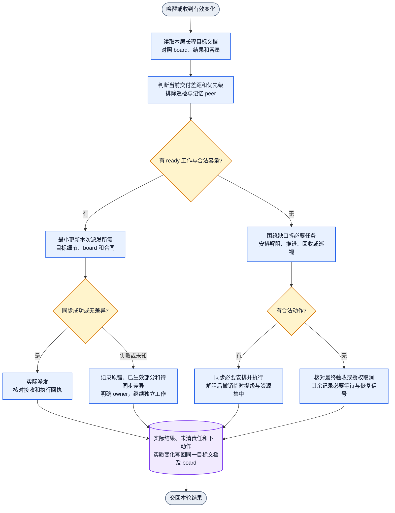

# Collab 编排与长程目标

本文件属于 Collab Skill，供已注册且获授权的 CEO、master 和承担编排的 peer 使用。宿主负责独立 worker、Plan、Review 和工程交付入口。Collab 的目标、board、角色与唤醒职责由本文件维护。

## 本层长程目标和持续文档

每个 Collab manager 持有一个说明本层最终交付与验收的长程目标。当前短期目标是向最终交付推进的可验收增量。master 自持自己的目标全文、board、父子映射和总验收。下级接收已拆解的子任务合同、必要上下文、相关依赖、验收和回传对象。peer 管理自己明确接受的子目标。

沿用本人已登记 goal 所指向的同一份目标文档。文档维护最终交付、范围、硬约束、当前增量、剩余差距、bottleneck、优先级、必要资源、board/合同关联、已确认结果、下一动作和等待条件。最终交付和验收依据当前有效用户要求，细节随新事实更新。原始证据使用路径引用。

每次唤醒读取文档当前有效部分，对照自己的 board、已确认结果与实际容量，判断距离最终交付还缺什么。有实质变化时更新同一文档和受影响任务，随后推进最高优先级可执行工作。相同输入复用有效结论。goal-prompt 可用于更新目标提示词和文档结构，日常增量维护直接在原文档进行。

goal 的登记、更新、续订和关闭使用 [Collab goal 入口](../SKILL.md#register-the-long-horizon-goal-before-dispatch)。由本人维护本人的 goal。目标记录、关联文档、调度配置与实际执行分别以各自真实回执确认。

## 身份与通信入口

身份明确且已有有效回执时直接复用。仅身份不确定、缺失或公开入口明确返回身份/绑定异常时，才在实际项目运行 `collab context`。首次注册由用户明确要求触发。压缩、续接、唤醒、派发、巡检及普通收发本身均沿用有效身份。缺任务、消息或订阅事实时查询对应公开入口。

Collab 日常注册、恢复和通信使用 Collab Skill。tm-iterm 仅在用户明确指定，或正常 Collab 通信方式已有真实失败证据且确需紧急排障时使用。按对应授权处理紧急排障所需证据与动作。

## 每轮触发与 board 对齐

每次唤醒、处理变化或选择下一动作时进入本轮。先复用本层目标文档、当前 board、变化证据和容量，识别影响当前调度的差异。

| 触发 | 必查差异 | 实际动作 |
| --- | --- | --- |
| 任一任务完成、交付、提出/批准阻塞或范围/依赖/owner 变更 | 父目标差距、验收/集成/清理、下游依赖和容量 | 更新原任务或拆子任务，同轮安排 ready 工作。交付与完成、阻塞申请与批准分别处理 |
| idle 或准备进入等待 | 已授权目标、MVP/缺陷差距是否有任务承接，是否有未派工作和合法容量 | 补齐必要任务并推进下一动作。必要等待记录对象、owner、恢复信号与下一步 |
| longhorizon 完成或阻塞 | 最终验收是否成立，子任务/运行/集成/清理是否遗留，独立分支能否继续 | 接住未清责任，按实际状态继续或依法收口目标 |
| 用户新任务或修正 | 与旧目标的关系、优先级、复用/拆分、依赖和资源冲突 | 接单当轮更新受影响目标细节、board 和合同，再派执行 |

从最终交付差距判断 board 是否覆盖。board 为空或 `eligible_task_ids=[]` 时，继续核对已有授权的 MVP、P0/P1 和未清交付。对未覆盖工作补最小可执行任务，过粗任务按真实依赖和唯一 owner 拆解，已有任务继续复用。

只通过现有公开入口和真实 revision 更新原 board，写清目标、范围/验收、优先级、owner、依赖、下一动作、合同与证据位置。原任务保留历史和未清责任。相同事实合并处理，有效差异才写入。

## 优先级与实际执行

动作顺序为并发派发 > 阻塞任务解决 > 推进当前任务 > 资源回收 > scope 内巡视。派发所需的 idle、owner、权限和容量核对属于第一级。先选最高优先级 ready 工作，完成本次派发所需的最小同步后实际派出。必要 Plan/Review 容量一并保留。

CEO 按授权管理项目 master，master 优先交合适可用 peer，peer 拆派本子目标的独立 worker。确认无合适 peer 可承接时，master 保留责任并沿宿主入口派独立 worker。巡检或记忆 peer 从所有任务派发候选和可承接容量中排除，任务优先级、idle 或容量不足均沿用这一限制。

master 选择承接任务的 peer 时，按 Collab Skill
[派单顺序与一 peer 一任务](../SKILL.md#派单顺序与一-peer-一任务) 维护的当前提示词优先级和容量边界执行；本文件不复制该排序细节。

master 是项目唯一负责人，peer 缺位不转移这项责任。reviewer、planner、裁判等角色缺位时的承接、独立 reviewer 后备、极端条件下的 master 临时代审、实际审查者与独立性缺口记录，统一由
[负责人承接规则](../../codex-orchestrator/SKILL.md#角色缺位时由负责人继续推进) 及其引用的 Review 合同维护；本文件不复制该角色政策。

每轮产生实际派发、解阻、推进/验收、资源收口或有依据的等待。邀请入队、接收、执行和完成分别记录。完成动作、解阻或释放容量后，对新变化重新检查并发机会。board 维护和文档更新服务本轮实际推进。

## Bottleneck 最小必要拆分与临时集中

确认具体受阻主线、首个未满足条件和恢复到什么可观察状态即可继续。根因未明时先安排必要采证或诊断。阻塞由直属主管依据原错、已试办法、影响和恢复条件核实。

1. 沿本次受阻条件拆最小必要任务，给出唯一 owner、输入、边界、交付和解阻验收。已有任务能够承接时更新原合同。去掉某项工作仍可解阻时，将其留在本轮范围外。
2. 在原 board/合同记录受影响主线、临时调高原因、资源安排和解除条件，更新安排后派发。低优先级工作由 owner 在安全边界让位，保留产物、责任及恢复下一步。
3. 将匹配技能、权限、设备与依赖的资源集中到解阻关键路径，保留必要 Plan/Review 容量。可并行的不同工作并行。共享写入、设备、配额或用户决定按真实约束安排资源，独立分支继续。
4. 用原受阻入口或真实消费者确认已可继续。根据关键结果释放下游依赖与派发容量，完成解阻所需验证。
5. 解阻成立后撤销该原因带来的临时优先级和资源集中，按当前主目标、用户优先级和依赖重排。owner 收口多余未启动任务，安全交接活动工作，保留必要验收和清理。继续当前主目标所需的最小增量。

尚未解阻时用新证据调整必要任务、执行者或依赖。明确缺权限、外部条件或用户决定时等待该条件，其他 ready 工作继续。临时安排和撤销结果记录在原任务。

## 单轮 DAG

入口为本次唤醒或有效变化，各分支汇入本轮结果。动作完成后的新变化进入下一次调用。

## 收口与失败

派发拒绝或结果未知时保留原错、已成功安排及待确认部分，先核对实际结果再决定后续。board 写入失败或冲突时保留待同步差异，只暂停依赖该变更的新派发。缺必要事实、权限或上级路由时交对应 owner 处理，独立工作继续。

本轮记录当前结果、证据、未清责任及下一 owner/动作。必要等待包含对象和恢复信号。最终交付和适用验收、集成、运行、清理成立后，才按正式入口收口本人的长程目标。授权取消或移交时接住剩余责任和资源。

## 巡检员与记忆 agent

二者维持各自固定职责，不接收临时开发派单。巡检员每30分钟检查 Jenny 的真实 session，重点分析主线、目标和优先级偏离，定向提醒纠偏并跟踪结果，架构问题按原入口去重报 bug。记忆 agent 根据已授权记录变化核对来源、去重整理、修正失效结论和维护恢复入口。记忆 agent 的触发沿其既有配置。
