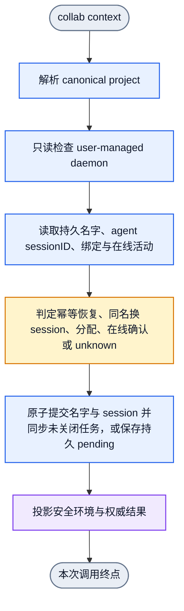
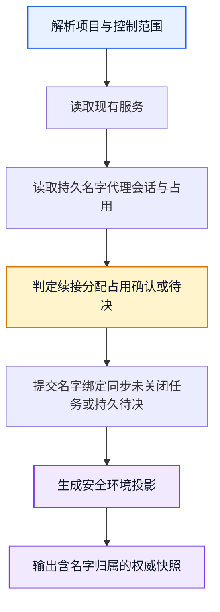

# Collaboration context state machine（按 DAGpipe 规范）

状态：`TARGET / DESIGN ONLY / RUNTIME UNVERIFIED`

本页描述 `collab context` 的目标逻辑，不声明源码、安装版或 live daemon 已具备这些
行为。机器图见 `docs/dagpipe/collab-context.graph.json`；`dagpipe graph validate` 和
`inspect` 只证明静态拓扑与 operator 声明，不证明 operator 已注册或已执行。

## 1. 入口与边界

入口是 `collab context`，出口是本轮权威 `state_snapshot`。`committed`、
`confirmation_required`、`pending`、`stale_decision` 和 `explicit_failure` 是不同终态。
重试或裁决续接从新的 invocation 和持久 operation 开始，不在图内画回边。

`client::require_server` 只观察 user-managed daemon 是否可达。CLI、agent 和
AppSDK/Collab context 不启动、停止、重启、替换或巡检维护 daemon，也不操作 tmux
server 生命周期。daemon 不可达是本次显式失败，不是自动启动条件。

名字是项目内工作归属，agent sessionID 是当前执行载体。tmux session、pane、
socket、server PID、thread 和 route 只定位投递与观测。pane 相同不能证明名字归属，
历史 session 也不能阻止新 session 接续当前名字工作。

## 2. 角色与 owner

| 角色 | 唯一职责 | 禁止 |
| --- | --- | --- |
| Agent | 调用 `collab context`，读取 snapshot，按真实缺失字段提供必要 runtime facts | 猜 daemon/socket、手改 state、启动 daemon、选择旧 session |
| CLI context wrapper | 解析 canonical project、读取 baseline、调用 `require_server`、提交 typed request | `ensure_daemon`、启动/重启 daemon、选择 worker 或名字 |
| Daemon name owner | 读取项目名字池与占用，恢复或分配名字，更新 agent sessionID | 用历史 session 做准入门禁 |
| Daemon context operation owner | 保存 unknown pending、请求 Jenny 裁决、续接原操作 | 把 pending 记为成功，或让旧裁决覆盖新占用 |
| Board assignment owner | 同步同名全部未关闭任务，或接受显式改派 | 修改 closed 历史，重置状态、资源、证据或义务 |
| Presence owner | 分开记录 presence 与 activity/background | 以历史滚屏或输入框猜测 idle |
| Human operator | 管理 daemon 生命周期、执行明确授权的重置或迁移 | 用诊断命令替代 agent context，绕过服务所有权 |

## 3. 状态转移

| 当前事实或事件 | 判定 | 下一状态或终点 |
| --- | --- | --- |
| 项目无法解析 | 无 canonical root | `explicit_failure`；不猜 route |
| daemon 不可达 | `require_server` 失败 | 本次失败；不启动 daemon |
| 已提供明确恢复授权 | 先解析本次用户意图 | 历史档案或旧 binding 不得先行否决；context 内部迁移并收敛 |
| 同 session 留有重复档案或多个旧载体 | 内部兼容迁移 | 优先 typed 名字归属和已提交当前载体；无当前载体时建立当前 session 身份，不让 agent 选择档案 |
| 同项目、同 agent sessionID | 幂等恢复 | `committed`；只同步投递位置 |
| 同项目/app/session 后一次注册提交 | 当前执行载体替换 | 退役前一载体的投递绑定并收敛名字占用；不停止旧进程，不影响其他 session |
| 同名字当前工作者从 S1 到 S2 | 正常 session 续接 | 更新名字 session，并换绑同名全部未关闭任务 |
| 名字可分配或已确认 offline | 正常分配或继承 | `committed`；新名字绑定当前 session |
| 其他工作者在线占名 | 尚需本次用户确认 | `confirmation_required`；保留现 owner |
| 其他工作者在线占名且本次用户已确认接管 | 允许替换 | 提交名字与 session，任务换绑；不处理旧执行者 |
| 占用 unknown | 需要 Jenny 裁决 | 保存持久 pending 并投递具体请求，返回 `pending` |
| snapshot 失败、Jenny 不可用或裁决仍 unknown | 无法安全分类 | 保留原绑定与 pending，返回明确未决状态 |
| Jenny 裁决 online | 回到在线替换规则 | 仍需既有二次确认；不自动接管 |
| Jenny 裁决 offline | 回到正常分配或继承 | 下一次调用应用并接续未关闭工作 |
| Jenny 自身 unknown 且无法响应，本次用户明确恢复 Jenny 并确认接管 | 用户确认优先于 Jenny 裁决 | 直接接管 Jenny 名字与 master；不等待旧执行者 |
| pending 所针对占用已变 | 旧裁决陈旧 | `stale_decision`；当前归属不变 |
| 提交或任务同步失败 | 部分完成或持久错误 | `explicit_failure`；返回原错与已提交进度 |

`pending` 是首次调用的有效终点。下一次调用重新读取同一持久请求和当前占用，核对
仍未变化后再应用。图中没有 pending 回到分类节点的边。

## 4. Presence 与 activity

| 观测 | presence | activity/background | 调度含义 |
| --- | --- | --- | --- |
| Codex 正在生成 | `online` | `busy` | 不作 idle 候选 |
| 明确等待后台命令 | `online` | `busy`，`background=true` | 不作 idle 候选 |
| 当前输入态且无执行、无选择、无未解释后台事实 | `online` | `idle` | 可供正常调度 |
| 等待批准、选择或补充信息 | `online` | `waiting_user` | 不接新任务，不算 idle |
| Codex 已确认但活动不明 | `online` | `unknown` | 不推断 idle |
| 输入态叠加不明后台事实 | `online` | `unknown`，`background=true` | 不推断 idle |
| 已回 shell，无当前 Codex | `offline` | 不推断 | 失去名字保持权；任务保留 |
| 探测失败或当前程序未知 | `unknown` | `unknown` | 保名；必要时交 Jenny |

未关闭任务因名字当前无可用工作者而显示空 owner 时，任务、名字、资源、证据和历史
仍保留。回流原因由 board mutation 或 timer owner 产生并投给当前 Jenny；读取
snapshot 不产生通知，Jenny 也不自动成为执行者。

## 5. 状态图

图中失败分支和 pending 也由节点 `E` 的 typed outcome 表达并汇入同一出口，不增加
回边。未知占用需要下一次 invocation 从持久请求续接。

## 6. DAG 与 ARC 契约

机器图 `appsdk-collab-context` 0.13.0 是一条 7 节点、6 条边的目标设计链：

| ARC | schema | 语义 |
| --- | --- | --- |
| `context_request` | Object | 唯一入口；仅请求当前 context |
| `resolved_scope` | Object | canonical project 与既有控制范围 |
| `daemon_available` | Object | 已存在 daemon 的只读可达性 |
| `durable_name_scope` | Object | canonical project/app scope 内名字占用、session、agent binding/generation、presence/activity、持久 operation |
| `name_resolution_decision` | Object | committed、confirmation、pending 或失败的选定路径 |
| `name_resolution_outcome` | Object | 实际持久结果、同一 scope 的权威 binding/generation、续接引用、已同步 assignment 与未消费消息归属 |
| `env_projection` | Object | 过滤后的安全环境子集 |
| `state_snapshot` | Object | 唯一出口；含名字、session、角色、binding、任务和本次终态 |

snapshot 必须区分 `committed`、`confirmation_required`、`pending`、
`stale_decision` 和 `explicit_failure`。`pending` 不能写成 `registered=true` 或
`committed`。续接引用指向既有 context operation，不新造 pending token、TTL 或
第二身份注册表。

### Binding scope 与事实补充

当前 cwd 和既有 worktree 映射确定 canonical project。typed `IdentityContext`
携带 `project_context.app_scope_id`、`project_scope` 和 `canonical_root`，以及当前
调用者的 runtime facts。host state root 是持久真源；项目 `.agent-collab/` 仅作发现
标记。不从其他项目、历史 pane 或退役 native route 借用当前身份。

binding 收敛并入现有名字提交节点，由既有 `ProjectRuntimeManager` binding、route
和 credential owner 完成 endpoint refresh 与 publication reconciliation。
context 完成、worker status 和 board admission 必须读取同一项目/app/agent binding
及 endpoint generation。仅 context 修复；status 与 board admission 只读。缺失、
歧义、陈旧或 principal 不符时，返回 typed 诊断（含适用的
`SESSION_THREAD_BINDING_MISMATCH`）、已知 expected/observed generation 和
`collab context` 修复指令。端点活跃度与持久身份有效性分开。

缺 runtime facts 是本次调用终态：`registered=false`、`identity=null`，携带
`requires_identity_update` 的 `required_fields`、`reason`、`action` 和 `exact_error`。
它不是名字 unknown 的持久 pending。仅当 action 要求 factual supplement 时，执行
一次 `collab context --provide`，只补所需的真实 `session_id`、`thread_id`、
`endpoint`、`namespace`。未知、重复或空字段被拒绝；与自动观察冲突返回
`IDENTITY_FACT_CONFLICT`。不接受 worker/token/approval/generation/binding/scope
覆盖，也不伪造 tmux ownership。CLI 不从 `TMUX` 注入 socket。

选择 AppServer endpoint 时，namespace/session/thread 必需；tmux 注册仍须报告
agent sessionID，不能用 tmux session ID 替代。缺能力时显式报告，不猜地址。
identity receipt 仅供 daemon 和紧邻的已认证操作使用，不显示 token，也不写入
snapshot、消息正文、metadata、debug log 或业务 payload。query 只读；现有 operation
journal 的幂等与取消边界保持。

## 7. 节点 owner 与验收

| 机器节点 | 唯一 owner | 验收 |
| --- | --- | --- |
| 解析项目与控制范围 | context bootstrap | 从 actual cwd 和既有 scope 得到 canonical project |
| 读取现有服务 | `client::require_server` | 只读；不可达显式失败；无自动 daemon 生命周期 |
| 读取持久名字代理会话与占用 | daemon name + presence owner | 项目隔离；presence/activity 分开；不按 tmux session 选身份 |
| 判定续接分配占用确认或待决 | daemon name recovery owner | S1→S2、online、offline、unknown、Jenny pending 均可定位 |
| 提交名字绑定同步未关闭任务或持久待决 | context operation、既有 binding/route/credential owner 与 board/mailbox owner | committed 收敛同一 scope 的 binding/generation，同步全部未关闭任务与未消费消息归属；pending 只持久保存请求与进度，不提交接管；closed 和已消费历史不变 |
| 生成安全环境投影 | `context_env_view` | token/key/secret/password/credential 键不泄露 |
| 输出含名字归属的权威快照 | `handle_context` | 本次终态不混淆；pending/失败不伪装成功 |

## 8. 变更边界

- Agent 只执行 `collab context`；缺事实时只执行一次 factual supplement
  `collab context --provide`，且只含 `session_id`、`thread_id`、`endpoint`、
  `namespace`。
- Agent 不运行独立身份选择或 status/route 探测序列，也不设置身份覆盖环境。
  用户已要求恢复或接管时，通过 context 的 approval 参数提交本次用户意图；不猜
  历史 worker、fence、generation 或 scope，不重复索取已有授权。
- pane 只是投递位置；当前明确授权覆盖历史 pane 绑定。名字归属仍按同名续接、在线
  二次确认与 unknown 裁决分类，不用“后注册 pane 取胜”代替名字合同。
- `collab init` 不是 Agent 的默认入口，也不是第二套身份算法：它与 `collab context`
  共用同一 daemon 身份门（`identity_gate`），保留为既有 AppSDK init 消费者的入口。
- master 权威沿既有 owner 和明确用户批准处理。用户指定恢复 Jenny 时接管其名字与
  master；Jenny 自身 unknown 且无法响应，本次接管确认优先于 Jenny 裁决。普通恢复
  不继承已清除或已注销的旧 master grant。
- 只读诊断保留：`collab who`、`collab status --all`、`collab worker status`、
  `collab route resolve`、`collab master status`。
- 人类授权操作保留：`collab down`/`up`、reset、migration、master promotion 和
  delegation。它们不替代 daemon 的身份决定。
- 不把 tmux/AppServer 作为可替换 fallback；不从日志、snapshot 或 payload 重建
  控制状态。任务与消息归属只由现有 typed owner 同步。

## Agent-facing rule

只执行 `collab context` 一次；线程/会话变化、daemon 重启或身份信息缺失时再次执行
`collab context`。若 snapshot 带 `requires_identity_update`，读取
`required_fields`、`reason`、`action`、`exact_error`，并只在 action 为 factual
supplement 时用一次 `collab context --provide` 提供请求的真实字段。`registered`
与 `requires_identity_update` 才是判据；退出码 0 不代表身份已验真。历史重复由 context
自己迁移，不作为 agent 选择题。明确用户意图通过 context approval 提交。真实输入冲突、token
拒绝、route/runtime/transport 失败保留原始错误，不 fallback、不伪装成名字裁决 pending。
worker status、board admission 或 mutation 返回 stale generation /
`SESSION_THREAD_BINDING_MISMATCH` 时，保留 registered binding，只通过
`collab context` 修复；不得手工 rebind、编辑 route/journal 或猜测 generation。

## 名字续接与交付边界

- 自动 session 换绑属于 assignment mutation，必须复用 TaskRec/board revision 并发
  控制。revision 冲突要求读取当前 revision 后重试，不能把旧 revision 变成旧
  session 准入门禁。
- Jenny 裁决使用现有 context operation 和消息投递。应用前核对占用 revision/变更
  引用；重复结论返回既有进度。
- 旧执行者不接收退位通知，不被停止、撤权、拦截，也不作为接管前置条件。
- board 读取保持只读。显式任务改派由
  `appsdk-collab-board-assignment-lifecycle` 表达，经现有 invite/respond 扩展。
- merge-pending 的 delivered review 和 accepted owner rework 是不同转换，不能扩大
  master 的 owner-only update 权限。
- 名字交接同步未消费消息的收件归属和唤醒目标；消息 ID、正文、原发送者与真实消费
  回执保持。已消费历史不回放、不改写；入队、adaptor 接受、recv 消费分别验收。
- master 和 peer 编排功能相同、目标层级不同。master 管项目大目标，peer 管受托
  子目标；两者负责拆分、派发、资源管理、验收和交付，优先让独立 GCM 子 worker
  完成一次性执行/观察。注册和恢复说明这些职责，推荐有限巡检；peer 阻塞先问 master。
- 本页与机器图不声明 installed/live 已验收。候选测试可用既有 `COLLAB_TEST_BINARY`
  seam；生产使用 canonical installed binary。正式安装和已加载 runtime 的公开
  context→board→改派→订阅 consumer 证据分别报告，全局 daemon 仍由用户管理。
