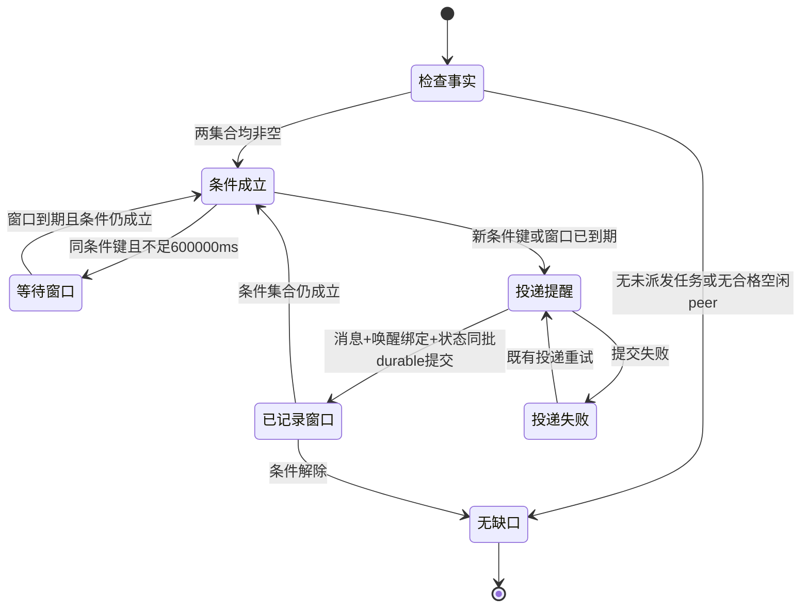

# Collab 派发差距提醒状态机

## 目标

把“当前项目管理员 board 上存在未派发公开任务，且管理员直接 scope 内有一层可承接工作的空闲
peer”的提醒收敛为一条幂等状态机。提醒不派单、不修改 owner/status。

同一条件集合 600000ms 内最多提醒一次。条件键变化视为新差距，立即允许一条新提醒；缺口解除
清空旧键，下一次缺口重新提醒。

## 当前实现

origin/main（aee5f189）已包含该提醒的初始实现，合入提交 28751b85：

- `collab/src/server/keepalive.rs`：keepalive tick 调用 `dispatch_gap_check_at`；
  `DISPATCH_GAP_IDEMPOTENCE_MS = 600_000`；条件快照、窗口判断、durable 提交与失败记录在
  一次 state 锁内完成。
- `collab/src/server/notification_state.rs`：`MasterWakeAccumulator` 持有条件集合、最后提醒
  条件键与时间、投递状态；条件记录、清键、成功与失败各有唯一写入口。
- `collab/src/server/work_assignment.rs`：`dispatch_eligible_worker_ids` 是 board dispatch
  稳定名字、binding、托管子 agent 和 transport 规则的唯一 owner。
- `collab/tests/board/dispatch_gap_reminder.rs`：公开黑盒用例覆盖触发、600000ms 幂等、
  无任务、忙碌/离线/等待用户 peer、executor pin 与失败不推进窗口。
- `collab/src/server/keepalive.rs` 的单元测试覆盖条件键变化、同键窗口、缺口解除后重新提醒、
  托管子 agent 排除和投递失败。

`ready_authorized_work` 已不在 origin/main，不存在第二份可写 ready work 真源。

## 范围

- 只检查当前项目管理员及其直接 scope 内的一层 peer。
- 只读取管理员可见的公共 board 任务。
- 复用 board dispatch 的稳定名字、binding、托管子 agent、transport 与活动规则。
- 复用现有 direct-message 投递、durable 提交与失败记录。

非目标：

- 不递归检查子 agent；不把 unknown、cold、offline、waiting_user 当作空闲。
- 不复用 15 分钟 board-idle 或 25 分钟 master-idle 巡检作为触发源。
- 不自动派单、不修改任务 owner/status、不创建第二套 board。
- 不新增 daemon、tmux lifecycle、timer 或另一份 ready work 状态。

## 与自动接续的职责边界

自动接续是已入队工作的主路径。本提醒只覆盖未入队且未派发的公开任务。

| 事实 | 唯一 owner | 本提醒的动作 |
|---|---|---|
| 任务已入队，等待自动接续投递或已在执行 | 自动接续 / ticket 队列 | 不提醒、不派单、不把该任务计入差距 |
| 任务未入队、未派发，但仍是 pending 公开任务 | 本状态机 | 存在一层真正空闲 peer 时提醒管理员一次 |
| 任务已有 active invitation | board dispatch | 视为已派发，进入本提醒排除集 |
| peer 有 queued/accepted 工作但 typed activity 仍为 idle | 自动接续 | 不作为本提醒的空闲容量 |

自动接续的 ticket 实现位于独立分支 `origin/codex/collab-ticket-system-20261107`
（03d31a63），尚未合入 origin/main。当前 main 的 `dispatch_gap_idle_peer_ids` 只能依据
board、binding、transport 与 typed activity 判断空闲，不能读取尚未合入的 ticket 队列。

自动接续合入时，必须在 `dispatch_gap_idle_peer_ids` 增加“该 peer 无 queued 自有工作”的
排除，并增加对应黑盒用例。不得在自动接续尚未合入时预置队列读取、空集合 fallback 或第二套
队列投影。

## 触发条件

未派发任务集合（`dispatch_gap_pending_task_ids`）：

- `status == pending`；
- owner 或 created_by 是当前管理员；
- board details 公开可见且 `invitation.is_none()`；
- 任务未 closed/cancelled。

空闲 peer 集合（`dispatch_gap_idle_peer_ids`）：

- 管理员直接 scope 内的一层 peer，不是托管子 agent；
- 具备当前 binding 与可达 transport；
- 对至少一个待派发任务满足 executor pin；
- typed presence 为 Online、activity 为 Idle；
- 排除管理员自身；
- unknown、cold、offline、waiting_user 不进入；
- 自动接续合入后，再排除持有 queued 自有工作的 peer。

两个集合都非空才形成派单缺口。

## 状态机

| 状态 | 条件 | 动作 | 下一状态 |
|---|---|---|---|
| 检查事实 | keepalive tick | 读管理员、board、一层 peer 绑定与 typed 活动 | 无缺口 / 条件成立 |
| 无缺口 | 任一集合为空 | 清条件键；不投递 | 结束本轮 |
| 条件成立 | 两集合非空 | 生成排序条件键，比较 durable 窗口 | 等待窗口 / 投递提醒 |
| 等待窗口 | 同键且未满 600000ms | 不投递 | 窗口到期 |
| 投递提醒 | 新键或到期 | 向管理员 direct-message 投一条 `master-dispatch-gap` | 已记录窗口 / 投递失败 |
| 已记录窗口 | 消息、wake binding、状态同批提交成功 | 推进最后提醒时间与 key | 条件成立 / 无缺口 |
| 投递失败 | 提交失败 | 记录条件与 `delivery_failed`，不推进窗口 | 既有投递重试 |

条件键为 `master=<id>|tasks=<排序任务ID>|idle_peers=<排序peerID>`。

## 调度

保持现有 keepalive tick + 600000ms 幂等窗口，不新增独立 timer。
`dispatch_gap_check_at` 继续由 keepalive `tick_at` 触发；窗口只限制实际提醒频率，不承担
调度周期。条件键变化不等待旧窗口，立即允许一次新提醒。

## 投递与失败

- 消息、`WakeBound` 与 `MasterWakeUpdated` 必须在同一次 checked 提交中成功。
- 只有 durable 成功才推进 `last_dispatch_gap_notice_ms` 与 key。
- 提交失败记录 `delivery_failed` 与条件快照，不推进窗口，保留原错。
- skip、读取、投递尝试与不 durable 的唤醒都不推进窗口。
- 提醒正文只列任务与空闲 peer，并要求走既有 board dispatch/invite 入口。

## 裁决定稿

Jenny 裁决定稿（m1794121130134-467）：

1. 条件键变化视为新差距，立即重置旧键窗口并允许提醒一次；同一键 600000ms 内只提醒一次，
   满窗可再提醒。
2. 保持现有 keepalive tick + 600000ms 幂等窗口，不新增独立 timer。
3. 状态机先合入 main；Alice 的 531e35c3 退役分支随后 rebase，只退役被状态机替代的旧重复
   实现与旧测试，不删除新状态机提醒。自动接续仍是主路径，提醒只覆盖未入队未派发的差距。

## 验收

当前 main 的实现验收复用已有测试，不新增等价用例：

- `dispatch_gap_pending_task_and_idle_peer_delivers_one_durable_reminder`：
  一条提醒、不派单不改任务、同键 600000ms 幂等、满窗可再提醒。
- `dispatch_gap_condition_change_reopens_before_window_closes`：
  条件键变化立即允许新提醒。
- `dispatch_gap_resolution_clears_key_and_new_gap_notifies`：
  缺口解除清键，重新形成缺口立即提醒。
- `dispatch_gap_ignores_busy_waiting_unknown_and_offline_peers` 与
  `dispatch_gap_excludes_managed_children`：空闲容量边界。
- `dispatch_gap_failed_delivery_does_not_advance_window`：失败不推进窗口。
- AppServer 黑盒 `dispatch_gap_reminder`：真实 daemon、board 与 direct-message 路径。

图验收：`dagpipe graph validate` 与 `dagpipe graph inspect` 通过；图单入口、单出口、无环。

自动接续合入后新增用例：持有 queued 工作的 peer 不算空闲容量。

## 关联

- DAG：`docs/dagpipe/collab-dispatch-gap-reminder-migration-20261108.graph.json`
- manifest：`docs/dagpipe/manifest.json`
- 验证映射：`collab/docs/verification-map.md`
- 任务日志：`/Users/fanzhang/.agents/task-notes/collab-dispatch-gap-reminder-20261108/note.md`
- 前序设计：`/Users/fanzhang/.agents/task-notes/collab-master-dispatch-gap-reminder-20261107/design-extract/`
