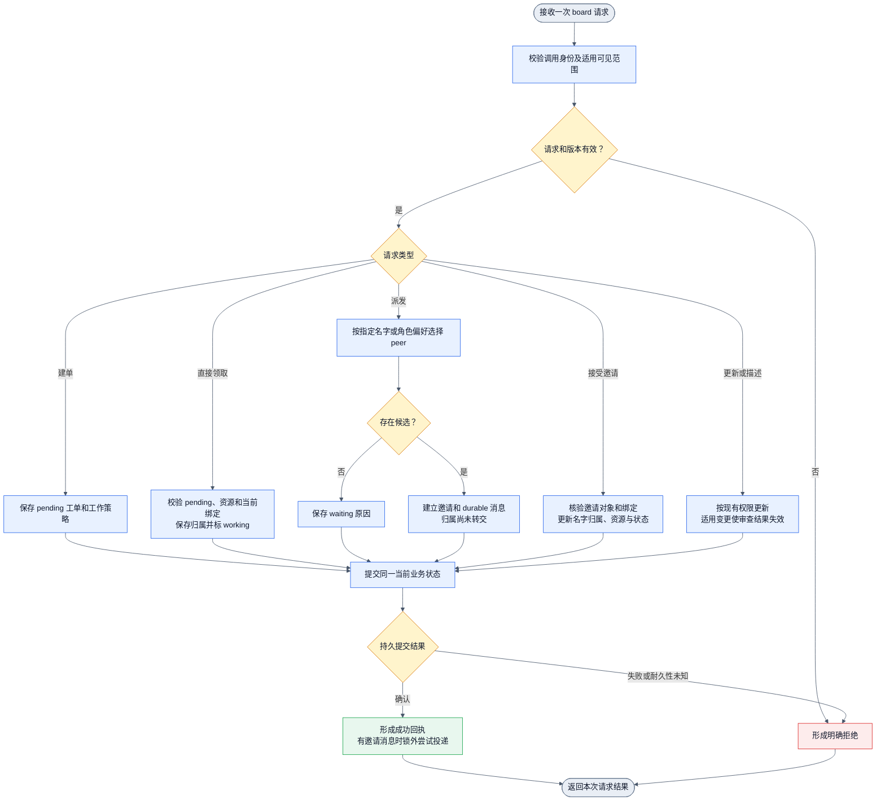
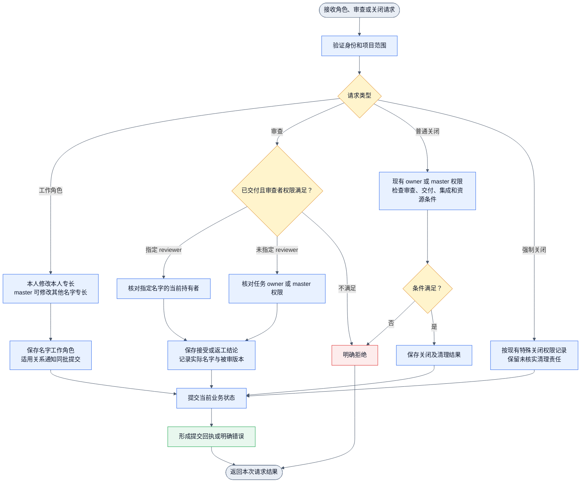
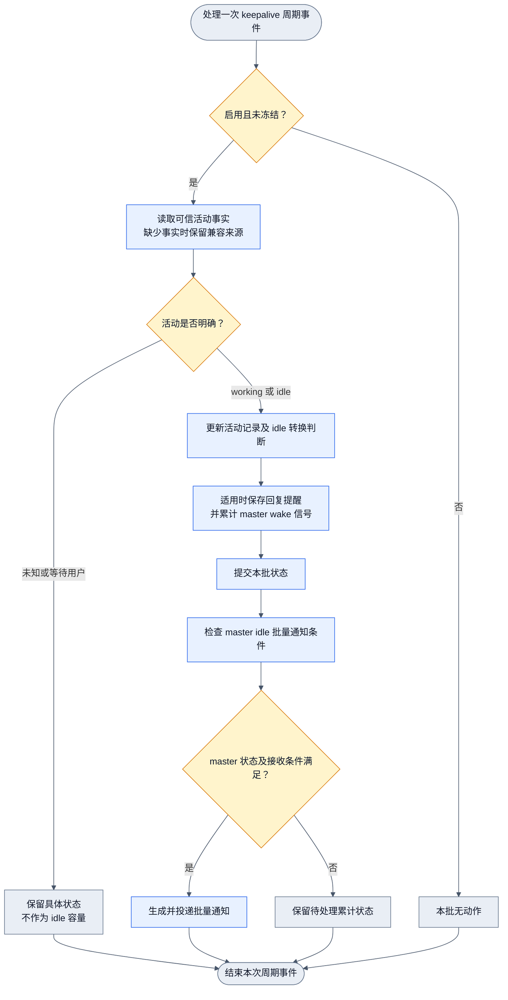
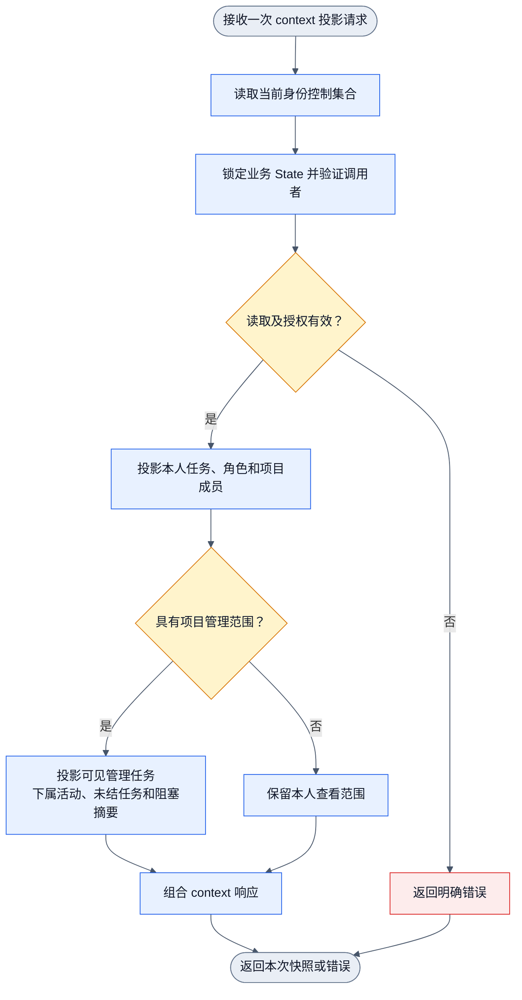

# Collab 工单系统当前主线状态

观察日期为 2026-11-07。本文件作为目标 DAG、gap 和实施计划的源码基线。

## 来源与证据边界

本文件亲读本轮已更新的 `origin/main` 源码。下文的 `origin/main:path:line` 是 Git 远端跟踪分支中的源码位置，不表示当前保留工作树中存在同名文件。

当前主工作树是 `codex/preserve-appsdk-local-20261021`，含其他 owner 的 dirty 内容。独立观察报告 `/Users/fanzhang/.agents/task-notes/collab-ticket-design-20261107/current-observation-evidence.md` 对该旧树有效，只复用其入口定位和本地差异。该报告中的缺失判断、行号和 Mermaid 不能代替当前主线事实。

本轮未构建、未测试、未连接 daemon。installed binary 与 live daemon 行为均未知。源码中存在测试，只证明已有验证入口，不能作为本轮运行通过证据。Git 读取期间出现工具链缓存写入受限诊断；所引用的源码读取均成功返回正文。

关联材料包括目标正文 `collab-ticket-flow-20261107.md`、gap `../design/collab-ticket-gap-20261107.md`、详细设计 `../design/collab-ticket-implementation-design-20261107.md` 和实施计划 `../plans/collab-ticket-system-20261107.md`。四份 20261107 机器图目前表达目标接口，运行算子仍待绑定。

## 当前工单请求 DAG

图描述一次请求。各分支最终只返回一次结果。邀请接受、claim 和后续交付是不同请求，不在图中串成一次同步执行。

当前派发不是最短 slot queue。`board_dispatch_work` 优先考虑角色匹配与是否存在未结责任，然后调用邀请 owner。当前直接 claim 已存在，不能沿用旧树的“claim 已废弃”结论。

## 当前角色与审查 DAG

以下图描述一次角色修改或审查/关闭请求。没有自动 plan 阶段，也没有三档自动审查队列。

工作专长不是完整的阶段授权。当前必需审查主要由指定 reviewer 名字和被审版本约束。未指定 reviewer 时，源码允许任务 owner 或 master 审查，尚不能满足本目标要求的实际参与独立性。

## 当前运行状态与通知 DAG

keepalive 是独立周期事件，不是每次 board 请求的后置步骤。

当前 worker idle 信号进入 `MasterWakeAccumulator`。批量发送会因 master working、waiting_user、unknown 或不在线而等待。这与新增要求的“worker idle 立即提醒 manager”存在差异。当前机制也不等同于“manager idle 提醒巡检员”和“同一次 worker idle 严格超过 10 分钟提醒双方”。

## 当前 context 可见性 DAG

主线已有 `scope_digest` 与 `management.tasks`，不能写成“master 只能看本人任务”。缺口是阶段运行与 slot queue 的具体投影，以及身份控制集合和业务状态跨资源读取的一致性。当前代码先读取控制集合，再锁业务状态，不能仅凭持有业务锁就宣称两者处于同一提交视图。

## 当前事实与唯一 owner

| 当前事实 | 主线证据 | 对实施的影响 |
| --- | --- | --- |
| 注册名字是稳定归属，session 是执行载体 | `origin/main:collab/src/server/binding_slot.rs:46`、`:186`；`origin/main:collab/src/server/name_state.rs:29` | 复用名字、绑定代际和 assignment；不能按 session 重建工单身份 |
| identity binding slot 已存在 | `origin/main:collab/src/server/binding_slot.rs:186`、`:343` | 这是身份绑定槽；尚不是带个人 queue 的调度槽 |
| peer 可建单 | `origin/main:collab/src/server/board_handlers.rs:315`，身份检查在 `:324`，创建在 `:337` | 无需重新发明 peer 建单能力；新增自领入队与自动推进 |
| claim 已有 CAS、资源及绑定检查 | `origin/main:collab/src/server/board_execution.rs:31`、`:45`、`:57` | 当前直接标 working；需拆开 claim 预留与真实开始 |
| 当前派发最终建立邀请 | `origin/main:collab/src/server/work_assignment.rs:248`、`:284`、`:318`、`:369` | 替换该选择与邀请路径，避免保留第二套自动调度 |
| 接受邀请才转移归属 | `origin/main:collab/src/server/board_invites.rs:88`、`:104`、`:122`、`:131` | 存量邀请迁移须保留原责任；不能当作已经开始 |
| 工作角色按稳定名字保存 | `origin/main:collab/src/server/work_roles.rs:45`、`:51`、`:76`、`:103` | 复用 `NameWorkRoles`；本人专长设置不应隐式授予全项目管理权 |
| 工作策略支持分类、角色偏好、执行者和审查者 | `origin/main:collab/src/board.rs:73`；`origin/main:collab/src/server/work_assignment.rs:24`、`:118` | 扩展既有策略，保持已保存任务的有效合同 |
| 指定审查者及被审版本校验已有 | `origin/main:collab/src/server/required_review.rs:1`、`:13`、`:43`、`:89` | 复用结果失效与版本绑定；增加自动路由、实际参与排除和阶段授权 |
| 未指定 reviewer 时允许 owner/master 审查 | `origin/main:collab/src/server/mod_parts/part_09.rs:41`、`:55` | 必须修正本目标下的独立审查漏洞 |
| 普通 owner 可关闭，特殊关闭也有额外授权路径 | `origin/main:collab/src/server/mod_parts/part_09.rs:402`、`:586`、`:604` | 工单关闭统一收敛到 master，不可只修 board 外观 |
| 当前业务状态采用候选副本和原子保存 | `origin/main:collab/src/server/mod_parts/part_02/commit.rs:40`、`:82`、`:159`；`origin/main:collab/src/server/current_state.rs:51` | 复用 State 事务，不因旧 JSONL 观察换数据库 |
| 现有 command receipt 只直接比对 command/operation 关系 | `origin/main:collab/src/server/mod_parts/part_02/commit.rs:96` | 工单接入还须比较同请求的 typed 意图，避免同 ID 不同内容误重放 |
| 可信 idle 起点已有 | `origin/main:collab/src/server/name_state.rs:75`；`origin/main:collab/src/server/name_monitor.rs:79` | 复用活动 owner；不能用 unknown、消息为空或任务为空推导 idle |
| keepalive 累计后等 master 可接收再批量通知 | `origin/main:collab/src/server/keepalive.rs:321`、`:381`、`:699`、`:711` | 新对象提醒不能被旧 master busy gate 延迟，也不能重复提醒 |
| 失去绑定后已有 reflow 提醒 | `origin/main:collab/src/server/name_stewardship.rs:42`、`:49`、`:76` | 当前要求人工重新 assign；需接入 master 鉴别后的自动回收 |
| context 已有下属及管理视图 | `origin/main:collab/src/server/mod_parts/part_09.rs:1503`、`:1620`、`:1955` | 在现有字段旁补阶段、运行、队列和等待原因，不建第二套 board |
| 当前 context 跨资源先后读取 | `origin/main:collab/src/server/mod_parts/part_09.rs:1355` | 实施需统一读取边界，不能把顺序读取冒称一致快照 |
| 身份发布已有 manager gate 和待消费交接意图 | `origin/main:collab/src/server/mod_parts/part_04/binding_control.rs:16`、`:78`；`origin/main:collab/src/server/binding_slot.rs:195` | 复用现有身份交接；工单调度不得另写身份真源 |

本文件各图都是一次请求或事件的单源单汇图，分支均到唯一出口，无回边，无孤立 gap 节点。此处为源码推导，尚无本轮机器校验或真实运行验收。缺失能力统一列入 gap 表。
