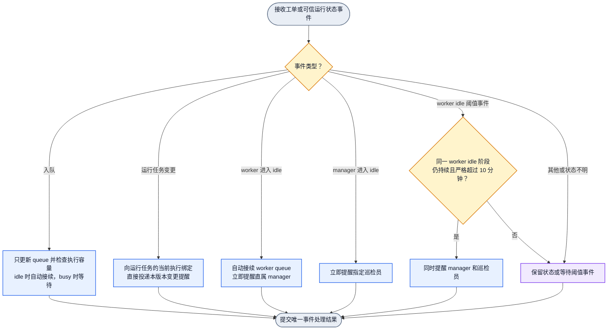
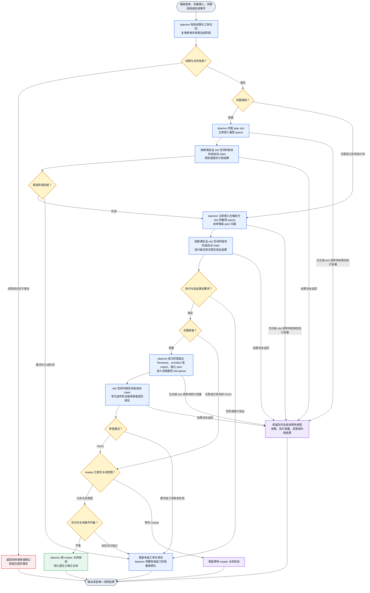
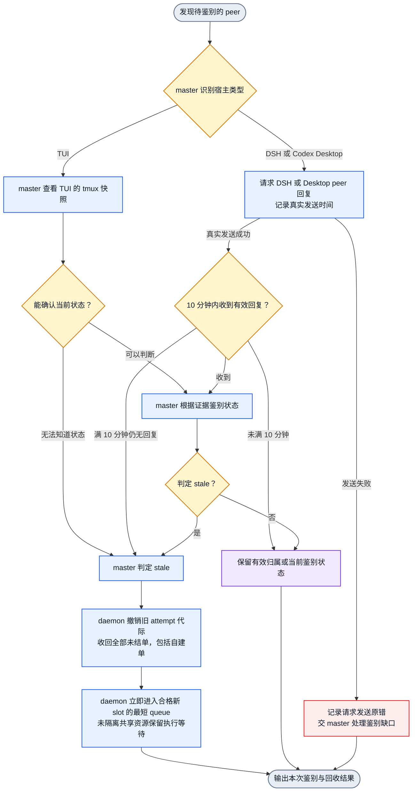
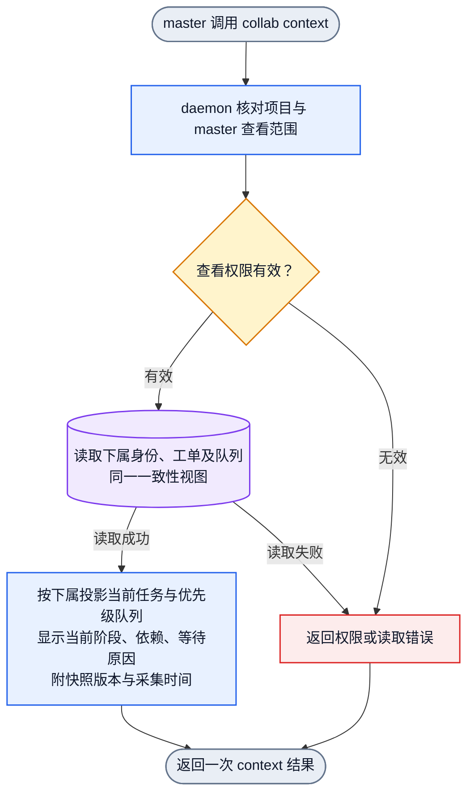

# Collab 工单自动流转设计

状态为完整设计包已通过独立设计审查，待 Jenny 组织实现。依据为 Jason 在 2026-11-07 本聊天中确认的工单权限、自动调度、规划与审查、个人队列、存量单接入、context 快照、失联回收及审查角色路由要求。审查原始结果为 `/Users/fanzhang/.agents/task-notes/collab-ticket-design-20261107/final-review-result.json`，接受依据见同目录 `note.md`。

## 目标与当前缺口

目标是让 master 建单分类，peer 可以自建自领，daemon 自动派单、排队、转交和接续。master 通过 `collab context` 直接查看下属当前任务和排队任务，并负责关闭工单。

已核对现有 `collab-dashboard.graph.json` 和 `collab-peer-lifecycle.graph.json`。它们覆盖单次任务板请求和生命周期请求，尚未表达本方案完整的角色队列、规划先行、审查转交及平均分配合同。本文件补充设计。图与校验结果只证明设计结构，运行行为仍待实现及验收。

## 权限与调度合同

- master 可以建单、更新、分类、调整优先级和接收范围，并关闭工单。
- peer 可以建单、自建自领、claim 和 update。peer 无删除、关闭权限。claim 和 update 受项目授权与本人承接范围约束。
- plan 和 review 角色通过 claim、update 提交各自阶段结果。Planner、实现者、最终 Reviewer 按同一工作的实际参与记录保持独立。
- 每个可接单 slot 绑定稳定 peer、接收范围和自己的 queue。peer 个人视图汇总本人的 slot queue。plan、review 团队视图汇总对应角色的 slot queue。队列视图引用同一工单及阶段执行真源。
- daemon 统一执行派单、排序、转交、唤醒和阶段推进。接收端自动 claim，实际开始执行后才记录运行状态。
- 新单和显式加入 daemon 的存量单采用相同流程。存量单接入复用原工单标识，保留已有结果和责任。已运行任务保留原归属及真实运行状态。
- 工单进入 daemon 时，按当前阶段的接收范围、能力、项目授权和独立性筛选 slot，并立即进入其中最短的 queue。slot 正忙仍可入队。peer 自建自领保留指定 peer，在其合格 slot 中选择最短 queue。
- 需要 plan 的工单先交 plan 团队，规划完成后才向执行者分发执行阶段。需要 review 的工单在作者验证满足准入后自动交 review 角色。
- 所有队列先按优先级选择可执行阶段。依赖未满足的阶段也先分配入队，保留等待原因，执行时跳过该阶段并继续选择其他独立阶段。
- master 关闭意图必须满足适用规划、验证、审查和交付条件。需要 review 且尚未通过时，daemon 自动送审。
- peer 自建自领只指定本次承接归属，关闭权始终归 master。peer 经 master 鉴别为 stale 后，自建未结单也回归系统并重新分配。

用户最新确认采用最短 queue 分配。本版定义 queue 水位为已入该 slot 队列但尚未开始的阶段项数量，包含等待依赖的队列项。运行中的阶段单独展示。daemon 在同一原子边界读取合格 slot 水位、选择最短 queue 并入队，防止并发派发依据过期水位集中到同一 slot。

同水位轮转、同优先级按入队时间排序为本版建议默认值。执行阶段等待 review 时保留原执行责任，review 阶段进入审查 slot 的 queue，原执行 slot 按实际执行结束回执释放。无合格 slot 时，保留角色待分配单；接收范围或有效 slot 变化后自动匹配。

## daemon 自动接续与对象提醒

用户最新要求为“正在运行的任务需要变更直接提醒，入队列不需要提醒，因为 idle 后会系统。worker idle，提醒 manager，manager idle 提醒巡检员，worker idle 超过十分钟提醒巡检员和 manager”。

daemon 的队列推进与对象提醒分别处理。入队事件只持久化并更新 queue，worker 正忙时维持排队。worker 进入 idle 后，daemon 自动检查其 slot queue，选最高优先级且依赖、资源满足的阶段并自动 claim/启动。slot 已 idle 时的新入队事件也触发内部调度检查，避免等待下一次 idle 事件。真正启动时交付一次执行合同。入队本身不产生给接收者或 manager 的提醒。

| 事件 | daemon 动作 | 对象提醒 |
| --- | --- | --- |
| 普通入队、排序或指定后续任务 | 原子入最短 queue，检查可执行容量，busy 时等待 | 无入队提醒 |
| 正在运行的任务发生需要执行者响应的变更 | 保存新任务版本，向当前执行绑定直接投递变更 | 立即提醒当前执行者 |
| worker 进入真实 idle | 自动接续其 queue，记录本次 idle 阶段 | 立即提醒直属 manager |
| manager 进入真实 idle | 执行本层既定调度检查 | 立即提醒指定巡检员 |
| worker 同一 idle 阶段持续严格超过 10 分钟 | 再核对仍 idle，并提交本阶段超时事件 | 同时提醒直属 manager 和指定巡检员 |

manager 和 worker 根据实际职责与直属关系判断。受托 peer 编排子任务时是其子 worker 的 manager。巡检员沿固定授权配置接收提醒，仍排除在普通任务派发候选之外。

idle 来自可信运行状态的真实转换。unknown、offline、通信不明和等待用户分别保留原状态。idle 起点、开始执行、绑定变化及超时判断由 daemon 同一状态 owner 处理。新执行开始时结束旧 idle 阶段，取消该阶段未触发的超时提醒。恰好 10 分钟时继续等待，严格超过后才触发。

同一任务版本的运行变更、同一次 idle 进入和同一 idle 阶段的超时各去重一次。daemon 重启恢复 idle 起点及提醒回执，重放不重复提醒。用户未要求周期重发，本版仅定义进入 idle 和超过 10 分钟这两个提醒时点。manager 或巡检员尚未配置时，持久保留缺少目标的具体状态，由对应 owner 补齐接收关系。提醒送达、消费与实际处理分别记录。

## 审查角色与路由顺序

用户本轮追加的原文为“如果没有独立 reviewer，默认给 architect 或者 expert review”和“如果没有，给另外独立的 peer 交叉 review”。这两条适用于计划审查及提交阶段审查。需要 plan 时，规划本身仍进入 plan 团队队列。

daemon 按以下顺序选择第一个存在合格接收者的角色组，再进入该组最短的 slot queue。

1. 有 review 权限的独立 Reviewer。
2. 有 review 权限且满足独立性要求的 architect 或 expert，两者处于同一顺位。
3. 另一位满足独立性要求的普通 peer，承接本单交叉 review。

路由规则授予第三组承接者对本单审查阶段的 claim、update 和审查结果提交权限。该权限受本项目、本单、本阶段约束，关闭权仍归 master。daemon 依据角色配置与本次路由记录核验权限。

三个角色组使用同一审查阶段 claim、update 和结果提交合同。阶段执行真源记录实际 actor、接收角色、路由顺位和独立性判定。结论由本次选中的合格审查者提交。

独立性以同一项工作的实际参与记录为准。Planner、方案作者、实现者及已参与对应内容修改的 actor 排除在该工作的最终审查候选之外。换角色或换 session 不清除参与记录。计划审查同样排除该计划作者。

合格候选应满足项目与范围授权、接单配置、参与独立性以及有效承接资格。已判 stale 的 peer 不参与分配。组内有合格接收者但其 slot 全忙时，daemon 将单排入该组接收者的个人队列。单纯 busy 保持当前路由顺位。没有合格接收者时，daemon 才检查下一组。

所有组均无合格候选时，工单保留在 review 待分配队列，显示缺少独立审查者。角色、接收范围或有效承接资格变化后，daemon 自动重新匹配。master 可以处理资源与权限缺口。必需审查满足后才进入可关闭阶段。

## 阶段、原子性与验收合同

工单保留稳定 ID、创建者、项目、目标、范围、验收条件、优先级、依赖、指定执行者及阶段记录。阶段执行记录保存实际承接者、slot、claim、当前 attempt 与代际、结果与证据位置。原执行责任与当前 plan/review 承接者分别展示。

当前 board 存量单以项目 ID 和原 board task ID 作为唯一工单身份。接入请求携带可重放的请求 ID，并关联原单版本。查找或原子创建、保留原责任及运行事实、记录接入请求结果、对尚未入队的当前阶段执行最短队列分配，在同一提交边界完成。相同请求重放复用既有回执。同一原单的其他接入请求复用既有工单与队列项。相同请求 ID 承载不同意图、原单身份冲突或版本过期时返回具体冲突，保持原记录。已关闭单保留历史并返回既有终态。

单次阶段按等待依赖、等待分配、个人队列、已 claim、实际运行、结果待验及完成推进。需要补正或返工时，在原工单内建立新阶段批次并保留旧结果。claim 受当前工单版本和可用 slot 约束，过期 claim 及旧 attempt 结果显式拒绝。

最短 slot 选择与入队在同一原子边界内提交。队列项按工单、阶段和执行批次保持唯一。claim 与 slot 执行容量预留也在同一原子边界内提交。阶段结果、下游排队及旧 slot 释放保持可恢复的一致结果。事件重送及进程恢复复用已提交记录。运行状态依赖实际开始回执，排队和唤醒分别记录。

以下行为构成实现验收，Jenny 的实施计划需将其转成真实 CLI/公开接口正反用例。

| 场景 | 必须观察到的结果 |
| --- | --- |
| peer 自建自领 | 本人归属可见，按优先级排队，peer 的删除与关闭请求被拒绝，master 满足条件后可关闭 |
| 普通自动分配 | 入 daemon 即选合格 slot 的最短 queue，busy 仍入队，等待依赖项也入队，执行时按优先级选择已就绪项，竞争入队使用实时水位 |
| 存量单加入 daemon | 重复请求、并发接入及重放均保持一份工单、一份当前队列项和一份责任，原身份或请求意图冲突明确拒绝，运行及关闭历史保持 |
| plan 先行 | 需要 plan 的单在有效规划结果前不启动执行，完成后自动进入执行队列 |
| 审查角色顺序 | 分别覆盖独立 Reviewer、architect/expert、独立 peer 三条路由，busy 与无合格候选的结果符合顺位规则 |
| 审查独立性 | 作者换 session 或角色仍被排除，交叉审查者能提交本单结论，无法越权关闭或审查其他单 |
| 必需审查及返工 | 未审或审查失败时关闭被阻止并自动送审或返工，通过后才满足该项关闭条件 |
| 并发与恢复 | 竞争分配及 claim 只保留一个有效承接，重复结果不重复排下游，daemon 恢复后归属、队列和 slot 可恢复 |
| 失联回收 | master 按宿主规则鉴别后，全部未结单回归系统，含自建单，旧 claim 与晚到结果失效，关闭历史保持 |
| context 快照 | master 直接看到下属当前阶段、实际运行与优先级队列，快照来自一次一致性读取，读取错误明确返回 |
| 入队与自动接续 | busy 入队及普通入队不产生提醒，idle 后自动 claim/启动，已 idle 时新入队也会自动执行 |
| 运行任务变更 | 当前版本变更直接提醒当前执行绑定，同一版本重放保持一次提醒 |
| idle 提醒 | worker idle 立即提醒 manager，manager idle 立即提醒巡检员，同一 worker idle 严格超过 10 分钟再提醒双方 |
| idle 边界与恢复 | 恰好 10 分钟、阈值前恢复 busy、unknown/offline、重启重放及重复状态事件均符合对应发送或不发送断言 |

实现范围为 Collab 工单控制入口、daemon 执行真源、适用 CLI/context 投影、角色与队列配置和对应分发合同。沿现有唯一 owner 扩展，不建立第二份可写 board。生产 runtime 写入按逐次安装授权执行，daemon 生命周期由用户管理。实现者应核对当前 `.appsdk/requirements.json` 的适用有效条目，并将本设计中的新用户指令经正式需求入口纳入实施材料，保留其他 owner 的 dirty 内容。

## 工单流转 SESE 图

本图描述一次事件驱动的流转批次。唯一入口接收建单、存量接入及后续事件，唯一出口输出本批结果。成功路径到达工单关闭。等待、失败和返工路径保留未结工单。后续事件对同一工单创建新执行批次，并从其当前阶段继续。

后续事件只推进当前未完成阶段。已经完成执行的工单直接检查审查或关闭条件。返工使受影响结果失效，原执行者自动接收对应返工阶段。计划补正沿原规划责任处理。已提交的关闭意图随工单保留，适用审查及交付条件满足后由 daemon 完成该意图。

## peer 失联鉴别与回收 SESE 图

本图的入口是待 master 鉴别的 peer，出口是一次鉴别和回收结果。master 负责鉴别，daemon 负责取证请求、计时和判定后的回收分发。

- TUI 由 master 查看 tmux snapshot 后鉴别。仍无法知道状态时，直接判 stale。
- DSH 和 Codex Desktop 向对应 peer 请求回复。请求必须真实发出并记录时间。10 分钟内未收到对应有效回复时，按 master 鉴别流程判 stale。发送失败须保留原错，失败投递不能充当已发出请求。
- 回复必须属于本次鉴别请求和当前 peer 绑定。回复到达后由 master 判断状态及后续处理。
- stale 判定后，daemon 在同一提交边界递增承接代际、使旧 attempt/claim 失效、收回全部未结工单，并按接收范围立即进入新 slot 的最短 queue。已关闭工单保留历史。
- 新执行使用新的有效承接记录。daemon 控制入口在每次可变更提交时核验当前代际，旧 claim、结果、关闭意图及队列更新均不能覆盖新承接记录。
- stale 只证明承接资格失效。外部进程、直接文件写入或已经发出的外部副作用仍需独立证据。新执行在隔离工作空间运行，旧工作树与未交付内容由原资源 owner 保留。实际共享可变资源或不可重复副作用仍被旧执行占用且无法确认结束时，新承接阶段先排队，并记录该资源的执行等待。确认旧执行已停止或资源已有效隔离后自动解除对应等待。其他独立阶段继续执行。
- 外部副作用的旧请求结果未知时，按该资源已有查询或幂等合同核对，再决定是否执行新请求。缺少安全恢复依据时将具体资源问题交 master 裁决，保持新承接及排队事实。工单状态代际本身不能证明任意 shell 进程已停止写入。
- 失联回收只改变未结责任的分配。工单关闭仍由 master 授权。

10 分钟从鉴别请求真实发送起算。到期、回复及旧绑定恢复必须串行裁决同一鉴别记录，防止并发结果重新激活失效归属。已判 stale 后到达的回复交 master 处理恢复，保留已发生的工单转派事实。

## master 查看下属最新快照 SESE 图

读取从 daemon 的同一一致性视图投影当前结果，附源版本及采集时间。工单状态和 peer 运行状态分别展示。读取失败返回明确错误。

## 机器图与验证边界

`collab-ticket-flow-20261107.graph.json` 保存阶段级 SESE 图。每个阶段返回带类型的推进、等待、拒绝或失败结果。后续阶段仅处理当前适用阶段，其余传递已有结果。上述 Mermaid 展开互斥分支，机器图保留阶段 owner 边界。

`collab-ticket-snapshot-20261107.graph.json` 保存快照读取 SESE 图。

`collab-peer-stale-reclaim-20261107.graph.json` 保存身份确认丢失、明确退役、容量判断与任务归属变化 SESE 设计图。daemon 确认当前 holder 丢失时开始 15 分钟等待；未知、连接错误、无回复或任务结果未交均不算确定丢失。重复丢失不延后期限；当前有效 holder 或同名新 holder 在线回归时结束等待。source 名字 current 已释放、任务仍归 source、且 map 无合法继任者时，从该缺位事实确认开始同一 15 分钟等待；target session 仍在线不等于 source 在线。明确人类退役普通名字后立即具备重派资格，不等 T2 期限；普通 close/self-unregister 不升级为 E2。到期或 E2 资格只有在存在合法 `Online + Idle` peer 时才准备重派，全部忙保留原归属与恢复入口，且不改变普通新任务队列策略。邀请和消息投递不等于归属转移，完成点是新 owner 接受且 daemon 更新任务归属。回归与接受由同一当前 revision 串行：回归先提交则撤回未接受邀请并拒绝晚到接受；接受先提交则保持新 owner。退役和真正转交后停止旧 holder 的该名字 wake；无合法 holder 时任务订阅保留内容、进度、剩余次数和节奏，待接续到当前任务 owner。图中算子为设计占位，静态校验不表示运行实现已绑定。

`collab-ticket-notification-20261107.graph.json` 保存入队自动接续和对象提醒的事件处理 SESE 图。

机器图中的算子均为拟定接口，尚未与运行实现绑定。`dagpipe graph validate` 仅验证拓扑，`inspect` 仅展示声明绑定。设计验收还应覆盖优先级、平均分配、自建自领、存量单去重接入、规划先行、审查独立性、仅 master 关闭、并发 claim 唯一性、恢复与最新快照。身份回归验收应覆盖未知或连接失败不判丢失、首次确认丢失固定期限、重复丢失不延期、有效 holder 回归结束等待、全忙保留、到期有 idle 才重派、接受或回归先提交的交错、提交失败与耐久性未知。

本图只描述一次状态、期限、容量或接受事件，不用 DAG 回边表达跨事件等待。单次处理的返回结果区分继续/结束等待、待重派、无容量、过时/拒绝、提交失败及耐久性未知；读回确认后再处理不确定提交。当前源码尚无身份回归 deadline、到期容量重派或回归撤回邀请的调用接口，因此本图是待实现设计，不是运行闭环。对应真实入口红测须由产品 owner 接入这些接口后执行。

较早版本的图形与机器拓扑校验记录属于 2026-11-07 的旧图，不作为当前版本验证证据。当前图修改后的静态校验结果记在本任务独占报告中。机器图算子仍未绑定运行实现；静态校验只证明图结构。
