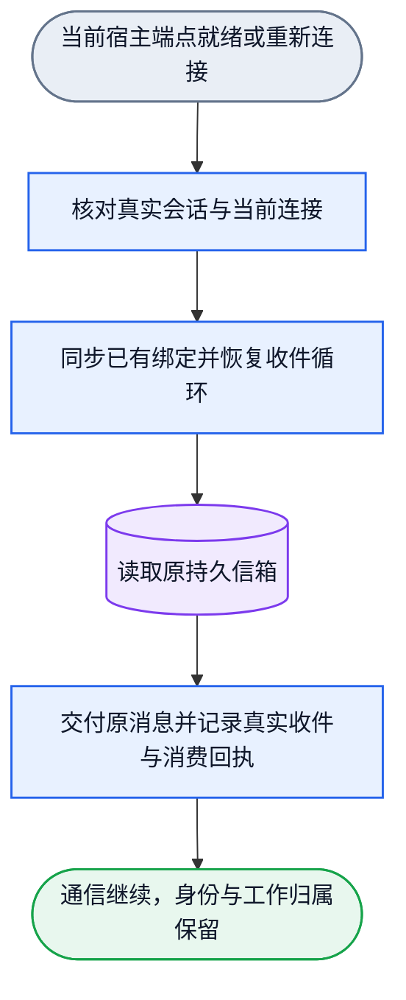

# 绑定与通信恢复生命周期

状态：候选设计。图与 gate 通过只证明模型闭合，运行验收另记任务证据。
机器图：[collab-binding-lifecycle.graph.json](../dagpipe/collab-binding-lifecycle.graph.json)。

Collab 持久身份是工作归属的真源。宿主提供当前会话与通信端点事实。
gateway runtime UUID 是当前连接地址，不是 Collab runtime identity。
连接地址变化须更新已有绑定，不能注销工作者后重新注册。

DSH gateway 仅在 `unknown-agent` 时明确表示当前 worker 缺席。收敛 owner
退役这条当前路由并增加无端点的绑定代际，同时保留 worker、名字、任务和
持久消息。该调用以 `retired` 结束，后续维护不再选择这条绑定。
`unknown-runtime`、超时、畸形回复和其他不确定结果不是缺席，保留 pending
供下一次独立维护调用收敛。

## Collab：读取与收敛

每次启动、当前事实更新或既有维护 tick 是一次收敛调用。
失败结果只影响所属绑定。下一次调用继续处理，不构造 DAG 回边。

能力判定只属于当前已提交渠道。其他渠道的能力不适用，不要求 peer 补报。
Desktop 声明文件缺失不等于原生能力丢失：后台只读检查已验证的原绑定，
原端点仍可读则保持就绪；已知能力实际不可用时，才提示该 Desktop peer 更新声明。
未验证的能力保持未知，不推断丢失。不安全、范围不符或损坏声明保留明确错误。
普通身份恢复只读当前精确 session/thread 绑定，不以端点在线或重新验证通信为前提。

```mermaid
flowchart TD
  S([启动、绑定提交或维护事件]):::boundary --> R[(读取持久身份与当前绑定]):::data
  R --> F[核对同会话的宿主端点事实]:::action
  F --> C{事实是否变化}:::decision
  C -->|变化| U[沿原 owner 更新绑定与订阅代际]:::action
  C -->|未变| A[恢复当前适配器收件能力]:::action
  U --> A
  A --> D{收件能力结果}:::decision
  D -->|明确 unknown-agent| X[退役当前路由并保留身份与持久消息]:::action
  D -->|就绪、pending 或错误| E([输出就绪、待恢复、已退役或明确错误]):::boundary
  X --> E
  classDef boundary fill:#E9EEF5,stroke:#64748B,color:#0F172A,stroke-width:1.5px
  classDef action fill:#E8F1FF,stroke:#2563EB,color:#0F172A,stroke-width:1.5px
  classDef decision fill:#FFF4CC,stroke:#D97706,color:#0F172A,stroke-width:1.5px
  classDef data fill:#F1EAFE,stroke:#7C3AED,color:#0F172A,stroke-width:1.5px
```

## 宿主适配器：重连与收件

当前运行态只打开 host state root 下的 central project/app 数据空间。
旧项目本地 `.agent-collab/server` 数据按存储版本隔离，保留文件但不导入或重放。
旧 route 的存储位置只更新为 current central owner，不复制旧数据。
当前中央空间的身份、消息和任务保持；中央 journal 损坏仍明确失败。

DSH gateway 接受 Collab 已提交的精确身份，恢复唯一 canonical Poll 循环。
Desktop bridge 按宿主 runtime 共享。公开 CLI 自动登记当前 session/thread，
bridge 经 native read_thread 核对真实 thread 与 canonical cwd 后发布 scoped 声明。
新聊天不需要先调用 MCP。服务调用使用明确关联 ID，不冒充 agent 执行 turn。
MCP wrapper 退出不停止共享服务；服务生命周期跟随 Desktop host pipe。
恢复不要求 agent 再执行 context，不把持久消息的 preview 当作正文投递。



## 重启依赖

| 发生的动作 | 其他组件需要做什么 | 不需要做什么 |
|---|---|---|
| Collab 重启 | gateway Poll 自动重连；Collab 恢复持久绑定和订阅 | 不重启 gateway、bridge、DSH、Desktop 或 tmux |
| gateway 重启，连接 UUID 未变 | 从本地缓存及 Collab 真源恢复接收循环 | 不重新 Register，不要求 agent 恢复 |
| gateway 重启，连接 UUID 变化 | 宿主核实当前 session，更新原绑定端点与代际，停止旧地址投递 | 不从旧 UUID 推导新 UUID，不注销身份 |
| bridge 重启或端点变化 | 共享服务恢复持久 session/thread 绑定，经 native 核实后发布并同步入口 | 不要求 agent 调 MCP 或重注册，不重启 Desktop |
| 端点暂不可用或先后启动 | 保持原身份和消息，按既有维护机制继续收敛 | 不把不可达当成身份丢失，不阻断其他绑定 |
| gateway 明确返回 `unknown-agent` | 退役当前路由并增加空端点代际；worker、名字、任务和持久消息保留 | 不把确定缺席当作暂时断线继续重试；不删除历史 |
| 显式换绑 | 读取当前宿主事实，沿同一 owner 更新原绑定 | 不调用 `worker close --self` 或 `UnregisterSelf` |

名字、master/peer、任务、未读消息及已消费历史在恢复中保持。
实际 session 续接按既有名字交接合同处理；不能只凭名字认领外部会话。
重启服务由其原 owner 管理。Collab 不拥有 tmux server 或宿主 pane 的生命周期。
