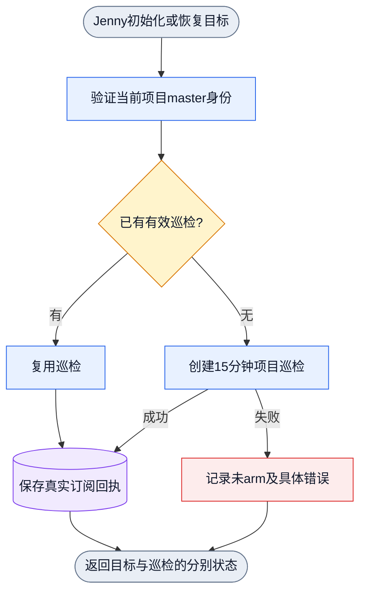
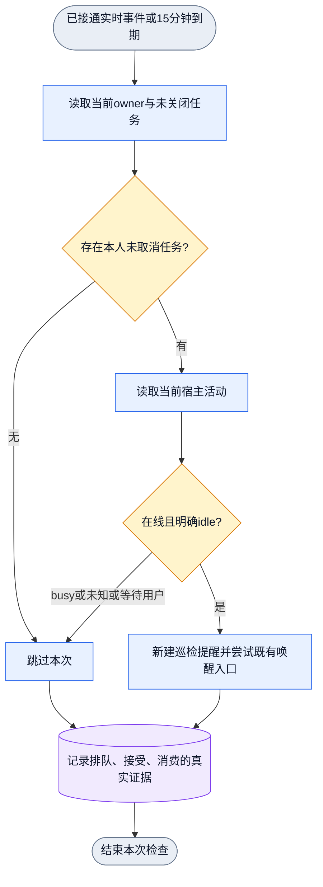
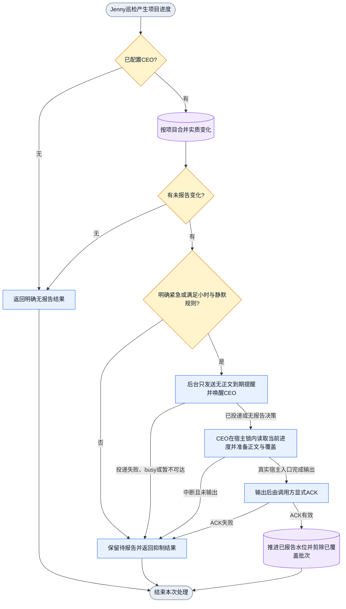

# Collab board 巡检与 CEO 进度汇报

状态：2026-10-25 用户确认需求；设计与实现验收进行中。本文是产品设计契约，
不证明已安装或 live。具体审计版本、参与者名字与个人偏好样例留在本轮独占
运行观察记录，不写入通用产品契约。

## 目标与权威需求

本轮用户依次要求：

> 重新测试基础状态。刚才 rcc 断线了。
> 如果 peer 持有 board 任务，但是现在是 idle，理论上应该唤醒，peer 可以取消这个订阅。
> skill 要说明这唤醒可以被 peer 取消，并且告知什么时候，如何取消。
> 如果能实时感知，实时通知，如果不行，默认 15 分钟唤醒一次，如果对方在忙就跳过。
> Jenny 在有 CEO 的情况下巡检还需要报告项目进度，CEO 收到项目进度以后要去重报告，
> 如果不是紧急情况，一个小时报告一次，并且设置静默时间，默认北京时间 0-8 点不报告。
> CEO 需要有用户喜好沉淀和风格习惯沉淀，默认加入它的 AGents.md 和 skills。
> 整体落盘设计文档，然后开始实现，你做编排，gcm worker 做实现。

用户另明确：每个项目的 Jenny 承担 worker 巡检责任，本人 longhorizon 初始化后默认
arm；每次巡检提醒必须检查 worker 是否 idle。项目 `.appsdk/requirements.json`
中的受影响有效约束继续适用，不修改旧需求来迁就实现。

## 已观察事实与缺口

2026-10-25 05:54 America/Los_Angeles 附近的只读审计是实现前的观察基线，不是
当前运行态证明，也不证明本轮改动已安装或 live。具体安装版本、参与者名字、
绑定异常与 workspace 现状只保留在本轮运行观察记录中。

当时确认的通用事实：

- Desktop native 状态读取可区分活动与空闲；Collab desktop bridge 的读取结果不等于
  常驻巡检已接通。DSH 的 runtime/agent 状态可读，旧绑定不可观测不等于整个 DSH
  不可用。tmux 只提供界面观测，不是原生 turn 状态事件。
- 当时没有公开的独立巡检取消入口。取消 board 巡检须由专门入口实现，不能借关闭
  未完任务、取消整个 goal 或关闭基本 direct-message 接收替代。
- 全局 CEO grant 指向某个用户工作区；本任务不接管 CEO。新增默认内容必须保留用户
  已有文件与规则。

现有注册、订阅、投递与消费 DAG 可复用；实现前缺少从 board 持有关系、宿主 idle 到
继续请求，以及项目进度到 CEO 汇总和用户报告的闭合路径。该缺口已由本文件与
`docs/dagpipe/` 对应机器图补正，当前实现与验收状态按文末边界单独判定。

## 状态与巡检

存活与活动分开。存活为 online/cold/offline/unknown；活动为 busy/idle/
waiting_user/unknown。任务板是任务归属真源；active_task 单字段不替代完整 board。

持有未关闭任务、当前 idle、本人巡检未取消时，唤醒任务 owner 继续推理。daemon
不预判业务下一步 ready；peer 自行复核真实依赖、权限、阻塞和下一步。唤醒不授予
额外业务权限，不证明任务完成。master 和 peer 使用同一基础语义。

支持且接通实时状态事件时及时通知；不支持时默认每 15 分钟检查一次，busy 时跳过
本次，不排队补发。unknown、offline、cold 保留具体缺口；waiting_user 不自动确认。
实时与定时共用 owner、取消状态和投递逻辑。相同实时事件合并；每次到期的 15 分钟
检查是新的巡检机会。旧提醒已接受但未消费时，不能永久挡住后续巡检。保留旧投递
的真实回执，不重放结果不确定的旧消息；新的巡检使用新的提醒。

peer 可自行取消其 board 巡检，无需结束任务或向 master 重复申请。等待用户、真实
外部依赖、用户暂停或不需要自动继续时，记录取消原因与恢复条件。仅取消本人对应
巡检；保留任务、其他 owner、其他订阅及基本 direct-message。取消后，恢复注册、
replay、周期检查或 Jenny 巡检不能重新 arm 同范围；本人明确恢复后才恢复。
具体 CLI 由 Planner 选择既有接口的最小扩展，必须在 Skill 写出可用命令与回执。

Jenny 初始化或恢复本人 longhorizon 后默认 arm 本项目巡检，复用有效调度。不凭
longhorizon 只读投影宣称已 arm。后台调度不依赖 Jenny 正在推理。每次提醒都要求
Jenny 检查 worker 活动、board 持有关系及取消状态。有 CEO 时回报本项目进度。

## CEO 汇总与用户报告

Jenny 使用现有项目 master → CEO 路由报告项目事实：目标、已验收结果、剩余工作、
具体阻塞、下一动作及需要用户决定的事项。无 CEO 时不假造接收者；继续本项目工作。

CEO 按项目与业务进度去重，合并同一项目重复进度，保留最新有意义变化。普通心跳、
重复文本、更新时间或仅 ACK 不产生用户报告。复用现有 typed 状态，不加 hash 清单。

后台到期调度只发送无正文、可持久的提醒并尝试 native CEO 唤醒，不生成正文、不
预绑定报告批次。CEO 收到提醒后在宿主锁内读取当前进度，按报告决策选择内容并
准备与该选择一致的精确正文与覆盖。只有真实宿主用户入口完成输出后，调用方才
显式 ACK 推进已报告水位。读取、准备、flush、queued、accepted、consumed 都
不等于用户报告已确认；旧批次 ACK 不能清除新进度，也不清除 canonical urgent。

非紧急进度默认每小时至多向用户汇报一次，统一汇总各项目；没有新增内容则不报告。
静默窗口可配置，默认 Asia/Shanghai 每日 00:00（含）至 08:00（不含）。静默期仍
接收、去重、积累项目进度，08:00 后在允许报告时合并为一次，不逐条补发。
重启后保留待汇总内容、最近报告时间与取消/静默状态，不靠进程内计时避开限制。

紧急由明确的 typed 紧急性或用户明确指定决定，可立即报告并越过普通小时/静默限制；
普通 P1 阻塞不自动升级紧急。报告范围与紧急判定在 CLI/合同中明确，不能由正文
关键词偷偷升级。发送接受、用户入口实际收到、阅读分别记录，不伪造已读。

## CEO 用户偏好与风格

沿当前全局 CEO grant 的 workspace 初始化默认 CEO 指引，默认纳入其 AGENTS.md 与
已存在的中央 Collab Skill；不新建第二套 CEO Skill。只增补本产品负责的必要段落，
保留用户内容，不用文件存在证明配置生效。

稳定用户偏好以用户既有 USER/preferences 真源和当前全局 CEO grant 的 workspace
为准，默认引用并遵循。明确确认的新偏好与风格习惯在其唯一 owner 沉淀，CEO 指引
给出入口与维护职责。不凭模型推断记录隐私、秘密或一次情绪，不重复复制跨项目规则。
本轮已知表达偏好：中文、结论先行、证据明确、短句、区分完成与未验证、避免重复
报告。不得把所有项目状态写进用户偏好。

## 业务 DAG（设计态）

### 初始化到已 arm

### 单次 board 巡检

### 项目进度到用户报告

每次触发是一张有终点的 DAG；周期与后续事件在图外重新触发，不在图中造循环。
图展示业务语义。机器图是 `docs/dagpipe/collab-ceo-coordination.graph.json`，
当前版本 `1.2.0`，九阶段单入口单出口。

后台提醒本身没有正文，也没有预绑定批次。CEO 读取的是提醒到达时的当前进度，
因此提醒与正文之间不存在固定批次对应关系；ACK 只推进实际覆盖的 revision，
受当前 revision 上限约束，且不清除 canonical urgent。无 CEO、无待报告内容和
抑制分支都携明确无报告结果沿同一出口结束。

## 状态 owner 与实现位置

报告状态与调度的唯一真源是 daemon 的 canonical CEO report state，不是日志、
消息正文或进程内计时。CEO 正文与覆盖由 CEO agent 在宿主锁内按当前进度准备；
用户入口实际输出与显式 ACK 由宿主批次 CLI 承担。三者职责分开，不用
queued/accepted/consumed 代替 user report confirmed。

| 机制 | 当前唯一 owner |
|---|---|
| board 持有关系、按任务取消与 15 分钟巡检策略 | `collab/src/board_patrol_policy.rs`；调度接线在 `collab/src/server/keepalive.rs` |
| 报告时间资格、小时与静默窗口 | `collab/src/ceo_reporting_policy.rs` |
| 进度去重、批次准备、ACK 水位与提醒闸门状态 | `collab/src/ceo_report_state.rs` |
| CEO 授权、工作区与跨项目协调 | `collab/src/server/ceo.rs`、`collab/src/server/ceo_bootstrap.rs` |
| 到期提醒巡逻与 native 唤醒 | `collab/src/server/ceo_report_patrol.rs` |
| 定时触发（每轮调用一次巡逻） | `collab/src/server/mod_parts/part_12.rs` 既有 `spawn_blocking` 定时回调 |
| 状态与持久记录 | `collab/src/server/state.rs`、`collab/src/server/state/` |
| 配置（静默分钟值、间隔） | `collab/src/config.rs` |
| agent 行为与命令入口 | `collab/skills/collab/references/board-idle-patrol.md` 与 `collab/skills/collab/operations.md` |

机器图算子绑定在 `rust/src/dagpipe.rs` 既有设计算子列表，不新增注册框架。

## 实现与验收边界

编排者：本聊天。实现者：独立 `codex exec --profile gcm` worker，使用外置独占
worktree。Planner 与 milestone Reviewer 独立；同一共享模块只有一个写入 owner。
不修改用户主目录脏树，不触碰他人工作树，不操作全局 daemon 或 tmux 生命周期。

必需验收：idle 持有任务唤醒；busy 跳过且不补发；实时事件去重；15 分钟兜底；
取消后任务与基本收件保留且不自动 rearm；Jenny 默认 arm 与提醒内容；无 CEO 分支；
Jenny→CEO 进度交付；同进度不重复报告；小时限制；北京时间 00/08 点边界与跨日；
静默累积一次汇总；明确紧急例外；replay 保持状态；CEO 指引初始化保留用户内容。

先绑定具体失败模式和红测，再修改唯一 owner。真实 CLI/公开接口黑盒贯穿持久状态
与可观测副作用；单测辅助定位。候选构建、静态图和测试通过只证明候选范围，不等于
线上部署。正式安装可按项目授权进行，但全局 Collab daemon 由用户拥有并激活；
未获得 live 结果时明确保留未验证项。
