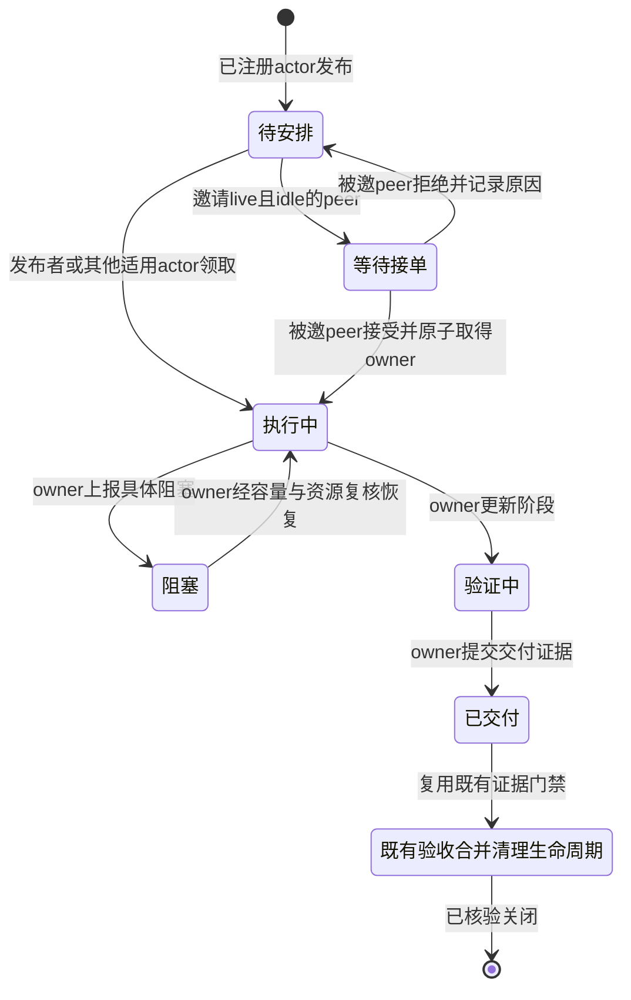

# Collab 执行任务板 v1

显示名增量：显式名称由 daemon 的 worker-name 控制记录持久化，默认值不另存。
当前 master 默认 `Jenny`，普通 tmux peer 默认 pane 标识；用户覆盖名随身份保留，
`collab worker name --reset` 清除覆盖。名称不参与身份、收件人解析或任务归属。
context、who、worker/master status、board 与 dashboard 共用同一名称投影。
公共 child 执行任务先投影到 parent，再取 parent 显示名，私有 child 名称不公开。
Subworker 日常沿 parent/master 派发，board claim 保留为可选能力。

状态：源码、作者回归与正式安装验收已完成；整体 Review 和远端集成待收口。
验证记录见项目 note.md 的 board queue 与显示名条目，以及该条目引用的独占运行记录。

## 用户已确认的契约

- 任务板只显示未关闭任务；`closed`、`cancelled` 后从列表移除，不删除任务历史。`merged` 在关闭前继续显示。
- 独立 AppSDK Web 任务板，不依赖 DSH GUI。
- master、普通 peer 和已绑定 managed child 都可发布待领取工作；普通 peer 可领取自己或他人发布的公开工作。
- master 仍可邀请 idle ordinary peer；邀请、接受、拒绝和撤回保留原事务语义。managed child 不进入邀请目标集合。
- 每个执行 actor 同时只执行一项 ready 工作，但可保留多项 pending、blocked 或 waiting 责任。blocked/waiting 不释放资源或收口义务。
- owner 更新自己的进度；发布者不因此拥有已接单 peer 的进度写权。
- managed child 是 parent 的内部执行细节；child 可用自己的认证身份查看所属私有队列、发布私有后续工作并领取公开工作。公共任务板、成员列表和公开 DTO 不暴露 child ID、私有任务或内部引用。
- 公开任务被 child 领取后仍在公共板显示；外部 owner 显示所属 parent，TaskRec.owner 保持实际 child。parent 承担协调和收口责任，但不因此取得改写 child 生命周期的权限。
- 本轮不扩展 spawn CLI。Codex TUI 是首要真实入口，DSH 复用同一协议；不修改另一个在研 worktree 或网关仓库。

## 入口与唯一 owner

Collab daemon 继续持有任务、身份、角色、邮箱和消费回执的唯一真源。CLI/MCP 与 DSH 是适配消费者，不复制状态机。Web 服务仅查询 daemon 当前项目的任务板投影，不读取 journal/日志重建控制状态，不自动 init/register/promote/up/down。

第一版 Web 是共享观察面，只读取匿名公共投影。执行者通过 CLI/MCP 写入，浏览器不冒充 master/peer，不用下拉选择身份获取代理写权。`collab board show` 使用当前已注册身份，可附带自己的私有任务和所属 child 的私有任务；dashboard 继续使用无 actor 的公共读路径。真实 actor 来自原有认证注册路径。

现有 TaskRec 是唯一执行任务记录；新增 task board detail 仅持有标题、描述、交付/测试条件、版本及邀请信息，不再建第二套任务状态、owner 或进度字段。现有生命周期和证据继续使用 TaskRec/TaskLifecycleRecord/CleanupReceipt。

## 最小增量

1. `collab board show`：认证读取。未关闭公共任务对 master/ordinary peer 可见；发布者是 managed child 的未关闭任务保持私有，只对 child 自身及其所属 parent 可见。关闭与取消任务不再列出，历史仍可通过 `collab task status <id>` 查询。公开投影不输出 managed 成员或 child ID，公开任务的实际 child owner 投影为 parent。暴露 status、外部 owner、publisher、priority、next_step、更新时间、交付/review/integration/cleanup证据；输出不得泄漏 token、host credential、transport endpoint。
2. `collab board publish <id>`：任意已注册 master、ordinary peer 或 managed child；必须提交标题、描述、交付条件和测试条件。TaskRec 在 pending，owner/created_by 暂为发布者；pending 不占执行产能、不订阅执行 keepalive。普通 actor 发布为 public，managed child 发布为 private。
3. `collab board invite <id> --to <peer> --expected-revision <n>`：仅 live master，任务仍待安排。只能 ordinary peer。外部 presence 读证明 live/idle，锁内再次检查身份 binding 未变、无 active task、无其他有效邀请。邀请不转移 owner，不意味着开始执行。
4. `collab board respond <id> --accept|--decline --expected-revision <n>`：仅当前被邀请 peer。accept 再检查任务占用，原子转移 TaskRec.owner 并进入 working；decline 清除邀请，回待安排，保留原因和审计事件。拒绝不可取消原有任务。
5. `collab board update <id> --expected-revision <n> --status <allowed> --next <text>`：仅 owner，复用原有任务更新和状态门禁。现有 CLI/MCP 更新仍兼容；所有相关 TaskCreated/TaskUpdated 事件都会使 board revision 递增，因此旧界面更新可检测冲突。不得允许直接写 delivered/accepted/merged/closed 绕过证据。
6. `collab board claim <id> --expected-revision <n>`：任意已注册 actor 可领取 public pending 任务；private pending 任务只允许其发布者领取。锁内核对 revision、pending 状态、无执行资源、执行容量和 runtime binding，一次原子完成 owner 转移及 pending→working。`created_by` 不变，自发布自领取走同一入口。
7. `collab dashboard --port <port>`：只绑定 127.0.0.1；启动于显式当前项目。随机 capability 仅作为浏览器读板凭证，不授予 actor 写权。通过 URL fragment 传入，浏览器内存保存、用 header 发送，服务器不从 query/log 中取凭据。静态资源不含状态、token；daemon 不可达显示显式错误和旧数据标记，而非空任务假成功。使用正式 HTTP 库，不手写 HTTP parser。浏览器每 2 秒读取最新公共投影；第一版明确采用轮询，不宣称事件推送。

独立 peer 继续 `collab task register/update/deliver/...`；已有任务无需迁移，不强制 master 批准。可选的标题/条件可由 owner 通过 board detail 编辑补齐。公共板不提供 cancel/reassign/force-close按钮。

## 状态机

普通 peer 或 managed child 发布后保持待安排，直到发布者自己或其他适用 actor 领取。独立 peer 仍可 `task register` 直接登记自己的执行任务，不创建第二份 board 任务。上述 graph 只治理一次操作请求，不把状态机循环误建为 DAG 环。失败、旧版本、身份不匹配、busy、invited、working 或资源冲突均无业务状态修改；邀请目标失联后由 master 显式撤回邀请，不自动接管或重派；owner 仍保留原任务。撤回邀请只允许等待接单状态，并以版本保护，不影响已接受任务。

## 通信闭环

仍走现有 Send/Inbox/Recv/ACK与App Server adapter。正文不进入控制metadata。派单邀请持久化任务变更和通知outbox在同一daemon提交，通知失败不撤销持久邀请、不报告已接受；响应携带任务和消息标识及通知状态。恢复不新增任意自动重试链。接受/拒绝是任务命令，不从消息正文猜。普通进度只更新板，不唤醒全员。邀请通知只面向目标peer；拒绝与交付通知面向发布master（已有交付不自动发消息的行为不暗改，可显式sendmessage）。没有可用route显式返回repair_required，不静默mailbox-only成功。

## DSH 边界

已读在研网关 `docs/COLLAB-DSH-CHANNEL-DESIGN.md`：其通道正在对齐message_id去重和enabled门禁，未把通道完整live验收当成既成事实。AppSDK main 已有TransportKind::Dsh。本期board不依据transport名称授予角色，不重写DshCandidate、admit、notify或网关队列。DSH插件可查询board、按认证peer调用相同命令；DSH未就绪不是Codex/Web主线的fallback或阻塞。验收中如无真实DSH入口，明确DSH live未验证。

## 变更边界

允许：collab/src 的协议、任务board模块、projection/reducer、CLI/MCP和dashboard入口；collab内静态web资源与测试；相关图、文档、skill工具说明。
禁止：appsdk治理语义、dagpipe内部、DSH原生agentteams、网关仓库、他人worktree、全局插件安装、peer/subworker spawn治理变更。

必须审计新状态在 task_resource_active/task_claim_held、keepalive、scheduler eligibility、compaction/replay、task accept provenance、scope admission中的影响。不能把本期邀请与旧scheduler任务识别成两套接单真源：保留合法来源区别，但共享最终owner验收和工作开始门禁。

具体并发准入：daemon 中的执行容量判定是唯一共享 helper，scheduler 候选选择、scheduler 锁内重查、board invite、claim、邀请接受/旧 accept 和 blocked→working 恢复调用同一规则。执行槽由当前 assigned/working/verifying/reviewed/delivered/accepted/rework 等工作占用；pending、publisher-owned invited、blocked 和 waiting 不占执行槽，但仍由 `keepalive::unfinished`、资源和收口投影保留责任。invited 任务对目标 peer 仍是容量预留。不得新增 busy 布尔、第二队列或 reservation 表。

claim、邀请接受和 blocked→working 恢复都在同一锁内排除当前任务自身后重查容量。任务 A blocked 时领取 B 后，A 的 blocker 解除也不得直接恢复；B 结束时才能恢复 A。task wait 仍只表示两个不同 owner 的资源冲突，blocked/waiting 不释放 worktree、feature claim 或收尾义务。

普通peer派单唯一入口：新派单只通过board publish/invite的完整交付/测试条件及expected-revision进入。旧SchedulerDispatch的输入缺少这些必要typed字段；选择ordinary peer后明确返回BOARD_INVITATION_REQUIRED，要求调用者使用board工具，不再创建assigned任务/提前转移owner，也不静默转去managed fallback。这是明确的旧接口行为调整，不伪造delivery/test条件或从body解析控制字段。已有scheduler request_id回执仍按原记录查询/恢复，不重新派单。既有普通peer的TaskAccept对board invitation必须转入同一accept事务；CLI补充expected-revision以保护新邀请（缺失则返回明确用法错误）。存量非board scheduler assigned保持历史owner归属，但accept也必须共用最终工作开始门禁：验证来源、scope、当前binding以及排除当前任务后的其他未收口责任，不能接受busy peer。存量普通peer可用新增TaskDecline命令拒绝assigned：只在尚未开始且无worktree/claim/证据时原子转owner回created_by并进入pending/记录拒绝；若已预绑资源则明确拒绝且要求发布者撤回资源义务，不暗中改资源owner。managed分支保留原有私有语义，不改spawn/parent或把子执行者输出到公共投影。

board待安排/等待接单新增状态必须在task_resource_active、task_claim_held、worker active_task和keepalive责任投影中排除；邀请占用只来自上述helper。board respond/TaskAccept只是同一事务的适配入口，不各维护状态。对已开始执行的board任务，进度更新复用既有handle_task_update，不允许publisher通过task update跳过accept。版本比较与任务更新必须在同一次锁内完成，不能check后unlock再调用旧handler。

资源转移门禁：pending/invited任务不能通过旧TaskRelocate/TaskWait/TaskDeliver/TaskReview/TaskIntegrated/TaskClose入口获得worktree、claim或生命周期证据；TaskUpdate不能直接进入working或任何执行阶段。publish/invite输入不接受worktree/branch/base_commit。accept必须验证该任务确无WorktreeBinding和生命周期/资源义务，之后仅owner可以按既有流程创建worktree。旧scheduler对ordinary peer预绑参数显式拒绝并要求accept后由owner绑定；managed路径不变。本期不做资源迁移。

版本/恢复真源：新增typed BoardTaskDetails记录title/description/conditions、revision、public_visibility、当前邀请(binding_id及endpoint_generation)、拒绝记录，不镜像TaskRec.owner/status/next_step。BoardDetailsChanged显式持久化完整记录；TaskCreated/TaskUpdated/TaskLifecycleUpdated/CleanupVerified通过reducer让已有detail的revision单调增加，且legacy无detail的任务首次创建/接入时生成初值。snapshot/compaction在任务和资源事件之后输出各detail的最终完整BoardDetailsChanged，恢复不重新计数。邀请及唯一message_id同一事务持久化，outbox/accepted/consumed仍由原Message事件持有；不重建另一个通知状态表。accept和withdraw锁内核对TaskRec状态、邀请目标、当前binding_id/generation、expected_revision；重新绑定导致旧邀请明确stale，master可withdraw再invite，不自动换目标。测试多次更新、待邀、拒邀/撤回后compact/down/up，owner/revision/邀请/预留/投递与消费状态等价。

可见性真源：每个任务的 public_visibility 作为 typed board detail 随创建记录，普通 master/peer 创建为 public，managed child 创建为 private；legacy replay 只在创建事件当时可证明 ordinary actor、且不存在 managed 来源时赋 public，不能把未知身份默认公开。WorkerClosed 不删除已经持久的 task visibility。managed child 登记事件只把 child 自己发布的任务设为 private，不得隐藏此前由普通公共 actor 发布、后来由 child 领取的公开任务。compaction 保存最终 detail 值，不能按当前 roster 重新计算 public。

认证查询按 actor 过滤：public 任务对普通 actor 可见；private 任务仅 actual owner 或其所属 parent 可见。公共 dashboard 只取 public 任务，并把 managed owner 投影为持久 parent，未知 parent 时不回退输出 child ID。公共 DTO 白名单只含公开 actor、公开 task 及其公开引用，不透传 WorkerRec、role_brief、私有 wait 引用或嵌入对象。证据只显示 owner 主动提交的文本；若指向隐藏任务仅显示“内部依赖”。测试普通 peer 退场后 public task 保留、private child task 对 child/parent 可见但公共投影隐藏、public task 被 child 领取后仍可见、未知历史 fail-closed、compact/restart 保持 owner/publisher/revision/visibility 等价。

## 可重复验收

开发黑盒：真实 collab CLI+daemon 与外部 AppServer fixture 贯穿公开协议（fixture 不冒充真实 TUI）。覆盖 master/peer/managed 发布、public/private 可见性、自发布自领取、master/peer 并发 claim、stale/非 pending 拒绝、blocked 后续领与容量恢复、邀请 accept/decline 竞争、daemon 重启恢复、隐藏 managed 内部引用、scope 隔离、通知接受不冒充消费、existing deliver/review/integrated/close 门禁。MCP claim 参数测试与 CLI 等价；安装后 replay 使用 `COLLAB_TEST_BINARY` 运行同一 fixture。

真实验收：隔离Collab状态目录、独占AppServer endpoint，两台Codex TUI启动/注册；用户授权master晋升用于隔离测试项目；经Collab发送双向唯一marker，在目标TUI执行并生成消息绑定消费回执；CLI更新owner进度，浏览器读取相同任务。busy peer邀请拒绝，idle peer接单/拒绝都覆盖；daemon down/up后读取同一任务/邀请/回执。模型/凭据不可用则live节点不通过，保留精确错误，不用fixture替代。

浏览器验收：安装/稳定入口的dashboard，真实浏览器打开capability URL；任务列、成员、状态、owner、证据和阻塞一致；CLI变更可见；无凭证API拒绝、跨源/Host拒绝、恶意任务标题作为文本显示、daemon断开显示错误、托管子执行者不可见。用已安装camo工具，记录实际URL和截图；不启动替换DSH GUI服务器。

作者完成受影响测试和适用的安装、运行与黑盒验收后，在重大 milestone 提交/集成边界进行一次独立整体 review。按现行交付合同组合最新 origin/main，仅重验受影响路径，复用仍有效的证据，再集成、push、核对远端并清理本任务 worktree 和隔离进程。

## 能力确认与未完成

已确认：外置盘存在；独占worktree clean且等于最新origin/main；Cargo/Codex/tmux/dagpipe/camo安装；现有通信fixture测试可复用；AppServer真实双TUI路径有历史证据，但本次必须重新验证。
已确认基础入口：当前Codex0.160.0通过本轮隔离AppServer unix endpoint接入真实TUI，显式--cd测试目录后模型gpt-6.1-sol响应DASHBOARD_PEER_A_READY；本地OAuth已登录，未修改全局provider；camo实际创建/关闭本轮独占tab成功（不停止persistent profile）；axum0.8.8可从registry取得；现有Collab公开通信fixture通过3/3；dagpipe图校验通过。独立设计复审ba1f22ec已PASS五项修订，准入依据见run notes。

这些历史记录只确认当时入口、工具和依赖可用，不代表本次新功能或完整通信 live 已通过。本次分别记录源码测试、适用的真实收发与消费、浏览器任务板、正式安装及 runtime 验收；未变路径复用有效证据，受影响路径补验。共享服务维护沿当前已有授权与正式入口执行。
