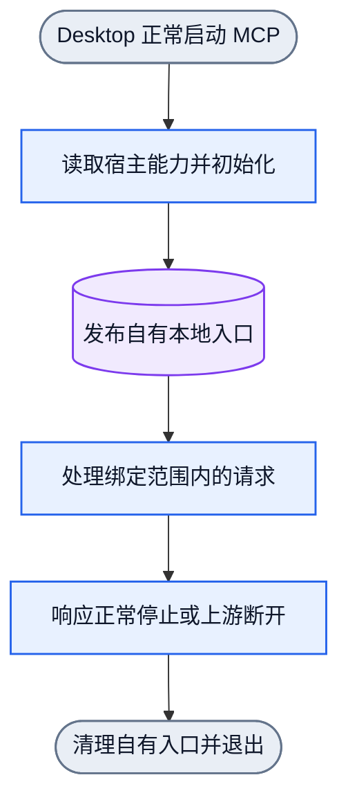
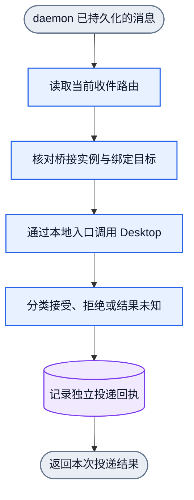

# Collab Desktop bridge

状态：产品接入设计与候选实现。基础通信和一次真实 idle 唤醒已有证据；正式安装、
MCP 配置加载及 Collab daemon 组合验收必须另行报告。

Desktop 的当前聊天不一定由独立 managed AppServer 承载。对那个 AppServer 的
`thread not found` 或 `notLoaded`，不能推导 Desktop 官方工具不能访问聊天。
本增量使用正常 Desktop-owned MCP bridge。daemon 只连接 bridge 的本地 UDS；
bridge 连接宿主提供的 app-tools pipe，并调用实际公布的原生工具。

实验已验证普通 tmux 脚本经正常受管前台 bridge，向当前聊天投递并收到实际 ACK；
随后在聊天 idle、原 turn completed 后发送第二条消息，实际启动新 turn 并继续工作。
这些事实见任务记录 `bridge-proof-20261023`。没有使用 detached keeper、忽略终止
或伪造 `cli-turn`。正式服务沿相同正常生命周期实现。

## 身份与上下文

名字承载工作，agent sessionID 是执行载体。bridge UDS、tools pipe 和 thread
定位通信，不是身份。Desktop transport 与 AppServer WebSocket transport 分开。
原有 tmux、TUI 和 DSH 不因此改变协议或恢复 gate。

真实 caller thread/turn 来自本次 MCP `tools/call` 的 executor metadata。
官方 MCP 接口从 `request.params._meta` 读取 `x-codex-turn-metadata` 或对应
`openai/threadId`、`openai/turnId` 字段。不能以普通工具 arguments 或历史日志
替代这个来源。真实原始发起 turn 可以随已授权请求保留，不能伪装成新的活动 turn。
通知 target 则由 Collab 当前注册收件 route 决定，不能由外部发送者指定上游身份。

bridge 只开放已绑定收件范围所需的投递与观测操作。它不提供通用 `tools/call`
转发器，也不为身份恢复新增一套宿主 service-token 框架。缺真实来源、未登记目标
和宿主拒绝应在对应边界显式返回。

## 正常服务生命周期



运行中的多请求由服务事件循环处理。图不为轮询或重试造回边。
stdin 结束、正常信号或上游关闭时，服务退出或明确失效。只清理自己创建的 socket，
不逃离宿主管理，不忽略终止，不拥有 Collab daemon 或 tmux 的生命周期。
正式 runtime 目录位于用户私有持久根下，不把生产 UDS 固定到临时目录。

机器图：[服务生命周期](../dagpipe/collab-desktop-bridge-service.graph.json)。

## 一次消息投递



所有结果汇入一个 typed 出口。只有明确的官方成功回执才能标为 transport 接受。
请求发出后超时或断开保留结果未知，不自动重发，不切换 AppServer、tmux 或旧 socket。
socket 可连接不等于聊天在线；busy/idle 读取实际原生 thread 状态。

transport 接受、实际新 turn、`recv` 消费和回复是不同事实。消费继续沿
[既有消费图](../dagpipe/collab-notification-consumption.graph.json)，不加入 bridge ACK。
机器图：[Desktop 投递](../dagpipe/collab-desktop-bridge-delivery.graph.json)。

## 验收边界

正式 installer 安装 `~/.cargo/bin/collab-desktop-mcp`。Desktop 的 Collab MCP
入口使用这个正常 stdio launcher，由 Desktop 提供 `CODEX_APP_TOOLS_PIPE_PATH`。
launcher 优先使用宿主 `CODEX_MCP_NODE_PATH`，缺省使用 PATH 中的 Node。配置示例：

```toml
[mcp_servers.collab]
command = "/Users/your-user/.cargo/bin/collab-desktop-mcp"
env_vars = ["CODEX_APP_TOOLS_PIPE_PATH", "CODEX_MCP_NODE_PATH", "CODEX_SESSION_ID", "CODEX_INTERNAL_ORIGINATOR_OVERRIDE"]
```

将示例中的 home 换为实际安装目录。`env_vars` 传递宿主当前提供的值，不能省略。
不要手填 tools pipe、caller thread 或 turn。
这是 bridge 服务的一种正常加载方式，不要求 agent 用 MCP 工具注册或发信。
MCP `collab_context` 可从该次 executor metadata 注入新 bridge；CLI 则接受本次
bridge 的当前受限能力，详见[CLI 用法与当前缺口](../../collab/skills/collab/references/migration-daemon.md#desktop-cli-registration-and-messaging)。
Desktop 身份锚点始终是 agent sessionID，thread 和 socket 不选择身份。
当前默认 CLI 的能力自动发现仍待补齐，不能用文档宣称已经完成。CLI 不拥有
Desktop MCP 的启动，也不会为 CLI 调用另起后台 bridge。

先保留旧候选在 Desktop candidate 上失败的公开入口红测，再验证新分支。
组合验收必须从正式 `context` 和 `collab sendmessage` 进入，取得 durable msg ID、
独立通知结果、Desktop 新 turn、实际消费与回复。停止自有 bridge 后，通知应明确
失败，消息与身份保持；未登记目标和伪造 caller 输入不能到达其他聊天。

源码、候选 fake-host 测试、正式安装、当前 MCP/daemon 加载及真实 Desktop
结果分别报告。临时实验的成功不能替代正式 Collab 组合验收。
