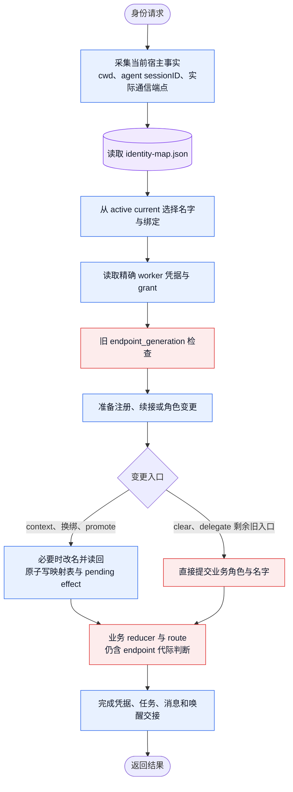

# 当前恢复路径与待删逻辑

本文件记录 2026-11-05 Jason 最新要求后的当前实现。它不是完成声明。执行顺序：当前图 → 删除退役逻辑 → 重画目标图 → 补齐新逻辑。统一映射设计仍见 collab-unified-identity-map.md；其中 endpoint 代际相关表述以本轮修订为准。

待删对象：

- endpoint_generation 参与身份恢复、绑定选择、旧请求门禁及 reducer/route 高低排序的活跃逻辑。它不能成为表 current 之外的第二权威源，也不能换名为另一套 epoch/fence。
- direct MasterPromote 的剩余旧实现，以及 MasterClear/Delegate 绕过唯一映射 owner 的提交入口。
- 测试中仅维持上述退役接口的旧恢复 fixture；有效鉴权、数据正确性和公开行为保障保留并转到唯一表入口。

保留对象：精确 worker/token/project/app 鉴权，真实 grant owner，当前映射的原子发布及必要待办，任务/未消费消息/goal/唤醒交接，四宿主既有通信适配器。iTerm 布局与 tmux 生命周期不属于本任务。

目标图须在删除边界完成后另行落盘；不能通过改当前图，把尚存旧路径描述成已经删除。
