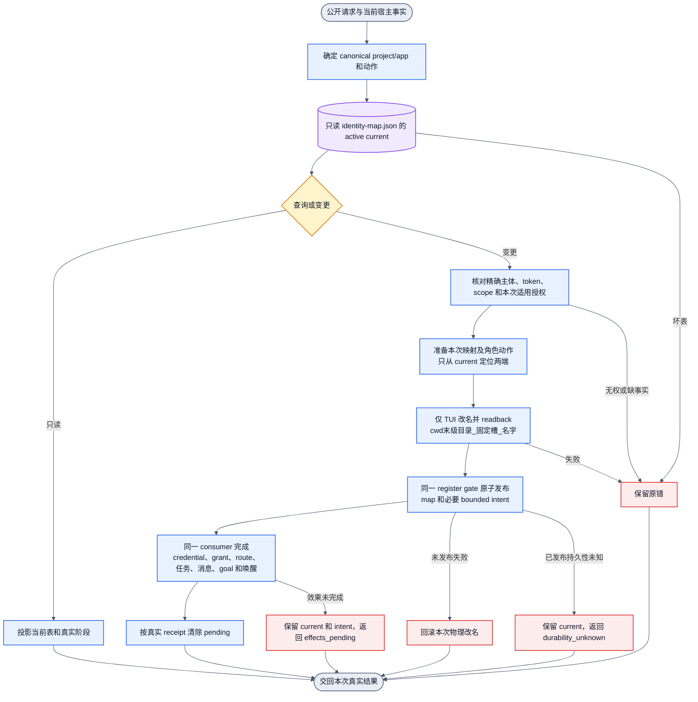

# 退役旧逻辑后的唯一恢复路径

状态：实现中。当前删除边界已完成；此图是接线合同，不是行为验收。
删除前图见 [当前路径记录](collab-endpoint-retirement-current.md)。

已删除活跃 endpoint generation 字段、排序、比较、自动 grant 撤销/重发，
以及 general dispatch 的 promote/clear/delegate handler。
改名、注销、binding-control 中的 reducer/history 选择器也已删除。
旧测试还需按实际行为改写。删除边界的编译缺口保存在任务记录
`single-identity-map-20261105/deletion-compile-breakpoints.log`。

当前断点：map 选定端点尚未接回改名；角色命令尚未接回 manager；
Name effect 尚未承载角色动作；注销尚未接回 map-first；receipt 仍调用已删除的
generation helper。补齐这些断点前，候选不得安装。

同一 Name intent 由正常执行和重启恢复共同消费。它只保存已接收动作和授权引用，
不复制 grant，也不以 Jenny 或显示槽授予权限。真 grant resource revision 保留。
没有替代 endpoint epoch、fence 或第二份 current。

| 入口 | 当前事实与授权 | 映射动作 | 同一业务 consumer |
|---|---|---|---|
| 首次注册 | 当前宿主 sessionID 和真实注册资料 | 创建 current；缺表不继承历史 | 真实 Register，首次名字不接走历史工作 |
| 恢复/换绑 | 表选定主体与当前宿主事实 | 同名字更新 sessionID/端点 | 精确凭据、投递、未结任务和消息续接 |
| Promote | 表内 caller、token、本次用户授权 | caller 移到 Jenny，保留 outgoing 普通位置 | 正式 grant owner revoke/grant |
| Clear | 表内 caller、token、本次用户授权 | Jenny 移回可用普通名字 | 正式 owner revoke |
| Delegate | 表内 caller 持真实 master grant；target 同 scope current | Jenny 移给 target；原 holder 回普通名字 | 正式 owner transfer |
| Unregister/close/reset | 表内精确对象及适用责任检查 | 先退役适用 current 并保存必要待办 | 原 owner 清理并回执 |

Desktop 与 DSH 使用相同表和 consumer；它们保留各自通信绑定，不经过 tmux。
previous 只用于本次精确交接。所有表外历史都不能选择身份或否决新授权。

## tm-iterm 共用布局合同

Jason 确认两个资源的不同归属：共同使用 tm-iterm manifest 的固定
`binding_id / tab_id / pane_order / iTerm profile`；identity-map.json 独占身份、
agent sessionID 和恢复。注册只关联已有布局 binding，不重新安排 pane。
名字和角色变化不能改写固定位置。无布局的 Desktop、DSH 和普通 TUI 不要求 iTerm。

Jason 最新约束：只有固定 1 号可以 promote 为 Jenny。其他位置不能 promote，
也不为角色变化移动位置。物理序号跟固定位置，不跟名字池。位置只限制适用的
TUI promote，不授予 master 权限；有效 grant 仍由正式授权 owner 产生。

正常运行时 tm-iterm 只创建缺失 session，不自动改名；agent 注册后由 Collab 改名。
skill 可保留显式批量改名脚本，本次初始化可用它一次；默认命令不能隐式触发。
tm-iterm 的解析必须兼容 Collab 实际 schema_version/slots/effects 及 nested current，
并按固定布局引用关联；不能以解析名字恢复身份，也不能把布局写入者变成身份写入者。
