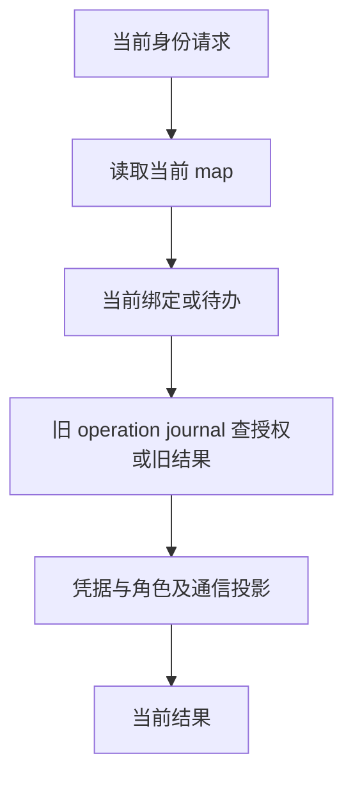
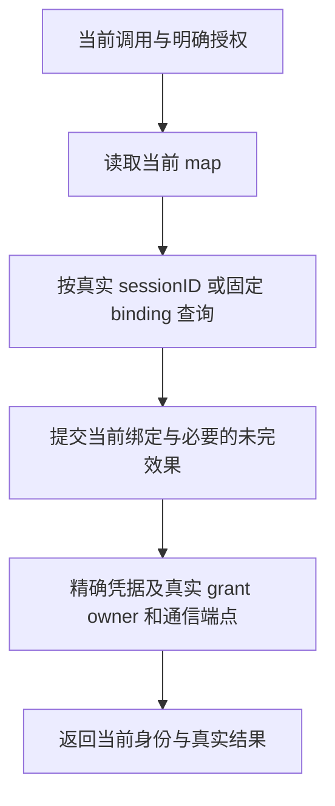

# Collab journal 移除

Jason 于本轮明确：身份只有当前绑定关系，不需要历史；journal全部移除。
本决定覆盖旧设计中身份恢复、迁移或待办消费依赖历史操作记录的部分。

删除前的缺口：

另有刚加入的迁移试验：旧绑定表 → 完整 journal 重放 → 名字别名消解 → 新表。
该试验已删除。它不属于最终恢复路径。

目标：

新建、换绑、换名、角色变化与恢复都走同一个表 owner。
未完效果仅表示这次当前变更尚未完成的具体工作，完成后删除。
旧身份、旧 operation 结果、归档和旧 route 均不生成恢复候选，也不否决新授权。

本次只做一次切换：依据当前公开身份目录、精确凭据、真实 agent sessionID、
tmux 与共享布局 manifest 生成新表。不转换旧绑定历史，不读旧 JSONL。
产品中的旧表 import 命令、解码器及其专属测试已经删除。
旧 `identity-map.migration.json` 不作为激活输入。
最终激活位置为 `~/.collab/identity-map.json`。

任务、消息、真实消费状态由当前业务 owner 保存到 `state.json`。
每次变更只更新最新记录；重启直接读取当前文件。不保存旧版本，不追加变更流水，
不重放事件。Board 保留当前任务、描述、必要证据和关系。消息保留正文及当前
投递、消费状态。独立 bug 系统不在本次修改范围内。
它们不参与身份选择。该边界不是恢复的第二条路径。

本次切换直接生成准确的新身份 map，并保留兼容的当前 Board 任务及证据。
Jason 已允许丢弃旧消息；不再要求完整旧状态导出，也不读取旧 journal。

本文件为删除与实现合同。当前候选已移除journal实现和维护入口；当前状态与
公开行为验收见`collab/docs/verification-map.md`及任务run原始回执。
源码验收不等于main集成、正式安装或用户激活；各阶段分别交回证据。
