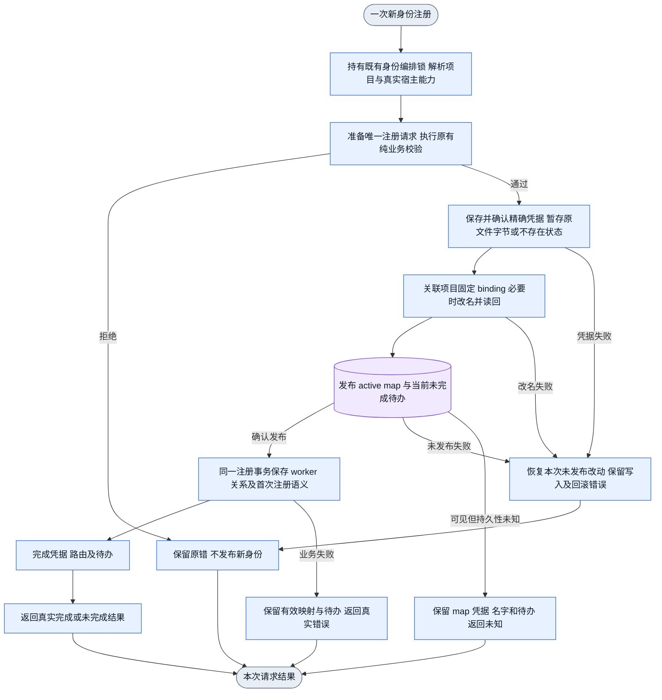
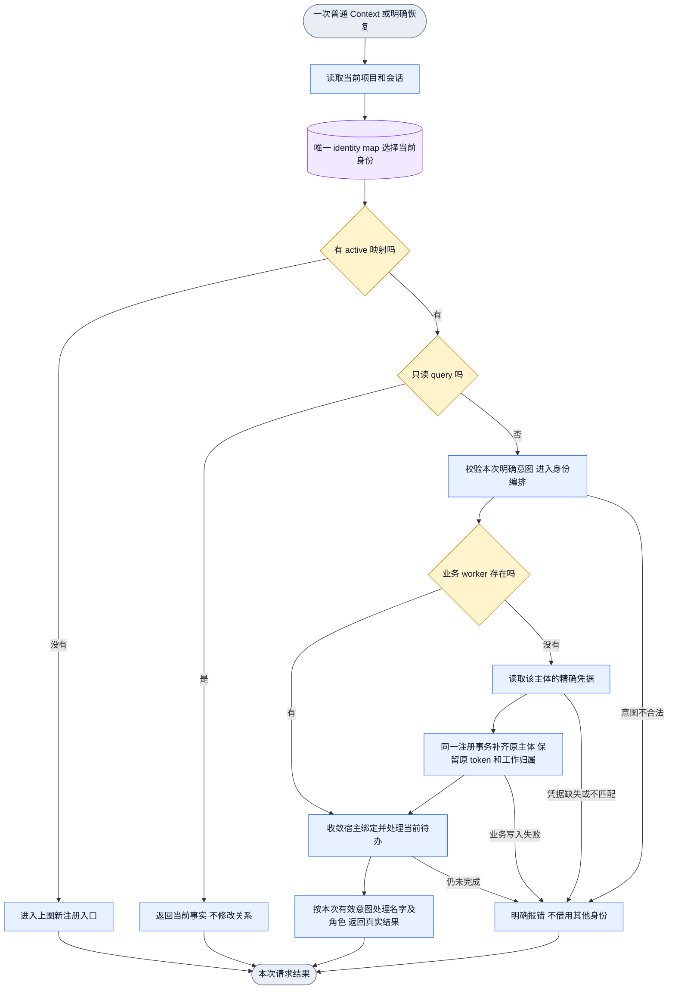
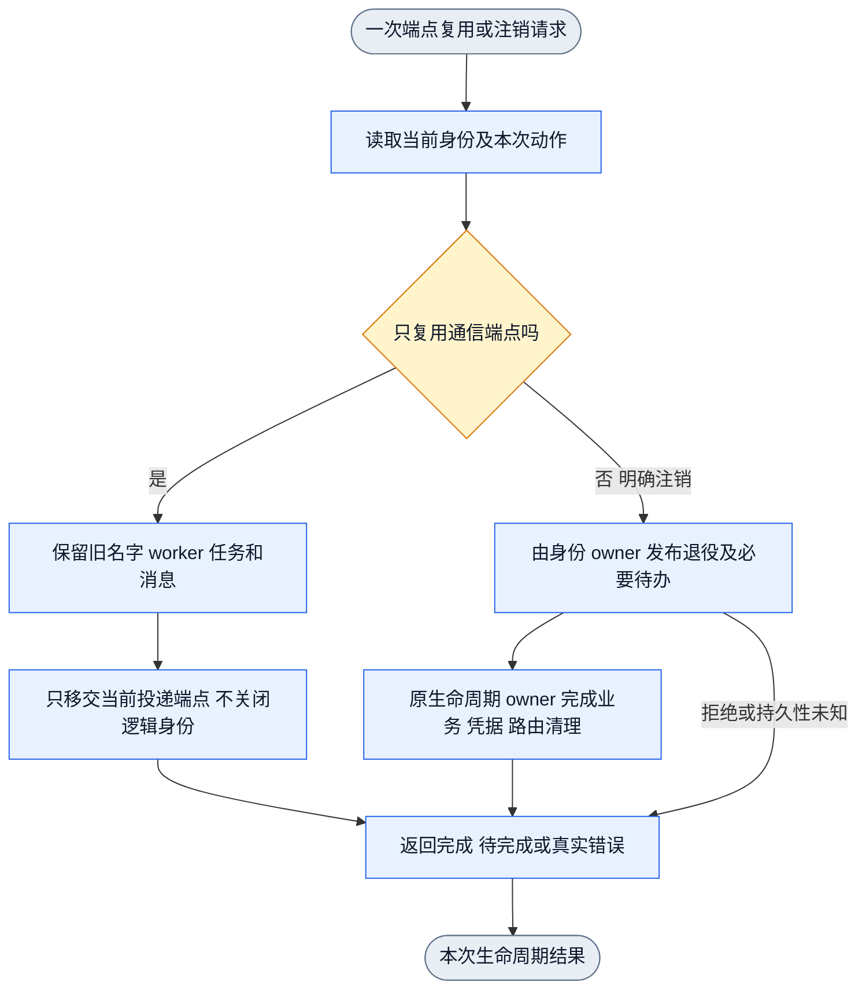
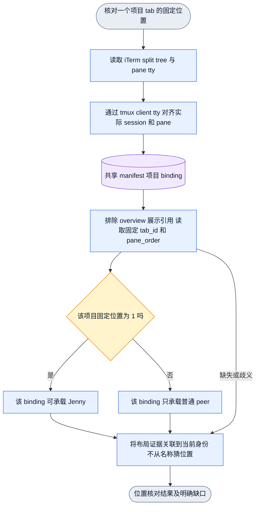
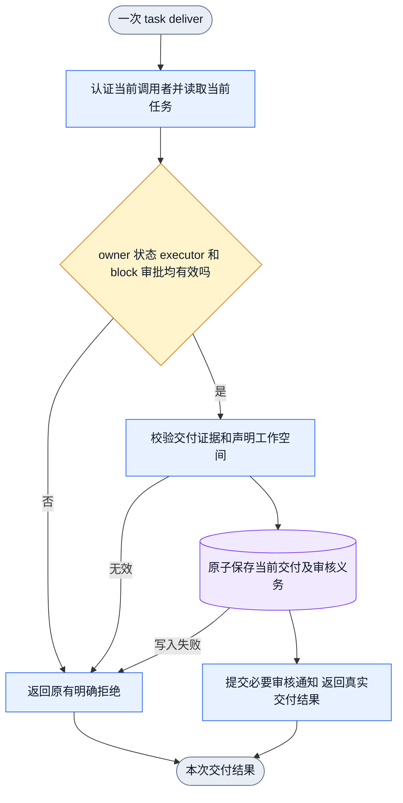

# Collab 身份生命周期与固定首 pane 核对

状态：现状证据与修正设计；尚未安装或完成线上恢复。
唯一身份源为当前 `identity-map.json`；布局位置由共享 tm-iterm manifest 提供。
本设计不要求关闭 daemon、tmux server 或宿主 pane。

## 已确认的断链

第一条发生在身份关系的关闭与恢复之间。创建身份曾成功写入 map 和 worker，
并不保证后续关闭 worker 时两者仍一致。旧 pane 抢占分支能产生 WorkerClosed，
删除业务 worker；Iris 回执把这次删除归因为其他项目复用同一 pane。
线上只读已确认 Iris 的当前 map 仍 active，session 和 pane 一致，而正式 worker
查询返回没有 resident identity。该历史关闭事件的完整运行回执尚未独立重读。

当前候选已经在同 runtime 与跨 runtime 抢占处保护 active map 的 owner，
避免仅因通信 pane 被另一个注册使用就关闭其逻辑身份。观察时的恢复实现仍在读取
active map 后要求 worker 已存在，因而进不到补齐业务关系的阶段。真实隔离公开入口
已复现；本轮候选已增加通过原注册事务补齐同一业务主体的路径，并通过公开回归。

创建阶段还存在一个独立窗口：先发布 active map 和待办，再写业务 worker，最后
持久化凭据。若在发布 map 后中断，既缺 worker 也缺凭据。恢复必须拒绝凭空生成
token，因此仅补业务行不足以覆盖这个窗口。已接受独立计划要求先确认精确凭据，
再发布 active map。候选已调整该顺序；原 Unknown 边界红测现已通过。

新主体判定使用精确 project/app/agent。其他项目或 app 的同一 agent ID 当前记录，
不能让本项目跳过凭据准备。跨范围旧凭据在未发布失败时按原字节恢复。

真实公开 Register 请求还确认了一个无需崩溃即可到达的情况：请求因 runtime 冲突
被拒绝，但其拒绝发生在 map 发布之后，新增 Bob 行已经 active，且没有 worker
或凭据。原有 Alice 仍完整。可判定的业务校验必须在 map 发布之前完成；
控制发布与业务提交仍需使用既有编排边界保持注册串行，避免校验后相互抢占。

第二条发生在布局关联。实时项目 tab 的树首叶目前指向各自的首号 session；
不能据此认定持久布局关联完整。manifest 用同一个 tmux session 同时表示项目位置
和 overview 展示位置。例如 appsdk 项目位置 1 与 overview 位置 4 同指
`appsdk_1_Jenny`；RouteCodex 为项目 1/overview 6，NNAnything 为项目 1/overview 2。
Collab 缺少已保存 layout binding 时仅按 session 显示名匹配，会得到两个候选。
当前 RouteCodex、NNAnything 的 Jenny map 行确实没有 layout_binding_id。
overview 是展示引用，不能成为项目的 master 位置，也不能阻断项目首位绑定。

## 创建与普通恢复

以下为已接受的候选设计。创建与恢复都由同一个注册事务 owner 写业务关系。
map 是身份选择源；worker 是业务关系，不得反过来否决 map 中的有效身份。
query 只读。普通恢复不重新进行通信准入，不分配新身份或新 token。

缺业务关系的补齐在既有 identity_gate 下完成。随后释放该锁，交由 DSH 收敛 owner
执行其自身带锁的端点变更，再取得 identity_gate 处理本次当前绑定与待办。
两个持锁阶段之间重新读取当前控制状态，不传递已选择的 map 行或注册请求。
这同时保留注册串行化，并避免 DSH 端点恢复重入同一把非递归锁。

创建的单入口、单出口子图：

恢复的单入口、单出口子图：

删除的错误边是 `active 身份 → worker 不存在 → 立即失败`。
补齐保持原 worker ID、名字、token、session、任务、资源、消息与真实消费回执。
已建立过的主体补关系不产生新 peer 通知或 bootstrap 授权。
初次注册尚未消费的待办须完成原首次注册语义，不能被当作已存在主体的恢复跳过。
后者已通过公开入口回归。原 pending Register 的首次业务消费产生一次注册通知，
重复 Context 和重启隔离 daemon 后不重复通知。已存在主体的补齐保持静默。
初次消费依据当前业务关系和未完成操作判断，复用同一事务，保留原待办 ID。

## 端点复用与真实身份注销

禁止把“别人接管了 pane”当作“这个项目的名字已注销”。
当前候选的 active-map claimant 保护属于预防；补齐已有孤立关系属于恢复。
两者不能互相替代。定向消费者审计已删除没有生产调用方的旧 route-failure
注册包装与专属 cleanup。真实注册、创建 peer 和明确注销入口保留唯一 owner。
完整组合回归通过前不声明全部闭环。

## 每个项目首 pane 的寻址

原生 iTerm tab ID、manifest 项目 tab_id、tmux session ID 和 agent sessionID
是不同字段。overview 位置不是项目位置。session 显示名允许改变，不能解析后缀
来决定 pane 位置或 master。首 pane 核对使用真实 split tree 与 client tty，
持久恢复使用 manifest binding_id 和固定位置。

只读实测的首位置矩阵如下。采集时间为证据文件中的 UTC 时间，显示名仅用于展示。

| iTerm 原生 tab | manifest 项目位置 | tmux session ID | pane | 当时显示名 |
|---|---|---|---|---|
| 3 | humanagent / 1 | `$15` | `%15` | `humanagent_1_Jenny` |
| 21 | zcamapp / 1 | `$20` | `%20` | `zcamapp_1_Jenny` |
| 4 | routecodex / 1 | `$1` | `%1` | `routecodex_1_Jenny` |
| 13 | zterm / 1 | `$9` | `%9` | `zterm_1_Jenny` |
| 10 | NNAnything / 1 | `$24` | `%24` | `NNAnything_1_Jenny` |
| 7 | OneStop / 1 | `$10` | `%10` | `OneStop_1_Jenny` |
| 16 | appsdk / 1 | `$5` | `%5` | `appsdk_1_Jenny` |

这些项目 tab 的真实首叶与项目位置 1 对齐。RouteCodex 和 NNAnything 的当前
Jenny 行缺 layout_binding_id，旧 resolver 又把 overview 引用算成候选，造成
身份恢复时的歧义。候选 resolver 只选项目所属 binding，并将其关联回当前 map。

原生 tab 28 为混合展示，首叶对应 collab 项目位置 1，另有 server Jenny 和未连接
shell。它不能用作专用 server 项目 tab 的首位证据。HumanAgent 还有两个项目 scope
指向同一 pane 的存量记录，精确项目 owner 归并尚未完成。

## 任务交付与 daemon 可用性

0.2.0436 曾通过正常 Context，之后公开 status/send 返回 DAEMON_UNKNOWN，进程仍存活。
进程采样与诊断链接图把活动请求定位到 task deliver 的候选发现及子进程输出等待。
现有实现持有业务 State 锁调用 Git/LayerFS。无关请求校验和后台名字观察随后等待该锁。
外部命令持续等待的具体原因尚未确定，系统确认窗口也尚未得到用户确认。

以下为已接受、待公开红绿验证的修正流。删除普通交付的自动候选发现，保留实际集成
证据和当前任务的权限、审核、集成、资源及清理义务。

代码交付继续要求审核、真实集成证据和清理。显式只读交付保留其当前生命周期。
公开回归须让延迟 Git 命令或继承打开的输出管道保持未释放，同时确认交付、无关
Ping 和另一个身份的 Context 都能完成。当前进程的后续恢复另行验收。

## 当前证据与 owner

任务证据根：
`/Users/fanzhang/.codex/task-runs/collab-name-recovery-20261105/single-identity-map-20261105/`。

| 对象 | 证据 | 当前结论 |
|---|---|---|
| Iris 缺业务行 | `current-iris-missing-worker-public-red.log`、`current-iris-ordinary-preservation-public-red-second.log` | 显式恢复与普通 Context 均真实失败 |
| 同一身份补齐设计 | `current-iris-refined-plan.md` | 独立计划就绪；不新增 map effect |
| 注册拒绝的半身份 | `current-register-rejection-no-side-effects-red.log`、`current-register-rejection-no-side-effects-green.log` | 正常冲突拒绝也曾发布 active map；纯业务校验已前移 |
| 凭据发布顺序 | `current-register-publication-credential-red.log`、`current-lifecycle-credential-order-green.log` | 凭据须先于 active map；Unknown 保留可恢复关系 |
| 顺序和锁 owner | `current-lifecycle-plan-addendum.md`、`current-lifecycle-addendum-accepted.md` | 复用既有锁与注册事务；不新增 journal、schema 或身份选择源 |
| 实时位置 | `current-first-pane-iterm-snapshot.json`、`current-first-pane-iterm-trees.json`、`current-first-pane-live-join.json` | 真实 tty/session 对齐；未做布局写操作 |
| manifest 重复引用 | 当前 `~/.local/state/tm-iterm/manifest.json` | 项目与 overview 同 session，缺 layout binding 时歧义 |
| 源码 owner | Context、typed Register、binding control、tm_layout | Jack 单一写入 owner；tm-iterm 脚本由 server.Jenny 维护 |

下一步完成初次注册中断、精确字节回滚及受影响组合行为回归。
源码通过、合入 main、安装和线上恢复分别验收；本文件不宣称后三项完成。
