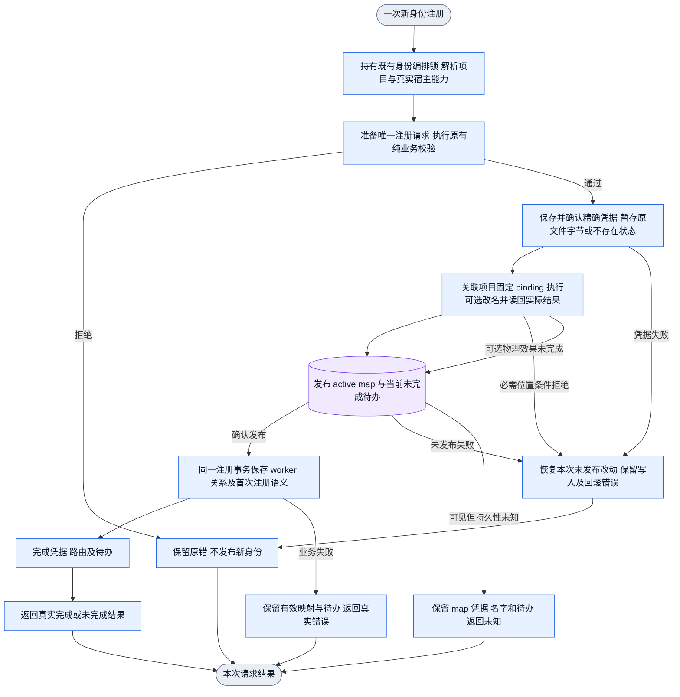
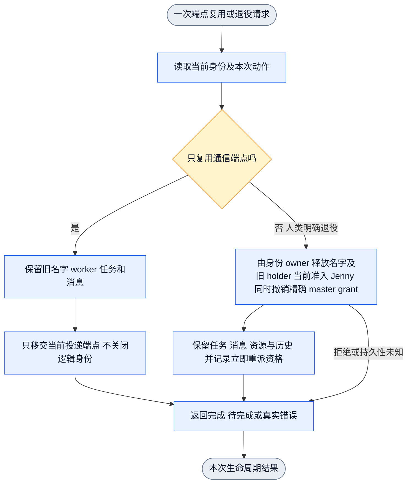
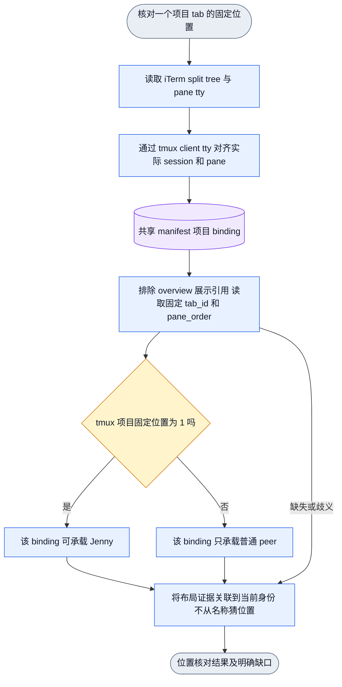

# Collab 身份生命周期一致性合同

状态：正式源合同；程序绑定与行为验收另行记录。
唯一身份源为当前 `identity-map.json`；布局位置由共享 tm-iterm manifest 提供。
本设计不要求关闭 daemon、tmux server 或宿主 pane。
本文件的当前合同覆盖下方历史调查叙述。历史证据只说明当时的观察，不作为当前强制条款。

当前验收记录（2026-11-12）：真实前端、公开 CLI 和隔离 fixture 证据根为
`/Users/fanzhang/Documents/github/appsdk/task-runs/collab-identity-lifecycle-ontology-20261112/`；
下表报告路径相对该根。N2 池满、N3 测试 daemon 重启、跨 app 当前字段与任务归属、
B4 可选物理失败和幂等重试、T2/D1 return-first、M 当前收件、T4、W1-W3 和普通名字
退役已有实际通过行为。真实十五分钟等待、全忙保留和 idle 后自动邀请通过。修复后的
E2 两个真实 TUI 场景通过。非空资源和原订阅转 Alice。Bob 回归不夺回任务并领取新工作。
tmux 重启后精确退出、原 pane 保留、等待 deadline、挂起和新执行对照均通过。
T2-M 与 E3 的公开回归及真实 TUI 已通过。证据见
`final-approvals-plan/e3-recovery-report.md` 和 `final-approvals-plan/e3-frontend-report.md`。
Jenny 退役撤销精确旧 grant，保留工作和重派资格，重启后保持。恢复后旧操作重放
不撤继任 grant。manager 在原 deadline 前邀请，接受提交后才转任务归属。
Rex 普通真实续接、重启、旧 reader 拒绝、人工恢复、同 ID 消息和任务接续有效。
human fence 的真实 Rex 增量 QA 已通过；同 block 多 current 歧义是保留边界，
同 exact execution 仅换 session 仍未真实验证。跨 app 消息、消费与订阅的公开组合
已有通过证据。`source-mail-frontend-qa/report.md` 补齐真实 TUI 源名字消息隔离、
目标消息消费与不重放。该批同时发现 worker 职责列表将 Alice 任务列给当前 Bob。
`board-name-projection-frontend-qa/report.md` 已在真实 TUI 复验该修复：Jenny 仍能看到
Alice 无 holder 的任务，Bob 的职责列表和 context 自有任务为空。原任务实际为公开任务，
不能根据其标题推断私有；私有可见性由独立公开回归覆盖。`task-registry-projection-fix-report.md`
已验证 registry、StatusAll 和 context 自有任务按名字投影当前 holder，关闭历史与 legacy
事实保持。`unmapped-status-fix-report.md` 已验证无 current 的旧 worker 可读但不显示当前
角色、端点或任务，严格操作仍拒绝，map 错误和歧义不被吞掉。
`final-query-mail-frontend-qa/report.md` 绑定最终候选的真实 Codex TUI PASS，覆盖无
current 旧 worker 查询、task registry 当前名字投影，以及 self-close 后未消费原消息由
后续 Alice 接收且已消费消息不重放。
最新组合回归曾发现跨 app 源 current 未释放，见 `composed-remaining-targets-r1.log`。
`context-composition-fixes-report.md` 已记录修复及准确公开复验：首次 Register 在同一个
map candidate 中释放 source 并发布 target，原 source 任务、消息和订阅断言保持。
共享 Register/pending/首次通知消费者也已通过定向回归。跨 app source 的精确旧 master
grant 撤销、提交失败重试和继任者保护已公开验证。`self-close-mail-fix-report.md` 覆盖
self-close 与人类退役后的 worker-ID 消息名字关系保全、后续收件和已消费历史不重放。
真实查询和消息增量已由 `final-query-mail-frontend-qa/report.md` 通过。
项目 memory `appsdk-collab-message-name-handoff` 已批准消息归名字，名字寻址消息即使
附带 `--target-session`，合法同名交接后仍交新 holder。旧固定 session 测试不构成
新增审批要求。`name-address-session-consumer-report.md` 与
`name-address-session-frontend-qa/report.md` 已证明该公开消费者与真实 TUI 行为。
`self-close-session-worker-report.md` 已记录 raw worker-ID 加当前 session 的精确退役
消费者修复及公开红绿。原条件会漏掉名字关系；现在无 session 或与本次退役 binding
匹配时保全，异 session 仍排除。`self-close-session-frontend-qa/report.md` 已用正式
候选 0.2.0491 通过自退役和人类退役的真实 TUI 增量：旧宿主存活且拒收，新 holder
收到原 ID/正文，session/wake/消费回执更新，旧消费历史和任务名字归属保持。
尚无整体 Review、main 或安装声明。

## 当前身份生命周期合同

对象、行为和关系按用户已确认的 N/B/A/T/D/R/M/E/W 条款建模。所有状态都是
公开可观察事实；邀请、接受、身份回归和业务完成分别提交。设计条款本身不证明
程序已经实现。

| 对象 | 关键身份 | 已确认行为与关系 | 真实 owner | 观测与 gate |
|---|---|---|---|---|
| 稳定名字 | canonical project + name | 名字持有工作归属；普通池耗尽后自动分配 `peer-n`；新注册和恢复共存；人类明确指令可顶替任意已有名字 | `name_resolution`、`binding_slot::move_name`、身份 map owner | `collab context`、`directory`、占用唯一性 gate |
| 当前 anchor | project + name + current anchor | 每个已分配名字在同一项目内只有一个当前 anchor；daemon 重启或 sessionID 变化时按唯一当前事实续接，事实不足保留具体 unknown | `mapped_context`、`commit_control_change_locked` | identity/relation/transition gate；公开恢复回执 |
| 存活与活动 | project + anchor + observation | `live`、`busy`、`error`、`ask`、`idle`、`offline`、`unknown` 分开。探测失败或事实不足是 unknown；静态错误不是 idle | tmux/Rex adaptor、`name_monitor`、`rex_monitor` | 当前特征、sessionID、snapshot/master 按顺序补缺；充分即停 |
| 角色授权 | project + grant | 普通注册默认 peer；已有合法角色自动恢复；新 master 需要人类明确指令，名字统一为 Jenny；顶替后旧 holder 失去目标名字的当前权限 | role/master grant owner | `context`、角色请求与 master grant 查询 |
| 任务归属 | task ID + stable name | 同名未关闭任务接续新 session；重派后旧身份不再自动夺回；到 15 分钟仍未回归且存在合法 idle 才邀请，接受提交才转移 ownership | `name_stewardship`、`board_respond`、task owner | board/assignment revision、邀请、接受和回归交错用例 |
| 消息与唤醒 | message/delivery/subscription ID | 未消费消息跟随当前名字；消费历史保留正文、ID和真实回执；迟到回执归原投递；任务唤醒跟随真实当前归属，保留内容、进度、剩余次数和节奏 | mailbox、delivery、notification/subscription owner | inbox、delivery/consume 回执、wake/subscription 回执 |
| 退役 | project + name | 人类明确退役普通名字后释放名字和旧 holder 当前准入。任务、消息、资源和历史保留，名字立即具备重派资格。合法 idle 存在才邀请。Jenny 退役需明确人类指令并释放当前绑定。该操作撤销精确 holder 的 master grant。Jenny 保留 master 专用名和恢复入口 | identity-map 释放、current master grant 与 task reclaim/invite/accept owner | 普通名字释放与重新分配、同名恢复及 self-close 物理复用已有公开回执。`final-approvals-plan/e3-recovery-report.md` 与 `e3-frontend-report.md` 证明 Jenny 退役、精确撤权、资格持久化与旧请求重放保护 |
| 资源与旧结果 | task current owner + resource | 交接保留代码、改动、证据和资源；旧结果不改变当前 owner；迟到结果交当前 owner 评估 | resource claim、task result/review owner | claim、真实 dirty/活动写入核对、result/review 回执 |

状态迁移规则如下：

| 事件 | 名字 / current | 任务 | 消息 / 授权 / 唤醒 |
|---|---|---|---|
| daemon 确认身份丢失 | 名字和恢复入口保留；presence 为 offline | 启动 15 分钟身份回归等待，重复丢失不延期 | 原进度和订阅保留 |
| 等待中当前 holder 在线回归 | 当前有效 holder 或同名合法接替者已在线，结束等待 | 尚未转交任务继续原归属；撤销本轮未接受的自动邀请，晚到接受被拒绝 | 收件和唤醒归当前 holder |
| 15 分钟到期且全忙 | current 不因 timeout 删除 | 保留重派资格并等待合法容量 | 订阅不因邀请提前转移 |
| 15 分钟到期且有合法 idle | 保留原名字/恢复入口 | 发出邀请；接受前 ownership 不变 | 唤醒仍走当前 owner |
| 等待期内 manager 合法邀请 | 继续 waiting-return | manager 可邀请合法 idle。接受并提交前 ownership 不变 | 唤醒仍走当前 owner |
| 新 owner 接受且 daemon 提交 | 名字 current 独立保持真实值 | assignment 转交，ID/状态/证据/引用保留 | 后续唤醒交新 owner |
| 人类明确顶替 | 新 holder 成为唯一 current；旧 holder 不即时获得 companion | 只接续目标名字任务；源名字任务不跟 actor/session 搬走 | 未消费消息/wake 转当前 holder，旧 grant 失效 |
| 人类明确退役普通名字 | 释放该名字，后续普通注册可取 | 立即具备重派资格，不再等待 15 分钟 | 旧 holder 停止该名字唤醒，任务订阅保留待接续 |
| 人类明确退役 Jenny | 释放 Jenny 当前绑定和该 holder 的 master grant | 未完成任务立即具备重派资格 | 消息、资源、唤醒和恢复入口按已批准规则保留 |

`D1` 以“新 owner 已接单，daemon 已更新任务归属”为派发完成点。邀请、
消息入队、adaptor 接受和目标消费都只表示对应阶段。接受提交与原身份回归
交错时，先提交者生效；未接受的自动邀请可撤回。

`B4` 要求部分提交可查询、真实失败保留原错、重试只完成剩余效果。可选物理
显示失败不封死基础身份与通信，不伪报全部成功。

资源接续先核对当前任务归属、实际活动写入者和原资源交接。当前 owner 完成交接后
在原工作树接续，保留旧代码、dirty 修改、untracked 内容、证据和资源引用。
迟到执行结果交当前 task owner 实际读取和评估采用。原 attempt 来源保留，
结果到达本身不改变任务归属或当前已提交状态。执行入口见
[同一任务资源交接](../../collab/skills/collab/references/task-worktree-lifecycle.md)。

状态探测依次使用当前确定性特征、适用 agent sessionID 查询和当前 snapshot 的
master 鉴别。事实充分即停，各级只补仍缺的事实。presence 与 activity 分开保留。
snapshot 判断须经过当前 holder、端点、master 权限和新观测核对。被替换的绑定为
stale，迟到观测和判断不能写到继任 holder。

## 已批准条款与执行绑定

下表各条均来自 Jason 在 2026-11-12 聊天中的逐对象确认。R9来自该聊天提供的
AGENTS。审批状态均为 approved。执行绑定状态另列。实际 gate 需要公开正反例和
真实观测回执，声明和静态图仅承载目标。

| 条款 | 场景、触发和状态变化 | owner 与 edge/gate | 合法用例及须拦截的变化 | 观测与当前证据 |
|---|---|---|---|---|
| N1 | 注册、恢复或交接时，项目内名字持续承载工作 | identity map、assignment、mailbox；名字到工作关系 gate | 同名续接保留工作；跨名字搬迁须符合明确任务转交 | context、board、inbox |
| N2 | 普通池耗尽，继续分配未占用 peer-数字 | `name_resolution`、binding slot；分配到唯一 current | 占用数字继续递增；池满拒绝新注册须修正 | `context_names_full_pool_allocates_unique_generated_names_and_reloads_them` 公开回归已通过；真实TUI在默认池满后取得 `peer-1`，重复 context、布局恢复和测试 daemon 重启均保持同一身份 |
| N3 | daemon 重启，保存名字和原工作，同时允许新注册 | binding store、runtime 恢复；持久加载到当前绑定 | 原名字恢复，新会话取得可用名；重启丢身份须拦截 | 真实TUI（`names-qa/report.md`）重启测试 daemon 后恢复原 `peer-1`、worker 和 session。`tmux-restart-observation-qa/final-report.md` 证原 Alice 精确退出后为 Offline，原 pane 保留，等待 deadline 在重启后保持。新会话同时供给与并发组合未验 |
| N4 | 人类明确指定已有名字，提交恢复或顶替 | context approval、`mapped_context`；授权到目标 current | 原端点失联仍可按授权接替；旧历史否决新授权须拦截 | 公开approval、query、角色及工作查询 |
| B1 | 任意 app scope 进入同一项目名字 | binding slot；project/name到 current唯一关系 | 同项目同名至多一个 holder；app分区产生两个同名holder须拦截 | `context-composition-fixes-report.md` 与 `context-composition-first-green.log` 覆盖组合后的跨 app Register 原子 source 释放/target 发布、源任务/消息/订阅保全和旧holder权限拒绝。`composed-register-consumers.log`、`composed-register-notice-consumers.log` 补共享 pending/注册消费者。真实源名字消息隔离由 `source-mail-frontend-qa/report.md` 证明；不将此扩大为跨 app 真实宿主验证 |
| B2 | 启动、重启或sessionID变化，当前事实唯一则自动续接 | current lookup/materialization；观察前key、generation、完整current（含Rex association/fence）到同次更新 | Rex caller匹配foreground Codex且启动标识稳定；精确当前执行可低于fence续接，非当前执行不高于fence不能自动取名；晚于fence和current的真实新执行仍自动续接。同执行仅换session、不可比较、旧current缺关联保留具体缺项。明确人类restore_name/restore_master优先，可恢复较早执行；同次发布合并source/target fence及被替换启动代际，缺关联取同域微秒发布界限。refresh、重新物化及effect重试不降低边界，不读历史选身份 | `rex-association-frontend-qa/oauth-report.md` 与 `fence-report.md`：普通真实续接、重启、旧 reader 拒绝、人工恢复、同 ID 消息、任务接续和 human fence 增量通过；同 block 多 current 歧义保留，同 exact execution 仅换 session 未真实验证。`fence-cleanup.md` 记录自有 session/进程收口 |
| B4.1 | 交接失败或中断，返回实际生效状态及未完成效果 | control commit、pending、outcome；真实阶段到回执 | map已发布可查询新current；假成功或假未提交须拦截 | `physical-frontend-qa/report.md`：真实 TUI 新 Bob 在物理改名冲突时已提交 map 和业务效果，返回 `incomplete`、committed `current/business_effects`、失败 `physical_anchor` 和精确 `TMUX_SESSION_RENAME_FAILED`；query 同结果且不伪造改名，双向通信继续可用 |
| B4.2 | 重试同一交接，只完成剩余效果 | pending恢复及既有操作receipt；幂等提交 gate | 已完成工作和进度保持；重建或回退owner须拦截 | `physical-frontend-qa/report.md`：释放冲突后只完成 physical rename，当前身份保持，已消费消息未重投。`composed-full-regression-r2.log` 中 `context_query_reports_published_registration_with_pending_business_commit` 公开通过，覆盖 State 写失败、只读查询和同操作重试。`composed-public-associated-final.log` 的名字交接业务失败用例覆盖单一 current、pending、State 保持、重启恢复和再次 context 幂等；源名字工作保留并由其后来真实 context 续接。公开故障 fixture 与真实物理失败证据分开 |
| A1 | 没有接替则保留名字与恢复入口；接替提交使旧关系stale | current绑定、monitor；当前关系核对 gate | 当前holder状态可更新；旧holder观测不能覆盖继任者 | `tmux-restart-observation-qa/final-report.md` 覆盖真实端点退出、保留与新执行。`composed-full-regression-r2.log` 中 `late_exit_cannot_overwrite_new_execution_in_same_pane`、`map_first_new_generation_rejects_old_exit_before_state_effects`、`r1_replaced_target_rejects_late_activity_submission` 均通过真实 typed 提交路径的受控交错。该证据与真实端点 QA 互补，不声称已制造真实宿主调度竞态 |
| A2–A5 | 依当前特征、适用sessionID、snapshot/master逐级补缺，充分即停 | `name_monitor`、`rex_monitor`、snapshot判断；事实来源/新鲜性/权限 gate | presence与activity分别保留；未知不推offline，静止不推idle，迟到判断不能覆盖新事实 | `rex-qa/report.md` 与 `rex-qa/public-error-parent/report.md` 覆盖真实 Rex Idle/Busy/Ask/Error。`snapshot-judgment-worker/parent-offline-classification-green.log` 覆盖公开 session probe 补足即停、snapshot/master 只补未知和合法 Offline。`tmux-restart-observation-qa/final-report.md` 覆盖精确退出、挂起及新执行。`remaining-evidence-completion-report.md` 区分这些公开分段证据与 DSH handler/gateway 测试；未独立观测完整底层调用序列或真实 DSH 前端，不扩大证据含义 |
| T1 | 同名新anchor接替，尚属该名字的未关闭任务接续新session | name resolution、assignment；target任务续接 gate | ID、状态、证据、资源引用保留；闭合历史维持原记录 | `task-name-authority-worker/recovery-final3-same-name-continuation.log` 的 `context_names_same_name_new_session_continues_open_task_and_old_carrier_cannot_commit` 公开通过。`recovery-final6-takeover-serial.log` 另证目标名任务继续、源名变更被拒且任务不变。改用公开 worker snapshot 后，`parent-projection-current-facts.log` 的 `offline_name_holder_projects_empty_owner_then_name_reassignment_preserves_work` 与 `parent-projection-working-current-facts.log` 的 `working_resource_reassignment_allows_new_owner_to_resume` 均通过 |
| T2 | daemon确认身份丢失，固定十五分钟等待回归 | typed调度、stewardship、timer；确认丢失到固定deadline | 重复丢失/重启保截止时间，有效同名在线回归结束等待；Unknown不能单独开等待 | `return-timeout-qa/report.md`：真实 TUI 确认丢失到 `deadline-started=900000ms`，测试 daemon 重启前后 deadline 不变，重复丢失不延期；到期前无邀请，Alice/Carol Busy 时保留 Bob owner，idle 后自动邀请 Alice 且 owner 仍 Bob，Bob return-first 撤邀，晚 accept 返回 `BOARD_STALE_REVISION` |
| T2-M | daemon 已确认丢失且等待未到期，manager 要求普通邀请 | Board invitation/respond、name stewardship；等待到邀请、邀请到接单提交 | manager 可提前邀请合法目标；daemon 自动重派仍等原十五分钟；邀请不转 owner | `e3-recovery-manager-after-launch.log` 公开通过。`final-approvals-plan/e3-frontend-report.md` 证明真实 Bob 退出后 daemon 建立原 deadline，Jenny 提前邀请 Alice，真实 Alice 接受提交才转 owner |
| T3 | 原身份回归，按当前实际任务归属继续或领取新工作 | current assignment；回归到任务选择 gate | 未接受转交继续原任务；已提交新owner的任务保持新归属 | `return-timeout-qa/report.md` 覆盖接受前 return-first。`e2-final-report.md` 证 Bob 回归后任务仍归 Alice，Bob 随后领取并启动新工作。`task-name-authority-worker/report.md` 证副本旧 carrier 不能提交目标任务 |
| D1 | 新owner接单且daemon提交才完成派发 | invite/respond、manager串行边；revision/current/idle/资源 gate | return-first撤自动邀请，accept-first保新owner；迟到接受或回归抢任务须拒绝 | `return-timeout-qa/report.md` 证 return-first 撤自动邀请并拒晚 accept。`e2-final-report.md` 的两个真实 TUI 场景均由 Alice 接受并提交 owner。`task-worker/parent-reflow-invitation-green.log` 的 board 组合 50 用例含换代拒绝和 accept-first |
| R1 | 人类明确接替名字，接续该名字角色或按本次角色覆盖 | name intent、role grant；授权到目标角色 | 接替Jenny接master；源角色不能凭actor带入目标 | context和master-only公开请求 |
| R2 | master接管提交，撤旧current权限并授新current | 当前master grant owner；current与权限一致性 gate | 新holder可执行角色操作；旧holder当前master操作须拒绝 | pending窗口与角色公开正反例 |
| R3 | 普通注册默认peer，既有合法角色恢复，新master需人类明确指令 | register/approval/current role；角色准入 gate | 合法恢复自动完成；无授权新master须拒绝 | `role_new_master_delegation_requires_user_authorization` 公开红绿已通过，覆盖无授权拒绝与明确授权生效 |
| R4 | 人类指定master，名字统一Jenny | name intent；角色到规范名字 gate | Bob升master成为Jenny；名为Bob的项目master须拦截 | role_name_master公开用例 |
| R5 | Bob升Jenny后，Bob原任务留Bob，Jenny工作接续 | source释放、target续接；名字到任务关系 gate | Bob任务保留待恢复/重派；源任务随session搬走须拦截 | `final-context-role-timing-r2.log` 的两条公开角色用例通过。原 `final-context-name-consumers.log` 保留异步 reflow 尚未生成时的时序断言失败；独立 `context-reflow-final-plan.md` 以保留现场确认通知随后生成。修正只分开同步归属/拒绝断言与异步通知观察，保留 task、ticket、assignment revision 不变和公开 board 空 holder 断言，未改产品时序 |
| R6 | 顶替时旧holder退出目标current，后来真实context再普通注册 | mapped context、typed DisplacedExecution准入、真实Register及完整基线CAS | 顶替不生成companion；已核实旧Rex执行不高于current fence时进入普通登记，不取目标名字/权限，不搬走目标工作和收件；明确人类恢复优先。fence仅存current常量边界，普通刷新、角色/名字移动和效果重试保全 | `public_r6_human_fence_preserves_target_work_role_mail_and_survives_restart` 为真实CLI/wire；Rex manager覆盖启动代际；`rex-association-frontend-qa/fence-report.md` 的真实 Rex 增量通过，同 block 多 current 歧义保留，同 exact execution 仅换 session 未真实验证 |
| R7 | 根据所选transport使用tmux pane或Rex block | tm_layout、Rex端点/current lookup；适用端点 gate | 合法Rex block无tmux位置仍升Jenny；endpoint与session命中不同current须拒绝；query不准入或提交所带端点 | 真实Rex角色/位置正例通过。`r7-evidence-reconcile-report.md` 区分只读查询实际current与端点变更；`public_context_rex_target_conflict_is_typed_and_explicit_approval_reaches_admission` 公开通过。唯一current session允许合法换端点，实际换绑仍核实当前执行事实；不再用“未知block加已知session的query必须失败”替代该契约 |
| R8 | Frank当前会话顶替Bob，Frank任务留Frank | name intent、source释放、target续接；源工作保留 gate | 当前会话只接Bob工作；同actor导致Frank工作搬迁须拦截 | typed assignment与旧无assignment数据的普通restore_name公开红绿均已通过 |
| R9 | 创建项目Rex session或身份角色变化 | Rex session owner；cwd目录名到session展示名 | session按项目cwd命名；按身份/角色/任务自动改名须拦截 | 真实Rex角色变化前后session查询已通过 |
| M1 | 同名接替提交，未消费消息交当前holder | typed名字地址、mailbox、通知；当前收件关系 gate | 已投递未消费仍可交接；名字寻址的显式session随合法交接更新；源名字消息不能泄漏给目标 | map-first 公开用例和 mailbox/notification tests 覆盖 pending/delivered 交接、wake 与 project 隔离。`source-mail-frontend-qa/report.md` 真实 TUI 证明源名字与目标名字消息隔离、ID/正文/真实消费回执保持且不重放。`name-address-session-consumer-report.md` 和 `name-address-session-frontend-qa/report.md` 证明名字寻址的显式session随合法接替更新。`self-close-session-worker-report.md` 和 `self-close-session-frontend-qa/report.md` 证明 raw worker-ID 加当前session在自退役/人类退役后保全名字关系，公开与真实TUI后继收件、旧holder拒收、session/wake及幂等消费均通过。无名字交接时保留发送session选择边界 |
| M2 | 交接时保留已消费历史 | receive receipt；历史重放归属与消费 gate | 正文、ID、真实回执保留；接替触发重复投递须拦截 | `name_mailbox_public_repeated_release_reallocation_keeps_current_carrier` 公开通过，含原 receive-id replay；`mailbox-worker/report.md` 记录正文、消息 ID 和真实消费回执未重投。`self-close-mail-continuation-green-r2.log` 通过完整 old-consumed-history 公开交接组合：先消费一条再 self-close，后续 holder 只收到原未消费消息，已消费消息不重放。`final-query-mail-frontend-qa/report.md` 在真实 TUI 复验同一 self-close 收件边界 |
| M3 | 旧holder收件/消费或迟到delivery结果进入提交边 | inbox/ACK/notification结果；current与捕获投递归属 gate | 真实旧结果归原投递；误标新holder已消费或覆盖其证据须拦截 | `mailbox-worker/report.md` 的迟到回执精确红绿及 `parent-map-first-green.log` 覆盖提交边界；`source-mail-frontend-qa/report.md` 的真实 TUI 源名隔离与独立消费回执通过。该证据不声称真实宿主已制造迟到 callback 竞态 |
| E1 | 人类明确退役普通名字，释放当前占用 | approval/UnregisterWithEffect；精确目标及退役操作 gate | 新普通注册可取得Bob，保留任务消息宿主资源；退役旧操作不能退继任holder | `human_retirement_` 公开回归覆盖无授权拒绝、明确退役释放并允许重新分配、旧 self-close 不进入明确退役路径，HumanRetire 直接消息消费者也已公开通过。`physical-frontend-qa/report.md` 另证真实 TUI self-close 保留旧 host/label，新 Bob 普通 context 取得名字并完成双向通信。`return-timeout-qa/e2-final-report.md` 的真实 TUI 场景已执行明确 human retire 并使 Alice 接管未完成任务 |
| E2 | 明确人类退役生效，未完成任务立即具备重派资格 | typed human retirement cause、调度；即时资格和合法idle gate | 有idle即邀请，全忙保资格；普通close不能冒充E2 | `e2-final-report.md` 与 `e2-final-cleanup.md` PASS。两种真实 TUI 场景均完成 Alice 接受和 daemon 提交。任务、非空资源与原订阅转 Alice。Bob 回归保持 Alice owner。`return-timeout-qa/report.md` 保留原失败和 return-first 证据 |
| E3 | 人类明确退役 Jenny，释放 current 与精确 master grant | HumanRetire、current master grant、task scheduling；授权到精确名字与 grant 释放，再到 E2 | 释放该 holder 的 current 和 grant；保留工作、消息、资源与恢复入口；Jenny 保持 master 专用。普通注册取得 Jenny 或撤继任 grant 须拦截 | `final-approvals-plan/e3-recovery-report.md` 公开通过，`e3-frontend-report.md` 真实 TUI 通过。无 master 时资格和工作重启保全，普通注册不取 Jenny，人类恢复后旧退役 receipt 不撤继任者，缺人类授权请求被拒绝 |
| T4.1 | 任务已转交，核对资源与活动writer并完成写入交接 | 当前task owner、resource gate及源任务合同 | 保留dirty/untracked/证据后同路径接续；活动或未知writer时暂停受影响写入 | 真实Codex TUI T4.1 PASS：活动writer存在时只读，writer正常退出后同路径续写，旧/新/未跟踪内容均保留 |
| T4.2 | 旧执行提交迟到产物，当前owner读取评估 | 普通发送、当前attempt/result gate及源任务合同 | 当前owner实际评估采用；产物本身不能转owner或覆盖当前状态 | private ordinary-message 路径端到端通过：迟到产物被当前owner读取并返回具体评估，任务owner/status/revision不变 |
| W1 | 同名接替或已接受任务转交，更新后续wake接收目标 | goal schedule、assignment、subscription；提交归属到wake gate | 邀请期间仍归旧owner，接受提交后随新owner | `task-subscription-public-worker/report.md`：公开 `board invite` 不移 schedule，`board respond --accept` 提交后同一 subscription ID 和内容转到接受者；后续真实 timer wake 由新 holder 消费。`return-timeout-qa/e2-final-report.md` 的两个真实 TUI 场景覆盖不同 owner 的实际转交：同一 subscription ID、内容、次数、原 trigger、interval 和 expiry 随 Alice 接续 |
| W2 | 交接或重启，续用原任务订阅 | goal/subscription当前持久owner；进度连续性 gate | 内容、进度、剩余次数、节奏保留；重建默认次数须拦截 | `task-subscription-public-worker/report.md`：私有 daemon 重启前后公开 subscription view 完全相同；同名 Bob 重新取得名字后同一记录恢复 `armed`，ID、内容、`fired_count`、`repeat_count`、`interval_ms`、`trigger_ms`、`expires_ms` 均保持。既有跨 session W2 用例未重跑，未变实现仍可复用 |
| W3 | 退役后无合法holder，停止旧名字wake并保留任务订阅 | identity effects、goal/subscription；待接续状态 gate | 有当前合法owner时接续原订阅；无holder误唤醒旧主体或删除进度须拦截 | `task-subscription-public-worker/report.md`：human `retire_name` 后 schedule 进入 `waiting-owner` 并保留全部字段；两个周期不绑定新 wake，旧 holder native input 不增加；新 Bob 普通 context 后同一订阅恢复并收到下一条真实 timer wake，任务 close 后 schedule 为 cancelled |

T2-M 与 E3 已批准。T2-M 只约束 daemon 自动重派等待十五分钟。manager 可以按现有
合法入口提前邀请。接受并提交后才转任务归属。E3 释放 Jenny 当前绑定和该 holder
的 master grant。Jenny 保留 master 专用名和恢复入口。E3 公开回归与真实 TUI 已通过。
早期 fixture 只发布而未建立任务归属，现已用公开 claim/start 补齐，并保留原断言。
完整 pending 中断重放未在本次 E3 前端增量中单独验证，不扩大完成 receipt 重放的证据。

## 已确认的断链

以下调查保留原始时间范围。当前条款与执行绑定以本节之前的合同为准。

`return-timeout-qa/report.md` 记录早期 E2 两次真实接受失败，错误为
`BOARD_STALE_AUTOMATIC_INVITATION`。后续 `return-timeout-qa/e2-final-report.md`
在两个独立真实 TUI 场景完成接受和 daemon 提交。早期失败作为历史原错保留，不代表
当前 E2 验收状态。

历史 T1 投影原错保存在 `task-name-authority-worker/projection-report.md`。旧 fixture
在 daemon 停止时写入 offline presence。重启把该记录改为 unknown，旧测试因此错误
保留 Bob owner。公开 worker snapshot 后的两个当前用例已经通过。该历史失败不再描述
当前 board 逻辑。

第一条发生在身份关系的关闭与恢复之间。创建身份曾成功写入 map 和 worker，
并不保证后续关闭 worker 时两者仍一致。旧 pane 抢占分支能产生 WorkerClosed，
删除业务 worker；Iris 回执把这次删除归因为其他项目复用同一 pane。
线上只读已确认 Iris 的当前 map 仍 active，session 和 pane 一致，而正式 worker
查询返回没有 resident identity。该历史关闭事件的完整运行回执尚未独立重读。

当前候选已经在同 runtime 与跨 runtime 抢占处保护 active map 的 owner，
避免仅因通信 pane 被另一个注册使用就关闭其逻辑身份。观察时的恢复实现仍在读取
active map 后要求 worker 已存在，因而进不到补齐业务关系的阶段。真实隔离公开入口
已复现；本轮候选已增加通过原注册事务补齐同一业务主体的路径，并通过公开回归。

创建阶段还存在一个独立窗口：先发布 active map 和待办，再写业务 worker，最后
持久化凭据。若在发布 map 后中断，既缺 worker 也缺凭据。恢复必须拒绝凭空生成
token，因此仅补业务行不足以覆盖这个窗口。已接受独立计划要求先确认精确凭据，
再发布 active map。候选已调整该顺序；原 Unknown 边界红测现已通过。

新主体判定使用精确 project/app/agent。其他项目或 app 的同一 agent ID 当前记录，
不能让本项目跳过凭据准备。跨范围旧凭据在未发布失败时按原字节恢复。

真实公开 Register 请求还确认了一个无需崩溃即可到达的情况：请求因 runtime 冲突
被拒绝，但其拒绝发生在 map 发布之后，新增 Bob 行已经 active，且没有 worker
或凭据。原有 Alice 仍完整。可判定的业务校验必须在 map 发布之前完成；
控制发布与业务提交仍需使用既有编排边界保持注册串行，避免校验后相互抢占。

第二条发生在布局关联。实时项目 tab 的树首叶目前指向各自的首号 session；
不能据此认定持久布局关联完整。manifest 用同一个 tmux session 同时表示项目位置
和 overview 展示位置。例如 appsdk 项目位置 1 与 overview 位置 4 同指
`appsdk_1_Jenny`；RouteCodex 为项目 1/overview 6，NNAnything 为项目 1/overview 2。
Collab 缺少已保存 layout binding 时仅按 session 显示名匹配，会得到两个候选。
当前 RouteCodex、NNAnything 的 Jenny map 行确实没有 layout_binding_id。
overview 是展示引用，不能成为项目的 master 位置，也不能阻断项目首位绑定。

## 创建与普通恢复

以下为已接受的候选设计。创建与恢复都由同一个注册事务 owner 写业务关系。
map 是身份选择源；worker 是业务关系，不得反过来否决 map 中的有效身份。
query 只读。普通恢复不重新进行通信准入，不分配新身份或新 token。

缺业务关系的补齐在既有 identity_gate 下完成。随后释放该锁，交由 DSH 收敛 owner
执行其自身带锁的端点变更，再取得 identity_gate 处理本次当前绑定与待办。
两个持锁阶段之间重新读取当前控制状态，不传递已选择的 map 行或注册请求。
这同时保留注册串行化，并避免 DSH 端点恢复重入同一把非递归锁。

创建的单入口、单出口子图：

恢复的单入口、单出口子图：

删除的错误边是 `active 身份 → worker 不存在 → 立即失败`。
补齐保持原 worker ID、名字、token、session、任务、资源、消息与真实消费回执。
已建立过的主体补关系不产生新 peer 通知或 bootstrap 授权。
初次注册尚未消费的待办须完成原首次注册语义，不能被当作已存在主体的恢复跳过。
后者已通过公开入口回归。原 pending Register 的首次业务消费产生一次注册通知，
重复 Context 和重启隔离 daemon 后不重复通知。已存在主体的补齐保持静默。
初次消费依据当前业务关系和未完成操作判断，复用同一事务，保留原待办 ID。

## 端点复用与明确退役

禁止把“别人接管了 pane”当作“这个项目的名字已注销”。
自动探测失败、静态错误、unknown 或暂时离线也不是退役。它们保留尚未被替换的
名字、恢复入口、任务、消息和订阅进度。只有人类明确退役才释放普通名字的当前
占用。明确退役 Jenny 释放其当前绑定并撤销精确旧 grant，名字仍专用于 master。
退役不等于终止宿主进程，也不删除未交付工作。
当前候选的 active-map claimant 保护属于预防；补齐已有孤立关系属于恢复。
两者不能互相替代。定向消费者审计已删除没有生产调用方的旧 route-failure
注册包装与专属 cleanup。真实注册、创建 peer 和明确注销入口保留唯一 owner。
完整组合回归通过前不声明全部闭环。

明确退役后，未完成任务立即具备重派资格。存在合法 idle peer 时通过既有
invitation/accept 路径派发；全部候选 busy、error、ask 或 unknown 时保留待接续，
不强行分配。接受提交前 ownership 不变。旧 holder 的迟到结果交当前 task owner
评估，不恢复旧 owner。

## 宿主位置与 Rex block 边界

固定 pane 序号只属于 tmux 布局。Codex/AGY 的 Rex 绑定使用当前
server/session/block endpoint，不附加 tmux 位置 1 条件；Rex session 使用
项目 cwd 末级目录名，peer 不因身份、角色或任务改名。sessionID 变化只更新
当前执行载体，不移动宿主 session 本身。

原生 iTerm tab ID、manifest 项目 tab_id、tmux session ID 和 agent sessionID
是不同字段。overview 位置不是项目位置。session 显示名允许改变，不能解析后缀
来决定 pane 位置或 master。首 pane 核对使用真实 split tree 与 client tty，
持久恢复使用 manifest binding_id 和固定位置。
该核对不适用于 Rex block。Rex 只读取当前项目 session 的真实 block endpoint；
缺少 tmux 位置不是 Rex 角色恢复或 Jenny 接替的拒绝条件。任何身份或角色变化
也不得顺带改写 Rex session 名。

只读实测的首位置矩阵如下。采集时间为证据文件中的 UTC 时间，显示名仅用于展示。

| iTerm 原生 tab | manifest 项目位置 | tmux session ID | pane | 当时显示名 |
|---|---|---|---|---|
| 3 | humanagent / 1 | `$15` | `%15` | `humanagent_1_Jenny` |
| 21 | zcamapp / 1 | `$20` | `%20` | `zcamapp_1_Jenny` |
| 4 | routecodex / 1 | `$1` | `%1` | `routecodex_1_Jenny` |
| 13 | zterm / 1 | `$9` | `%9` | `zterm_1_Jenny` |
| 10 | NNAnything / 1 | `$24` | `%24` | `NNAnything_1_Jenny` |
| 7 | OneStop / 1 | `$10` | `%10` | `OneStop_1_Jenny` |
| 16 | appsdk / 1 | `$5` | `%5` | `appsdk_1_Jenny` |

这些项目 tab 的真实首叶与项目位置 1 对齐。RouteCodex 和 NNAnything 的当前
Jenny 行缺 layout_binding_id，旧 resolver 又把 overview 引用算成候选，造成
身份恢复时的歧义。候选 resolver 只选项目所属 binding，并将其关联回当前 map。

原生 tab 28 为混合展示，首叶对应 collab 项目位置 1，另有 server Jenny 和未连接
shell。它不能用作专用 server 项目 tab 的首位证据。HumanAgent 还有两个项目 scope
指向同一 pane 的存量记录，精确项目 owner 归并尚未完成。

## 任务交付与 daemon 可用性

0.2.0436 曾通过正常 Context，之后公开 status/send 返回 DAEMON_UNKNOWN，进程仍存活。
进程采样与诊断链接图把活动请求定位到 task deliver 的候选发现及子进程输出等待。
现有实现持有业务 State 锁调用 Git/LayerFS。无关请求校验和后台名字观察随后等待该锁。
外部命令持续等待的具体原因尚未确定，系统确认窗口也尚未得到用户确认。

以下为已接受、待公开红绿验证的修正流。删除普通交付的自动候选发现，保留实际集成
证据和当前任务的权限、审核、集成、资源及清理义务。

代码交付继续要求审核、真实集成证据和清理。显式只读交付保留其当前生命周期。
公开回归须让延迟 Git 命令或继承打开的输出管道保持未释放，同时确认交付、无关
Ping 和另一个身份的 Context 都能完成。当前进程的后续恢复另行验收。

## 当前证据与 owner

任务证据根：
`/Users/fanzhang/.codex/task-runs/collab-name-recovery-20261105/single-identity-map-20261105/`。

| 对象 | 证据 | 当前结论 |
|---|---|---|
| Iris 缺业务行 | `current-iris-missing-worker-public-red.log`、`current-iris-ordinary-preservation-public-red-second.log` | 显式恢复与普通 Context 均真实失败 |
| 同一身份补齐设计 | `current-iris-refined-plan.md` | 独立计划就绪；不新增 map effect |
| 注册拒绝的半身份 | `current-register-rejection-no-side-effects-red.log`、`current-register-rejection-no-side-effects-green.log` | 正常冲突拒绝也曾发布 active map；纯业务校验已前移 |
| 凭据发布顺序 | `current-register-publication-credential-red.log`、`current-lifecycle-credential-order-green.log` | 凭据须先于 active map；Unknown 保留可恢复关系 |
| 顺序和锁 owner | `current-lifecycle-plan-addendum.md`、`current-lifecycle-addendum-accepted.md` | 复用既有锁与注册事务；不新增 journal、schema 或身份选择源 |
| 实时位置 | `current-first-pane-iterm-snapshot.json`、`current-first-pane-iterm-trees.json`、`current-first-pane-live-join.json` | 真实 tty/session 对齐；未做布局写操作 |
| manifest 重复引用 | 当前 `~/.local/state/tm-iterm/manifest.json` | 项目与 overview 同 session，缺 layout binding 时歧义 |
| 源码 owner | Context、typed Register、binding control、tm_layout | Jack 单一写入 owner；tm-iterm 脚本由 server.Jenny 维护 |

下一步完成初次注册中断、精确字节回滚及受影响组合行为回归。
源码通过、合入 main、安装和线上恢复分别验收；本文件不宣称后三项完成。
