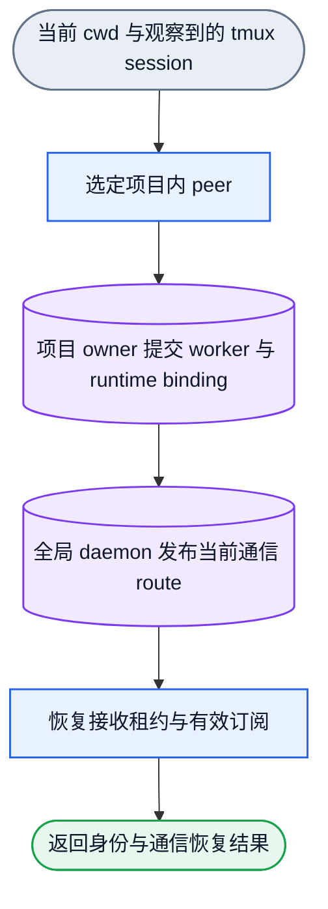
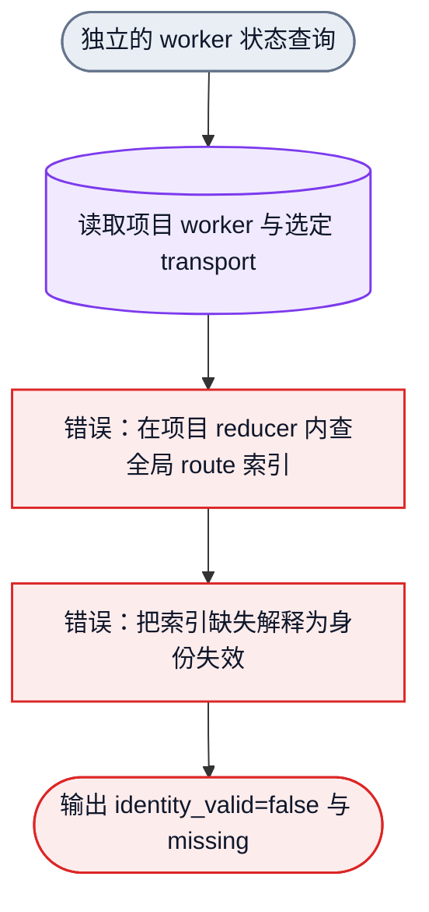
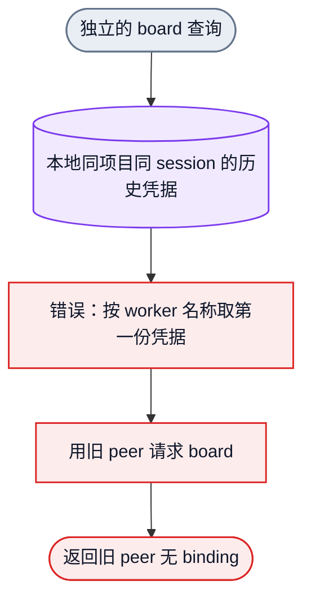
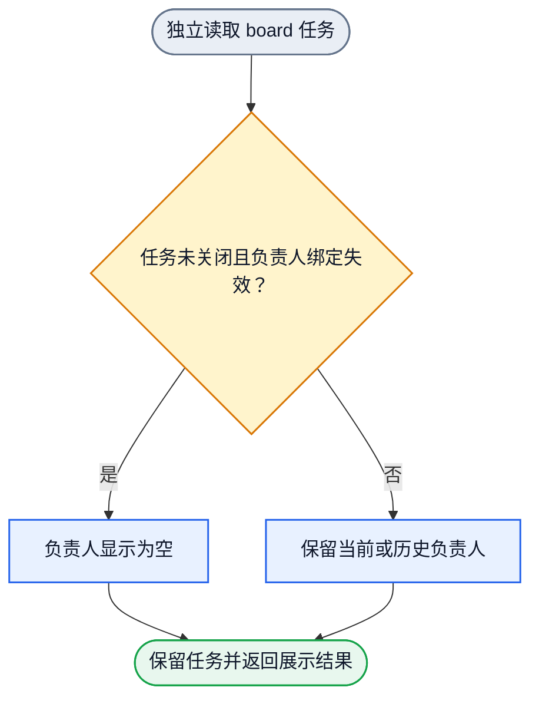

# 当前身份对象流与读取缺口

状态：已核对修复前现场 Collab 0.2.0295。候选修复已安装为 0.2.0296；现场身份状态与独立公开入口回归已通过，整体复核及 main 集成待完成。第二、三组图保留首次偏离的证据，第四组为用户明确要求的 board 展示规则。

身份恢复、worker 状态查询、board 查询是三个独立入口。board 和任务分配不参与身份恢复判定。以下图描述对象及其 owner，不把函数调用或诊断输出当作控制状态。

## 一、当前身份恢复链

该链不读取 board，不要求存在任务，不要求空闲产能大于零。现场 peer `codex-%11` 已有项目 binding，当前端点存活；pane `%1` 不要求 worker 名称也叫 `codex-%1`。

## 二、修复前 worker 状态读取链及首次偏离

缺口是 owner 读错，不能通过重新注册、伪造 `identity_valid=true`，或把 host route 复制到项目状态来补偿。

修正对象流：状态查询 → 项目内当前 worker 与唯一适用 runtime binding → 身份有效性；物理端点由所属 adaptor 单独观察 → 真实 liveness/activity → 返回状态。端点丢失或未知不删除持久身份，也不伪造 idle/working。

## 三、修复前 board 读取链及独立缺口

修正对象流：board 查询 → 观察当前调用者位置 → 只读解析全局当前 route → 取该 route 对应的精确凭据 → 原有 board 授权与查询。查询不得注册、恢复、写 route 或改变身份。board 错误只影响 board 请求，不回写身份状态。

## 四、board 任务负责人展示规则

该图没有身份恢复节点。master 根据空负责人任务另行安排；读取不执行重派，也不关闭或改写任务。

## Owner、gate 与修改顺序

用户补充的 board 契约：未关闭任务保留；当前负责人身份没有有效绑定时，`owner` 与负责人显示为空。读取不改变底层 TaskRec 的历史 owner、状态、资源、证据或 revision，不恢复旧身份、不自动关闭任务；重新安排属于 master 的独立动作。已关闭任务保留历史负责人。物理端点暂时离线不等于持久身份绑定失效。

| 独立责任 | 唯一事实 owner | 首次偏离与实现位置 | gate 必须证明 |
|---|---|---|---|
| 身份恢复 | 项目 worker/runtime binding；全局通信 route | 既有 context 与 route publication owner，本轮不重建这条链 | 身份、绑定、通信各自按所属 owner 完成；不要求 board 或任务存在 |
| worker 身份状态 | 项目当前 worker/runtime binding | `collab/src/server/mod_parts/part_07.rs::tmux_identity_presence` | 外部项目、只有项目 binding 时身份仍有效；实际 binding 退役仍失效 |
| 端点和活动 | 当前选定 adaptor | 既有 endpoint/activity probe | missing 与 unknown 如实返回，不伪造可调度产能 |
| board 调用者选择 | 全局当前 route；精确本地 credential | `collab/src/main.rs::registered_board_identity` | 同 session 多份历史凭据不改变当前 actor；board 查询不注册、不写身份 |

先更新上述独立 gate 与 verification map，取得原错误对应的红测，再改唯一 owner，最后走同一公开入口回归。读取修复可以同批交付，但不能互相成为身份恢复的准入门槛。四个图各自单入口单出口；没有跨组的恢复依赖或回边。
