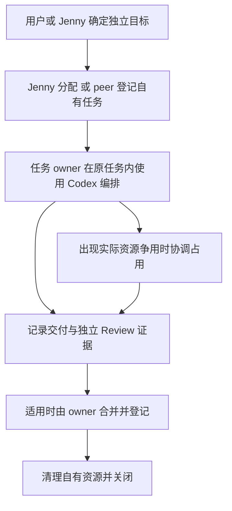

# Collab 独立任务与交付计划

## 用户决定

Jenny 统一分配 Collab 工作。Architect、executor、reviewer、QA 与其他 peer 的专长只说明能力。每个任务有一个 owner。Owner 通过 Codex 编排取得探索、Plan、执行和独立 Review 的产物，完成交付、合并和资源清理。跨 peer 消息只用于实际资源争用。任务状态与证据写入原任务。

## 审计与行动项

| 行动项 | 现行生效点 | 修改与验收 |
| --- | --- | --- |
| 协作入口 | 全局 AGENTS、AppSDK AGENTS、打包 Collab Skill 和操作手册仍将 Architect 写成派单、验收和汇报层。Codex 编排局部已有 AppSDK 平级规则，但通用入口和交付合同仍混用。 | 统一入口、角色表、派单模板、恢复、问题路由及交付命令。运行时模板的同义指令一起核对。确认已安装正文与打包源，并以恢复后的实际 Context 核对。 |
| 派发权限 | Board 的 invite、dispatch、withdraw、describe、policy、update 共享 Architect 受托权限，父任务及 reviewer pin 也能产生权限。 | Jenny 单独控制分配。Owner 修改自己任务的内容和状态。其他 peer 在公开 CLI 被拒且无任务、消息和订阅副作用。 |
| 任务独立性 | publish 会分配 Execute slot，普通 claim 可领取等待分配的工作，父任务参与合同继承。 | Jenny 发布可调度工作，普通 peer 发布只用于自有工作。无指定分配的他人任务由 Jenny 处理。删除父任务的派发与继承语义，保留历史字段用于读取。 |
| Review | reviewer pin 会排除 executor、阻止 owner 记录结果，并在 deliver 后唤醒另一 peer。 | 清除 pin 对准入、验收和通知的控制。Owner 登记本次独立 Codex Review 的证据，保留 revision 与证据门禁。旧已验收证据保留，旧待审任务可由 owner 续接。 |
| 合并与清理 | Review 接受会创建给 master 的 merge obligation；旧 pending merge 阻止 owner 登记实际合并。 | 新交付由 owner 完成，不生成给 Jenny 的 merge 请求。旧记录在 owner 提交真实集成证据后正常结清。保留 worktree 归属、main 集成、清理门禁。 |
| 通知和提示 | Board next step、角色提示、自动通知和巡检仍引用给其他 peer 分配、验收和例行汇报。 | 只保留真正需要行动的派单、资源释放与授权事件。旧 next step 在读回与上下文恢复时按当前生命周期解释，避免改写历史证据。 |
| 发布闭环 | 源码、全局 Skill、安装 daemon 和工作中会话分别生效。 | 跑受影响公开 CLI 正反用例及旧数据场景。按主线交付合同集成、安装并回读激活。对活动任务使用支持的状态转换。 |

本轮实现由本会话负责。每项以表中行为作为完成证据。

## 执行 DAG

一次 daemon 请求的入口为已认证 Board/Task 操作，终点为真实回执。所有许可和拒绝先核对当前身份、任务归属及 revision。交付、审查证据、集成和关闭各自以现有 durable 记录提交。独立 Codex 审查运行于 daemon 之外，记录证据的人为任务 owner。既有稳定身份、邀请接收、资源归属及 Git 集成证明继续提供相应保障。

## 迁移与回滚边界

- V1 自定义工作流留在历史记录。V2 Context 自动恢复到当前默认职责，不执行旧覆盖正文。配置记录仍可读；重新配置时使用 V2 合同。
- 历史 reviewer pin 不参与执行、审查或集成授权。历史审查证据和交付代际仍可读。当前 owner 继续未完交付，合入时同时结清已有 merge 记录。
- 对历史自动代审和代合并消息取消行动资格，保留原消息记录。常规 owner 更新写原 Board。Jenny 修改任务安排时仍通知受影响 owner。
- 保留身份、工作范围、原始交付证据及资源归属。生产切换用既有安装与激活入口；不清空项目、邮箱或工作树。

## 当前验证

- Board、角色分工和审查 DAG 已通过本机 DAGpipe 结构验证。
- 隔离 AppServer CLI 验证了 Jenny 派单、Architect 越权拒绝、历史 reviewer 失去代审能力、owner 记录审查、普通合并与 squash 集成、资源清理、旧模板恢复与普通进度静默。
- 完整回归仍在收敛。剩余失败须逐项判定是退役合同断言还是现存行为退化。候选达到完整行为验收后进行独立 Review，随后走 main、安装和生产回读。
- 较新 AppServer 套件中只剩一次原有的 pinned executor presence fixture 失败，单跑复验通过。广泛单测还包含未迁移的旧代合并、历史角色提示和并发环境夹具断言。用户随后要求紧急恢复全局存储与 Rex 投递，该修复在独立分支交付。本候选未安装。
- 已按新合同复验 task owner 登记 review、合并和回收。legacy merge 及邀请通过历史数据输入验证。新模板不依赖 master 的通知订阅。剩余行动是核对串行全量结果、在新主线上组合紧急修复，然后按完整候选独立审查。

## 独立审查发现与修复路径

| 缺口 | Owner 与动作 | 验收 |
| --- | --- | --- |
| 自有任务依赖 | 本任务 owner 通过原 Execute phase 持久化依赖。普通 peer 发布时保留本人归属，不选他人槽位。 | 依赖未完成时领取和改派接受均拒绝，完成后同一 owner 可推进。 |
| 同名换绑 | 领取判断使用当前 owner。创建者保留发布历史。 | 同名新 carrier 可领取，旧 carrier 和其他 peer 被拒绝。 |
| 迟到的 review | 在 review 写入锁内核对调用者观察的交付代际。 | 旧交付的结果不改变新交付，当前代际可以登记。 |
| 长程派发 | 发布阶段等待明确派发，订阅由现有 invite/dispatch 事务提交。 | 有空闲 peer 也不提前换 owner，派发回执包含订阅。 |
| 消息误过滤 | 复用已持久化的 daemon 通知标记识别退役 review 通知。 | 原历史通知不进入行动队列，普通同文本消息仍可收取。 |

独立审查第一轮发现已在候选修复。隔离真实 CLI 回归区分依赖未完成与完成、
换绑前与换绑后、迟到审查与当前代际、长程发布与派发订阅，以及普通请求与退役通知。
AppServer 公开套件、MCP 和受影响单测通过。独立复核确认所有 finding 收口。

后续复核补了旧代际重交付、MCP 参数传递和历史排队任务。公开 MCP 实测首次交付、
旧代际拒绝及当前代际接受。公开 Execute 交付触发真实队列续派。该用例能推进普通
队列任务，保留未订阅的历史长程任务归属。独立测试构建移除续派过滤时，原用例在
同一入口失败于长程任务归属断言。候选源恢复后同一用例通过。
