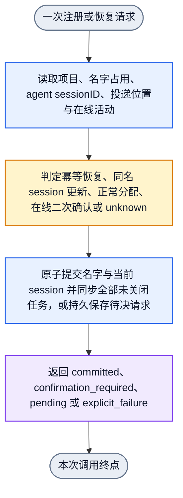
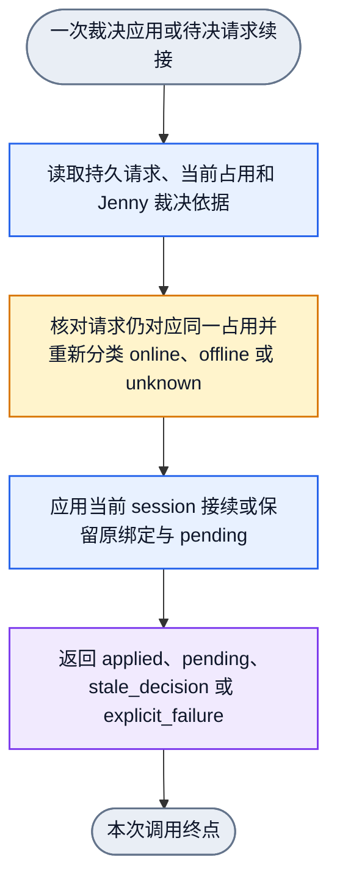

# Collab 稳定名字工作归属合同

状态：`TARGET / DESIGN ONLY / RUNTIME UNVERIFIED`

本文是 `name-runtime-closure-20261020` 的逻辑合同。它定义目标行为，不声明源码、
已安装二进制、全局 daemon 或 live runtime 已经具备这些行为。机器图只校验拓扑、
输入输出和 operator 声明，不证明 operator 已注册或已执行。

最新用户澄清优先于旧 B1 审计和本文引用文件中的冲突说明。旧 B1 的“同名但旧
session 保持空”“固定旧 session 阻止新 session 执行旧工作”和旧执行者停止/撤权
前置条件全部作废。

## 1. 唯一语义

名字是项目内的工作归属。agent sessionID 是这个名字当前的执行载体。通信
binding、route、pane、socket 和 thread 只承担当前投递位置与观测职责，不能替代
名字，也不能让历史 session 成为准入门禁。

正常续接不要求 Jenny 再 assign。名字仍属于当前工作者而 agent sessionID 从 S1
变为 S2 时，daemon 更新名字的当前 sessionID，并在同一逻辑提交中把该名字下全部
未关闭 board 任务换绑到 S2。已关闭任务保留关闭时历史。任务 ID、状态、证据、
资源、revision 历史、merge obligation 和 cleanup obligation 不因换绑重置。

名字交给新会话时，尚未消费的消息随名字交接给当前持有者，并更新当前唤醒投递归属。
已消费消息及消费历史保留，不迁移或重放。消息 ID、正文、原发送者和真实回执不变。
名字、任务与未消费消息交接由同一提交完成；pending 或失败不修改邮箱。
按名字发送的消息须保留寻址时的项目内名字关联。工作者改名后，此关联不随显示名改变。
后续接管按该关联选择未消费消息，不能把同一 worker 曾持有的其他名字消息一起交接。

接管完成后，当前名字工作者直接继续该名字的未完成工作。系统不通知、不停止、
不撤权、不拦截旧执行者，也不等待旧执行者回应、退出或证明离线。旧 session 后来
重连时，只能按当前名字池和占用规则取得名字，不能用历史恢复记录把当前归属倒退。

## 2. Owner 与真源

| 对象 | 唯一 owner | 真源与边界 |
| --- | --- | --- |
| 项目名字占用 | daemon 名字与身份 owner | 保存项目、名字、当前工作者、当前 agent sessionID、占用变更引用；名字不是任务主键 |
| 当前通信位置 | 既有 typed binding/route owner | 保存 adaptor、endpoint、binding 和投递位置；不决定名字分配 |
| board assignment | TaskRec 与 board mutation owner | 保存任务执行归属和当前 sessionID；不复制名字占用表 |
| unknown 裁决请求 | daemon context operation owner | 保存原请求、目标名字、所针对占用、pending 进度和应用结果 |
| presence 与 activity | daemon presence owner | 分别保存在线事实与活动事实；观测结果必须带原因 |
| 调度回流原因 | board mutation 与既有通知 owner | 只由状态变化或 timer owner 持久产生；board 读取不能创建或改写 |
| 订阅 | `NotificationSubscription` owner | 保存目标、计划、TTL、fired count、生命周期状态和 suppress 原因 |
| merge obligation | daemon journal | 保存 `MergeRequested` / `MergeResolved`；不存进聊天内容或 snapshot |

同一事实只能有一个写入 owner。snapshot、日志、错误文本和历史凭据只能用于读取或
诊断，不能作为第二控制真源。

## 3. 名字池与注册恢复顺序

普通名字固定池按以下顺序使用：

`Alice, Bob, Carol, David, Emma, Frank, Grace, Henry, Iris, Jack, Kate, Leo, Mia, Noah, Olivia, Peter, Quinn, Rose, Sam, Tina`

Jenny 是当前项目 master 的显示名，不占普通名字池名额。不同项目独立使用名字池。
当前 master 主动委派项目职责时，按既有 master 权限在同一提交中交接 typed grant、
Jenny 名字、未关闭工作和未消费消息。这是现持有者主动交接，不伪造用户接管授权。
清除 master 时，同一提交明确撤销当前 typed grant，不能因历史名字与角色错位而
返回假成功。已失去 grant 的旧 Jenny 普通恢复走 peer 名字池，不自动索要 Jenny
授权；Jenny 的未完成工作继续归 Jenny 名字。
第 21 个同时存在的普通名字请求返回明确池满错误，不生成池外名字，不把 Jenny
计入普通名字。

一次注册或恢复调用按以下顺序处理：

1. 读取 canonical project、请求名字或固定池候选、持久名字占用、agent sessionID、
   通信 binding 和当前 presence/activity 事实。
2. 同项目、同 agent sessionID 的恢复直接幂等成功，只同步当前投递位置。
3. 同项目且名字仍属于同一工作者时，将当前名字的 sessionID 更新为本次报告的
   agent sessionID。正常 session 变化不需要 Jenny 裁决。
4. 新工作者请求一个可分配或已确认离线失去保持权的名字时，按正常分配或继承路径
   提交。离线不是“旧执行者必须先退出”的条件。
5. 其他工作者在线占用名字时，默认不替换。只有本次用户明确要求接管且完成既有
   二次确认后，才能进入替换提交；同一请求不重复询问。
6. 占用状态 unknown 且无法安全分类时，持久保存原请求、目标名字和所针对占用，
   向当前项目 Jenny 发送具体裁决请求，并返回 `pending`。`pending` 是本次调用
   的有效终点，不是成功，也不是新的身份。
7. 探测 snapshot 失败、Jenny 不可用或裁决仍为 unknown 时，保留原绑定和持久
   pending 请求。不能把 unknown 解释为 offline，也不能覆盖当前归属。
   例外：Jenny 自身 unknown 且无法响应时，用户明确指定恢复 Jenny 并完成本次接管
   确认，直接提交 Jenny 名字和 master；用户确认高于 Jenny 裁决，不等待旧执行者。
8. 提交前重新核对 pending 针对的占用没有变化。占用已变化时，旧裁决不适用，
   不改当前名字或任务；原操作按最新事实重新进入分类。

## 4. 名字与 session 转换表

| 当前事实或输入 | 本次转换 | board 结果与终点 |
| --- | --- | --- |
| 同项目、同 agent sessionID 恢复 | 幂等恢复并更新投递位置 | 不重复 assign；返回当前名字 |
| 当前名字工作者从 S1 变为 S2 | 更新名字当前 sessionID | 同名全部未关闭任务换绑 S2；closed 不动 |
| 新请求命中可分配名字 | 分配名字并绑定当前 agent sessionID | 返回新名字和分内工作 |
| 名字当前工作者已确认离线 | 正常分配或继承该名字 | 未关闭任务换绑新当前 sessionID |
| 其他工作者在线占名，尚未二次确认 | 保留现 owner | 返回需要本次确认；任务不变 |
| 其他工作者在线占名，本次用户确认接管 | 替换当前名字 owner | 未关闭任务换绑；旧执行者不处理 |
| 名字占用 unknown | 持久保存待决请求并通知 Jenny | 返回 pending；名字、session 和任务不变 |
| snapshot 失败或 Jenny 不可用 | 保留 pending 与原绑定 | 本次显式 unknown/pending；不猜测 |
| Jenny 裁决 offline | 原请求进入正常分配或继承 | 应用后当前 session 接续全部未关闭工作 |
| Jenny 裁决 online | 原请求进入在线替换二次确认规则 | 确认后提交；确认不能由裁决自动替代 |
| 裁决所针对的占用已经变化 | 旧裁决失效 | 当前归属不变；从最新事实续接原请求 |
| 目标名字没有可用工作者 | 保留持久工作归属 | 执行者投影为空；原因回流 Jenny，Jenny 不自动成为执行者 |
| 任意未关闭任务显式改派 | 走既有 invite/respond 扩展 | 保留 task ID、状态、证据、资源和义务 |
| 已关闭任务 | 不参与自动换绑 | 保留关闭时 owner、session 和证据 |
| 名字已被其他工作者接管后旧 session 重连 | 按当前名字池规则取得名字 | 不夺回当前名字，不倒退任务归属 |

自动同名换绑和显式改派都是 assignment mutation。读取到旧 revision 时返回明确
冲突并由调用方按当前 revision 重试。revision 只保护并发一致性，不保护旧 session。
项目内同一名字的占用 revision 跨释放、重新分配及持久重放保持递增；释放名字不删除
其已提交版本记录。名字再次分配不能重用旧占用引用，也不能命中过去的消息交接去重键。

## 5. Presence 与 Activity

| 当前观测 | presence | activity / background | 名字与调度 |
| --- | --- | --- | --- |
| Codex 正在运行或生成 | `online` | `busy` | 保名，不作 idle 候选 |
| 当前轮明确等待后台命令 | `online` | `busy`，保留 background 事实 | 保名，不接新任务 |
| 当前 Codex 输入态，无执行、无待处理选择、无未解释后台事实 | `online` | `idle` | 保名，可供正常调度 |
| 等待批准、选择或补充信息 | `online` | `waiting_user` | 保名，不接新任务；不能算 idle |
| 已确认 Codex，活动无法确定 | `online` | `unknown` | 保名，不推断 idle |
| 输入态同时存在后台任务，分类信号不足 | `online` | `unknown`，`background=true` | 保名，不推断 idle |
| 当前前台已回 shell，无 agent 运行 | `offline` | 不推断 activity | 失去名字保持权，保留任务历史 |
| 探测失败或无法确认当前程序 | `unknown` | `unknown` | 保留原绑定；必要时交 Jenny |
| 只有历史滚屏含 Codex 标识 | 不能据此判 `online` | 依当前程序和当前界面决定 | 不用历史输出抢占归属 |

presence 与 activity 是两项独立事实。`waiting_user` 不是 idle。background 分类不明
必须保留 `activity=unknown` 和 `background=true`，不能通过输入框可见性推断空闲。
周期裁决由当前 session 的明确 unknown 观测触发。尚无探测事实或仅有旧 session
事实时，不伪造一次 unknown 观测或裁决通知。明确恢复遇到未知占用时仍按待决流程处理。

## 6. Unknown 持久待决与跨调用续接

首次遇到 unknown 占用时，daemon operation owner 持久保存：

- 原操作和幂等键；
- 目标名字与所针对的占用 revision/变更引用；
- 当前 sessionID、通信 binding 和观测原因；
- pending 进度和已有投递结果。

daemon 随后向当前项目 Jenny 发送具体裁决请求。请求包含名字、当前 session、占用
引用和需要判断的项目。Jenny 的有效结论只能是现有快照支持下的 `online`、
`offline` 或 `unknown`，并保留依据。Jenny 不可用不删除请求。

下一次调用从同一持久请求读取并续接。应用步骤先核对占用未变，再执行原操作；
重复结论返回既有进度，不重复接管。图不画回边，跨调用关系由持久请求 ID 和现有
operation journal 表达。`pending` 出口不能伪装成 registered、committed 或成功。

## 7. Board Assignment、离线显示与重新派发

同名自动换绑不需要邀请。显式改派到另一名字时，复用现有 invite/respond 的接受
语义并将其适用状态扩展到任意未关闭任务，不建立平行命令或第二套任务状态机。

显式改派可作用于 `pending`、`working`、`rework`、`delivered` 和 `accepted`。
它只改变 assignment，不替代 review、accept、merge 或 close，不把任务重置为
`pending`，不删除 worktree、资源、证据、revision 历史或 pending merge。closed 和
cancelled 不进入该 mutation。

名字当前没有可用工作者时，未关闭任务的执行者投影为空，但持久工作归属、任务 ID、
名字、资源与历史保留。调度回流原因是独立持久事实，由 board mutation 或 timer
owner 在任务进入不可用状态时产生一次，并投给当前 Jenny。`board show` 只读，不写
assignment，不发送回流通知。Jenny 收到原因后显式 respond/assign，不自动成为
执行者。

## 8. 订阅与通知边界

普通 peer 可以创建有限的、owner-scoped、与本人已分配工作相关的 subscription。
事件类别、有限 schedule、TTL 和 subject 必须在持久化前校验。

master 与普通 peer 各自创建和维护本人 goal deadline；按 canonical project 与
稳定名字隔离 goal，sessionID 只表示当前执行载体。master 不代登记 peer goal。
只有 master-idle reminder 要求当前 master 权限。managed subworker 不能创建独立
deadline schedule。goal 的读取、更新、续订与取消均由本人完成，不以端点在线、
tmux 或 Desktop/TUI 位置作为权限条件。

名字换执行载体时，仍有效的本人 goal 订阅随名字接续到新 worker 和当前投递目标。
订阅 ID、schedule、TTL、触发次数和消费历史保持；旧载体不再控制该订阅或接收
后续 deadline。cancelled、expired 和 consumed 不因交接复活。旧版单例只从当前
调用目录及规范项目的实际旧写入位置检查明确归属，保留原文件，不扫描其他目录。

订阅生命周期是单向的：

| 当前状态 | 事件 | 下一状态 |
| --- | --- | --- |
| 无订阅 | 创建默认 direct-message 或合法显式订阅 | `armed` |
| `armed` | 当前投递目标不可用或与当前 transport 不符 | `transport-lost` |
| `armed` | goal schedule reconcile `ended` | `cancelled` / suppressed |
| `armed` | TTL 到期 | `expired` |
| `armed` | 一次性 occurrence 已消费 | `consumed` |
| `transport-lost` | transport 恢复，包括 method 与 target 未变化 | `armed`，保留 schedule、TTL 和 fired count |

同 target 恢复不能因“target 未变”被跳过，也不能重置 schedule、TTL 或 fired count。
显式 owner 取消、`expired`、`consumed` 不因恢复被复活；调度如果需要继续，由 owner
显式创建新的生命周期实例。默认系统收信 lease 保留现有恢复语义：非 owner 主动
取消导致的自动退役不等于用户停用，可由 context 恢复，不改变分内显式订阅的终态。

## 9. AppServer 当前能力边界

当前 AppServer notification path 在出现 `RouteUnavailable` 时保留原始错误和投递
失败事实，并显式终止本次通知。自动发现唯一 live thread、自动重绑 durable route、
刷新 transport lease 和一次自动 retry 尚未接入，本文不把它们声明为现有能力。

后续自动恢复需要走既有 context/typed route owner，并单独补齐图和 gate。不能用
transport fallback、猜 thread、伪造消费或自动 retry 掩盖 `RouteUnavailable`。

## 10. Merge Rework 边界

`task review --rework` 只接受 `delivered` 任务，把 delivered review 结果转为
`rework`。`accepted` 不是 delivered review 的输入。

已 accepted 任务需要 rework 时，由 task owner 执行现有
`task update --status rework`。该转换在 owner 权限内与 `MergeResolved` 同事务
提交。master 不能借 merge-pending 处理获得通用 owner-only update 权限；授权 force
close 仍是独立明确路径。

## 11. 中文业务图

以下图是一次调用的业务合同。两图都是单入口、单出口、无回边。未知占用在本次调用
结束；裁决后的续接是下一次调用，从持久请求读取，不在图中回到首次分类节点。

## 12. 图节点 Owner 与验收映射

机器图节点是设计合同，不表示 operator 已注册。每个中文节点只有一个业务 owner；
验收必须先绑定到对应 gate，再由 runtime 同入口验证。

| 图与中文节点 | 唯一业务 owner | 验收条件 |
| --- | --- | --- |
| `collab-context.graph.json` / 解析项目与控制范围 | context bootstrap | 从 actual cwd 得到 canonical project；不猜 route |
| 同图 / 读取现有服务 | client `require_server` | 只观察现有 daemon；不可达显式失败，不启动或重启 |
| 同图 / 读取持久名字代理会话与占用 | daemon 名字与身份 owner | 读取项目隔离的名字、sessionID、binding 和观测原因 |
| 同图 / 判定续接分配占用确认或待决 | daemon 名字恢复 owner | 覆盖同 session、同名换 session、在线确认、offline 和 unknown |
| 同图 / 提交名字绑定同步未关闭任务或持久待决 | daemon operation owner | 原子提交或持久 pending；closed 不变；失败给进度 |
| 同图 / 生成安全环境投影 | context env projection | 只输出允许环境子集；不泄露 token/key/secret/password/credential |
| 同图 / 输出含名字归属的权威快照 | context snapshot owner | snapshot 能定位 committed、confirmation、pending 或 explicit failure |
| `collab-name-ownership.graph.json` / 读取当前项目名字占用 | daemon 名字 owner | 固定池和 Jenny 规则可定位；项目间隔离 |
| 同图 / 分类当前工作者与名字候选 | daemon 名字恢复 owner | 同 session 幂等；S1→S2 更新；在线/offline/unknown 分类正确 |
| 同图 / 提交名字绑定或保存待决 | daemon operation owner | 变更与 pending 只落一个 owner；应用前核对占用 |
| 同图 / 同步全部未关闭任务代理会话 | board assignment owner | 同名全部未关闭任务改 S2；closed、状态、资源和证据不变 |
| 同图 / 投影本次名字归属结果 | context snapshot owner | 不把 pending、confirmation 或失败写成 committed |
| `collab-board-assignment-lifecycle.graph.json` / 读取任务与当前归属 | board read/mutation owner | task ID、状态、revision、资源和 merge obligation 可定位 |
| 同图 / 分类同名自动换绑或邀请回应改派 | board assignment owner | 自动路径不要邀请；显式路径复用 invite/respond |
| 同图 / 校验目标名字权限与占用 | daemon 名字 owner | 无可用工作者不自动选 Jenny；在线他人遵守确认规则 |
| 同图 / 原子提交 assignment | TaskRec/board mutation owner | 任意未关闭任务可改派；不重置状态和义务；closed 拒绝 |
| 同图 / 投影 assignment 结果 | board projection owner | 返回新名字、session 和旧义务；不创建第二状态表 |
| `collab-board-caller-read.graph.json` / 观察只读调用者 | board handler | 当前 actor 由实际调用者和精确凭据确定 |
| 同图 / 解析当前名字与通信 binding | typed route owner | 不按历史凭据排序取第一条 |
| 同图 / 读取任务真源与责任投影 | board read owner | 读取不写 TaskRec、revision、assignment 或通知 |
| 同图 / 投影无可用工作者的未关闭任务 | board projection owner | owner 为空；名字、任务、资源和历史保留 |
| 同图 / 输出只读任务板结果 | board handler | 失败只结束本次请求；不恢复身份或启动 daemon |
| `collab-subscription-lifecycle.graph.json` / 读取持久订阅与目标 | subscription owner | 从已提交 binding 读取，不重新选择身份 |
| 同图 / 分类生命周期转换 | subscription owner | create、transport-loss、cancel、expire、consume 和 suppress 可区分 |
| 同图 / 校验角色范围与有限计划 | subscription authority owner | master/peer 各自管理 owner-scoped goal；仅 master-idle 要求 master 权限 |
| 同图 / 提交单向生命周期状态 | subscription owner | 同 target 恢复 armed 且不重置；终态不复活 |
| 同图 / 投影订阅结果 | notification context owner | armed、cancelled、expired、consumed 与实际投递分开 |
| `appserver-route-repair.graph.json` / 保留原错并显式终止 | AppServer notification adapter | 保留 RouteUnavailable；不自动发现、重绑、刷新或重试 |

## 13. 证据边界与后续 Gate

| 层 | 本轮可提供 | 不能声明 |
| --- | --- | --- |
| 源文档 | 本合同的名称、状态、owner 和失败边界 | 源码已实现 |
| DAG 静态检查 | 单入口、单出口、无回边、arc 连接和 operator 语法 | operator 已注册或已运行 |
| 实现 gate | 后续 T2–T8 的红绿测试、构建和公开 consumer | 安装版已加载 |
| runtime | 正式安装、用户管理的 daemon 维护和 live 同入口证据 | 本轮没有运行 |

后续 T2 必须把新增或改名图同步到现有 embedded graph 路径、design graph ID、operator
allow-list、operator version 和 DAGPipe 测试。T8 再对公开入口验证完整行为。当前
图通过 `dagpipe graph validate` / `inspect` 只证明静态设计，不关闭 runtime 验收。
