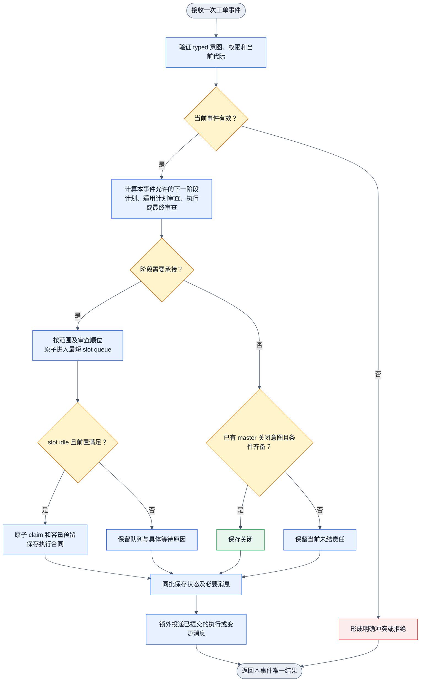
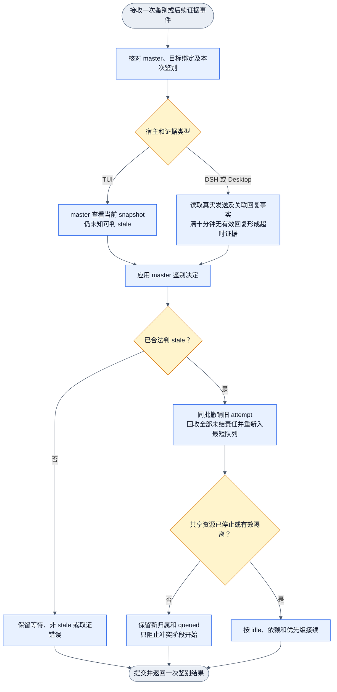

# Collab 工单系统实施详细设计

当前状态为完整设计包独立 review 已接受，由 Jenny 安排实现。源码基线和行号见 `../dagpipe/collab-ticket-current-20261107.md`，差距见 `collab-ticket-gap-20261107.md`，执行合同见 `../plans/collab-ticket-system-20261107.md`。目标正文及四份 20261107 机器图继续作为需求和目标拓扑材料。

## 目标与约束

入 daemon 即按接收范围分配到最短 slot queue。busy 和依赖未满足均不阻止入队。只有开始执行才检查 idle、依赖、阶段前置和实际资源。daemon 自动推进 plan、执行、review 和已授权关闭。master 通过一次 context 看到下属当前运行和排队任务。

复用现有 board、WorkPolicy、NameWorkRoles、IdentityBindingSlot、TaskAssignment、State candidate commit、durable mailbox 和 adapter。业务状态继续保存于现有当前状态资源，不引入数据库、事件日志真源或第二份可写 board。通知与自动接续分开。禁止主树 dirty 混入、生产启动自检、身份重注册、tmux 生命周期操作和自动全局安装。

适用需求为 `.appsdk/requirements.json` 当前有效 `req-minimal-governance` v1、`req-minimal-command-surface` v1、`req-collab-identity` v1、`req-collab-communication-notifications` v5、`req-command-logs` v1，以及恢复边界相关的 `req-collab-daemon-restart-recovery` v1。新工单要求来自本任务用户指令及 `review-task.md` 原文。既有调用日志沿原 owner 使用，不为本功能新增一套历史流。

## 唯一 owner 与拟改结构

| 责任 | 现有 owner / 拟改位置 | 取舍 |
| --- | --- | --- |
| 公开请求与 CLI | `collab/src/board.rs`、`proto.rs`、`main_cli.rs` 和既有 board 客户端分派 | 扩展 board/task 表面，不另建 ticket CLI 树 |
| admission 与旧入口适配 | `server/board_handlers.rs`、`board_invites.rs`、现有 task register/update/close handler | 建单、接入和兼容入口调用同一工单控制函数 |
| 选择及阶段接续 | `server/work_assignment.rs`；可将新增纯调度函数拆到 `server/ticket_scheduler.rs` | 原 dispatch owner 改为调用新函数，删除被替代的角色偏好邀请调度 |
| 阶段模型与 reducer | `server/state.rs`、`server/state/` 既有 reducer include；新增类型可放 `server/ticket_state.rs` | 类型只描述当前工单执行，不复制 TaskRec 内容 |
| claim、Started、结果 | `server/board_execution.rs` | 保留真实资源与执行绑定 gate，取消 claim 即 running 的推断 |
| 审查 | `server/required_review.rs`、`mod_parts/part_09.rs` | 复用被审版本失效，统一三档权限和最终结果提交 |
| 活动与通知 | `name_monitor.rs`、`keepalive.rs`、`notification_state.rs`、`timers.rs` 和现有 mailbox | 接收可信活动事实；新提醒不走旧 master idle 批量 gate |
| 鉴别及回收 | `name_stewardship.rs`、`name_state.rs` | 不可用先形成鉴别对象，master 决定 stale；daemon 执行回收 |
| 一致性边界 | `mod_parts/part_02/commit.rs`、`current_state.rs`、manager 既有 binding control 协调入口 | 复用现有原子业务提交和 register gate，不增加数据库或身份镜像 |
| context | `mod_parts/part_09.rs` 的 `context_projection` | 在 management 与本人视图补充同源队列投影 |

上述新增文件名是本版选定的拆分位置，只有相关代码达到需要分离职责时建立。不得为名称一致创建空模块。`mod.rs` 与共享 State 注册点由核心 owner 单写。

## 最小数据模型及消费者

工单身份仍是项目 scope 与原 task ID。不得为存量单分配新的 ticket ID。TaskRec、BoardTaskDetails 和 TaskLifecycleRecord 继续承载原有内容、验收和交付事实。

| 对象与必要字段 | 当前消费者及作用 |
| --- | --- |
| 工单调度扩展：`admitted`、任务 `revision`、`requires_plan`、适用 `review_subjects`、阶段依赖 ID、本次 `requested_executor`、`close_intent` | admission 决定是否自动调度；revision 做并发更新；阶段 gate 决定合法下一阶段；自领限定执行候选；关闭 owner 保留 master 意图 |
| `review_subjects`：plan / delivery 的集合 | workflow 或工单合同明确需要哪个审查时使用；不因需要 plan 就擅自要求额外计划审查，也不取消合同已经要求的计划审查 |
| 阶段键：`task_id + phase_kind + batch`；阶段种类为 plan、plan_review、execute、final_review | reducer、queue 唯一性及返工使用。plan_review 仅在合同要求时建立。batch 用于内容变化或返工，不另建工单 |
| 阶段状态：waiting_assignment、queued、claimed、running、completed、rework、revoked | 调度、执行及 context 共用。等待依赖和资源是 queued 项的具体等待原因，不建立一套可与队列矛盾的主状态 |
| 阶段记录：当前 slot 引用、enqueue sequence、attempt generation、claim、当前结果及证据引用、实际参与者 | queue 计算、CAS、Started/结果核验、审查独立性和 context。保留旧批次结果及必要参与记录以防重放，不复制源码或完整消息正文 |
| 调度 slot key：既有 IdentityBindingKey 的 project/app/name | 按稳定名字和绑定分区定位接收者。每个有效绑定作为一个可占用的执行位置；不新增可任意声明的容量数字。不同角色共享该 slot，不能分别建立 plan 与 review 容量后重复占用同一执行载体 |
| slot 接收策略：enabled、可接 phase、work_kind 范围、manager/patrol 引用 | 候选过滤和提醒接收关系。范围省略表示本项目已授权范围内的通用工作，不表示跨项目授权 |
| slot 当前 active claim | 防止竞争启动。队列是阶段记录按 slot 的索引投影；不持久化第二份可独立修改的任务列表或水位计数 |
| 轮转游标：项目、阶段候选组、work_kind 对应的最后选中 slot key | 同水位公平轮转。与入队一起提交。接收组变化时从现有有序候选中接续，无需保存候选快照 |
| claim：阶段键、attempt generation、slot、当前 binding generation/session、领取主体和合同消息 ID | 执行授权、重复投递去重、Started 与结果匹配；不新增时间租约或擅自过期策略 |
| 参与者：稳定名字，以及产生参与时的 actor 关联 | review 排除作者、Planner、实现者及对应内容修改者。session 更换不清除参与；名字交接沿现有身份关系保留实际 actor 来源 |
| 路由结果：review subject revision、实际接收名字/actor、角色组、顺位、阶段内授权、被排除参与者的判定依据 | review handler 核验实际承接角色。交叉 peer 只获得本项目本单本阶段结果权限，不获得全局 reviewer 或 master 权限 |
| 工单请求回执：request ID、typed 意图、结果引用 | 接入及有副作用命令重放。typed 意图保存必要命令字段，不保存密钥，不计算哈希 |
| idle episode：slot、binding generation、episode sequence、trusted start、已生成的进入提醒和阈值提醒消息引用 | 恢复连续 idle、去重与阈值取消。既有 AgentActivityRecord 的可信起点可用时直接引用；不再记录另一套观测历史 |
| 鉴别记录：本次 request ID、目标名字及 binding generation、宿主、snapshot 或请求消息引用、真实发送时间、有效回复引用、master 决定及依据 | 宿主规则判断和迟到回复隔离。没有真实发送回执就没有回复倒计时 |
| 资源等待：既有资源 ID、旧 attempt、等待原因、资源 owner 的隔离或释放证据引用 | stale 后阻止实际冲突执行。只对工单已声明的共享可变资源或不可重复副作用建立等待，不增加假设资源注册体系 |

不持久化独立的运行数、队列长度、团队 queue、个人 queue、快照缓存或推导出的授权。团队和个人视图均读取同一阶段记录。阶段 result 仅保留消费者所需结论、subject revision 和证据位置。

## 接收范围默认值

注册身份及工作专长继续沿既有入口。注册成功不依赖新调度配置。对已经有效的普通 peer，默认可接本项目通用 execute；`plan` 或 `planner` 专长允许 plan；`reviewer` 进入第一审查组；`architect`、`expert` 进入第二组。普通 peer 可由第三档路由取得单阶段审查授权。专长只是接收匹配，不能覆盖项目范围、实际参与独立性和 master 关闭权。

巡检员和记忆 agent 从普通派发候选排除。master 默认承担管理职责。已有指定 executor 或 reviewer 的合同保留。指定 reviewer 仍必须满足独立性，其不可用时显示具体指定人缺口。未指定 reviewer 时采用三档路由。

manager 关系优先复用 managed subagent 的 parent 和项目 master。受托 peer 管理子 worker 时，该 peer 是子 worker 的 manager。巡检员使用现有明确授权的名字配置；缺少时只标该提醒的目标缺口，不猜测人选，不阻断其他队列。

## 请求、事件与原子提交

公开请求继续进入 `Req::Board` / 既有 task 请求，先转成 typed 工单意图，再调用唯一控制函数。新增必要意图为接入、接收策略更新、阶段领取/开始/结果、master 关闭意图、鉴别请求与决定。内部事件包括阶段入队/领取/开始/结果、活动边沿、idle 阈值、slot/范围变化、资源释放。事件是 reducer 输入，不是新增可回放的业务历史真源。

新 publish 默认接入 daemon。自领沿现有 executor 参数指定本人，并在一次请求内完成创建、接入和本人 slot 入队。`board backfill-execute --admit-legacy` 是当前已落地的最小显式存量准入分支；`board dispatch` 的既有存量接入语义不在本次改动范围。`board claim` 走同一领取 gate，不允许跨过队列优先级、阶段前置或其他人的 active claim。

`commit_locked_checked` 已能对 candidate 应用一组变化并原子保存。工单控制函数须在同一个 State 锁区间完成读取水位、选 slot、生成阶段变化、预留/释放 claim、生成必要消息和保存请求回执。阶段结果、下游入队和旧 slot 释放不得拆为三个提交。adapter 调用、snapshot 采集及外部资源查询均在锁外；结果回库时核对目标 binding generation、阶段 batch 和 attempt。

`commit_command_locked` 当前重放只核对 command 与 operation 关系。工单 owner 增加 typed 意图比较。同 request ID 同意图先返回原结果，不受后来版本变化影响。同 ID 不同意图明确冲突。首次请求才检查 expected revision。不同 request ID 接入同一已接入 task，若版本有效则返回现有接入状态。旧版本返回冲突。此能力可做工单范围的专用回执扩展。

提交前写盘失败不发布新 candidate。替换完成但目录同步未知时，保持已替换的内存 candidate 并返回现有 typed DurabilityUnknown；同 request ID 查询/重放读取原回执，不能重新生成派发。继续复用 `current_state::save` 的语义。

身份 control 与业务 State 不合并。manager 提供一个受既有 `register_gate` 保护的工单调用/快照边界：先在 gate 内读取当前 control，确认该 scope 的 pending handoff 已消费或显式未完成，再锁 runtime State。顺序固定为 manager register gate → runtime State；绝不从已持 State 锁的 handler 反向取 gate。timer 和旧公开入口也经该边界调用。不得在 gate 内执行 adapter I/O。执行前先定向核对现有 gate 覆盖所有相关 control 发布者；若发现绕过者，只补受影响 owner，不能靠重复读取 control 声称消除竞态。

## 最短队列与自动接续算法

入队算法如下。

1. 在一致性边界内解析当前阶段。依次校验项目范围、接收策略、专长、独立性、指定名字和 stale 承接资格。busy 不参与候选淘汰。通信可达性作为执行条件单独呈现，不能仅因临时不可达便把已持久身份判 stale。
2. 对合格 slot 计算当前 queued 阶段项数量。包括依赖和资源等待项，不包括 claimed/running/completed 项。不得使用运行数加可执行排队数。
3. 选择最短 queue。本版采用同水位轮转默认值，作用是避免同水位长期偏向同名 slot。候选按稳定 key 排序，从持久游标后选择首个最短项。
4. 更新阶段 slot、enqueue sequence 和轮转游标，一次提交。无合格 slot 时保存 waiting_assignment 和具体原因。配置、资格或角色变化会触发一次内部匹配。

取单时，slot 须无 active claim，且当前执行载体有可信 idle 事实。daemon 按 p0 至 p4 遍历其 queue，同优先级采用 enqueue sequence FIFO。跳过依赖、规划/审查前置或资源未满足的项，再选择下一独立可执行项。无项可执行则保留等待原因。领取与 active claim 同批提交，并保存执行合同消息。已经 idle 时的新入队、结果释放 slot、依赖完成、资源释放和范围更新都会触发相同内部检查。

同一 slot 一次仅有一个有效 active claim。claimed 不因重复 idle 观测而释放，也不因用户未指定的超时自动回收。真正开始由当前 claim 的 `Started` 回执确认；durable 入队、唤醒或 adapter accepted 均不算 running。执行合同携带阶段键、attempt、绑定代际和内容版本；接收端按该键去重，自动开始后用既有 update 通道提交 Started。启动失败保留明确状态和 slot 责任，由对应恢复事件处理，不虚构成功，也不自动重试到任意次数。

## 阶段推进与审查

本图只推进当前事件允许的边。规划结果和真实执行结果必须来自后续独立事件，不在一次 publish 中假定同步完成。

需 plan 时先建立 plan 阶段。有效 plan 结果与适用 plan_review 满足后才能建立 execute。自领 pin 约束 execute，不把规划强塞给本人。执行完成须提交合同要求的验证证据，然后才建立 final_review。旧执行 slot 按真实阶段结束回执释放；TaskRec 的原执行责任保留，review slot 不覆盖原实现者。

review 候选依次为独立 Reviewer、独立 architect/expert、另一独立 peer。先选首个有合格接收者的组，再选其最短 queue。busy 只影响何时取单，不触发降档。所有组均缺合格者才 waiting_assignment。计划审查排除该计划作者及对应内容修改者；最终审查排除同一工作的 Planner、方案作者、实现者和修改者。实际参与记录跨 session 保留。

三档使用相同 claim/update/result 合同。提交者必须匹配本次 route 和 claim。结果记录真实角色组，不能固定写 Reviewer。review PASS 绑定当前 subject revision；返工或合同实质变化增加 subject revision，使受影响结果失效。计划补正回原规划责任，执行返工回原执行责任；若该名字已被 master 判 stale，则回系统匹配。不存在合规候选时等待，不绕过必需审查。

关闭只接受当前 master 的意图。peer 普通 close、force close、delete 或 update 伪造终态均拒绝。master 缺审时的关闭请求保存意图并自动送审；必需 plan、验证、review、交付及适用资源收口满足后自动完成意图。无须二次 close。保留现有代码交付和只读交付的区别，不强迫只读报告制造 merge。对不需要 review 的合同，不继续沿旧代码无条件要求 reviewer 字段。

## 存量接入与旧入口兼容

接入使用当前项目 scope 和原 board task ID；核对原单版本及已有责任。一次事务同时完成接入标志、现有阶段解释、必要 queue/claim、请求回执。已关闭单返回原终态，不重开、不篡改历史。

存量 pending/queued 单接入后按当前阶段分配。存量 working 单保留原归属和资源；只有可信开始证据才标 running，否则保留已领取且运行未知，不重复派发。已有有效计划、审查或交付事实可复用；缺少必需前置时显式显示缺口，不能伪造补历史，也不能仅凭旧 working 状态宣称新阶段合规。只暂停受影响的后续变更，独立任务继续。

接入未接受的旧 invitation 时保留原 owner。事务中撤销尚未消费的邀请及其启动权限，再创建唯一 queue 项；若 accept 与接入竞争，锁内只有一种结果生效，败者收到 stale revision。接受事实已经成立时按已承接存量处理。旧消息消费历史保留，不重放。

原 `board publish/claim/update/dispatch`、task register/update/deliver/review/close 及适用 scheduler 请求均转入同一工单 gate。旧 invite/respond 在已接入单上作为兼容指定接收或本阶段回执，不再要求新流程人工 accept，也不新增入队通知。未接入存量入口不得获得绕过 master 关闭和必需独立审查的权限。未知旧版本请求若无法合法转换，返回具体升级错误，不静默退回旧执行链。

### 显式存量准入（`backfill-execute --admit-legacy`）

这是当前唯一落地的存量准入实现，范围为已描述但缺阶段记录的既有 owner 单。命令扩展已有 `board backfill-execute <task-id> --expected-revision <r>`，新增必填语义的显式布尔选项 `--admit-legacy`。

- 权限与范围：实际调用者须为当前项目 master；仅接受公开、已描述、状态为 `working` 或 `rework`、`admitted == false`、无任何 stage 记录、无待处理 invitation，且当前 owner 在本项目 scope 有 active binding 与匹配稳定 assignment 的任务。
- 原子性：在一个 State 锁区间内校验 revision、slot、binding、assignment、executor pin 与同 slot 占用，然后同批提交 `BoardDetailsChanged`（仅改 `admitted` 与 `revision`）和一个 `Execute` 阶段（状态 `Claimed`，`attempt_generation = 1`，`batch = 0`，空依赖）。不产生 task-created、assignment、lifecycle、subscription 事件，也不启动执行或交付。
- 保留与拒绝：任务 ID、owner、历史、证据、review/close 义务和订阅保持不变。读取与普通更新不触发准入；重复请求一次成功、其余因 stale revision 或已准入被明确拒绝，不产生第二个阶段或第二次 attempt。未带 `--admit-legacy` 的原命令行为完全不变。

## 自动接续与对象提醒

| 事件 | 同批状态及调度 | 对象提醒 |
| --- | --- | --- |
| 普通入队/重排 | 更新 queue；idle 时尝试取单 | 不发送入队提醒 |
| 运行任务的执行合同变更 | 保存新版本、适用结果失效及变更消息 | 直接向当前执行绑定投递，manager busy gate 不适用 |
| worker 进入可信 idle | 开启 episode，自动检查 queue | 立即生成直属 manager 消息 |
| manager 进入可信 idle | 执行本层既定调度检查 | 立即生成指定巡检员消息 |
| worker 同一 episode 严格超过 10 分钟 | 再核验同绑定仍连续 idle | 同批生成 manager 和巡检员消息 |

同一主体可同时是上级的 worker 和下级的 manager。按实际关系应用两条事件规则；同一对象相同消息意图去重，不擅自取消其中一条职责。

idle 来源是可信 online + idle 活动，不从 queue 空、无消息或端点存在推导。busy、unknown、offline、waiting_user 或绑定代际变化结束连续区间，旧阈值不可在之后补发。已领取待启动也不能作为再次领取容量。Started 立即结束旧 episode，防止适配器状态刷新延迟导致超时误发。

阈值条件固定为 `now - trusted_start > 600000ms`。恰好 600000ms 不发。使用既有 timer 的下一次合法处理检查，不增加新的轮询周期。重启读取持久 episode、可信起点和提醒引用，再以当前事实决定是否仍连续。不能像现有某些 patrol 路径一样重启即重置该目标的 idle 起点。

提醒去重键为运行 task revision、进入 idle episode、idle episode 阈值事件。生成消息和去重引用同批提交；不能先标已提醒再另写消息。目标缺失保留 unresolved recipient；关系补齐后生成同一事件所需消息，不设额外重发周期。消息入队、adapter 接受、目标接收、消费及处理继续分层。

新提醒使用既有 durable direct-message 和名字寻址。修改本目标覆盖的旧 WorkerIdle/MasterIdle 批量分支，防止同一边沿再生成旧消息；保留无关 goal、回复义务和既有用户订阅，不全量删除 master wake。必需提醒不能被 finite patrol 次数、quiet window 或 manager busy 批量 gate 当作普通巡检摘要吞掉。

## stale 鉴别、代际和资源安全

DSH/Desktop 的回复期限以真实请求发出回执为起点。满 10 分钟无有效关联回复即可形成 master 鉴别条件；这与 idle 提醒的严格超过 10 分钟不同。master 提交带本次请求和绑定依据的决定，daemon 不因普通 offline 观测自行作 stale 裁决。发送失败保留原错且不启动计时。回复必须匹配本次鉴别及当前目标绑定；旧请求回复不能撤销新决定。

stale 决定在同一 State 提交中停用该承接资格、递增受影响阶段 attempt generation、撤销 claim、回收全部未结阶段并分配新 slot；解除该次自领 pin。关闭历史不改。普通名字会话续接沿现有 pending effect 换绑，保持任务及队列，不等同 stale，不要求 Jenny 重新 assign。

所有可变更工单提交核验当前 attempt 和绑定；旧 Started、result、close intent 和 queue 更新拒绝。绑定 generation 与任务 attempt generation 分工不同，不相互冒用。新 claim 只引用新 attempt。

工单 fence 只能阻止 daemon 控制的提交，不能保证任意旧 shell 停止。新执行使用独占新 worktree。原 worktree、未交付文件和活动进程由原资源 owner 保留并核实。共享可变资源或不可重复副作用仍可能被旧执行使用时，新阶段先排队并挂该资源等待；资源 owner 提供停止、隔离或可安全恢复的具体证据后才能开始。daemon 控制的外部动作在执行前再次核验 fence；无法原子 fence 的外部系统必须沿其既有幂等或查询合同核对未知结果。缺少恢复依据交 master 裁决，只停该资源下游。不终止宿主 pane，不操作 tmux server，不擅自杀进程。

## context 一致性快照

复用 manager gate → control load/交接状态检查 → runtime State lock 的边界，复制本次投影所需数据后释放锁。在同一响应附业务 revision、所用相关绑定 generation 和 captured_at；它们供调用者识别状态版本，不作发布身份包装。

本人视图和 `management.tasks` 增加每个阶段的 assigned slot、queued/claimed/running、优先级顺序、依赖及资源等待、原执行责任、当前 plan/review 承接者。管理范围按现有授权和直属关系。plan/review 团队列表只是同源过滤。

快照不做 adapter probe，不消费消息、不 claim、不改 revision。外部可达性注明已有观测时间，与业务状态分开。控制读取失败、交接未完成或业务投影错误返回具体状态，不能变为空任务成功。无队列时返回明确空列表。

## 必要技术验证边界

执行前验证 manager gate 是否覆盖所有相关身份发布及其锁序，验证公开测试 fixture 能提供真实 Started 和可信活动事件，验证当前 schema 对新增默认字段的恢复行为。这些是实施验证，不是本轮已经通过的事实。失败只阻止一致性或运行/提醒等真实下游；不阻止纯选择器、权限与模型工作。不得以未知为由改数据库、增加探测服务或发明超时策略。
