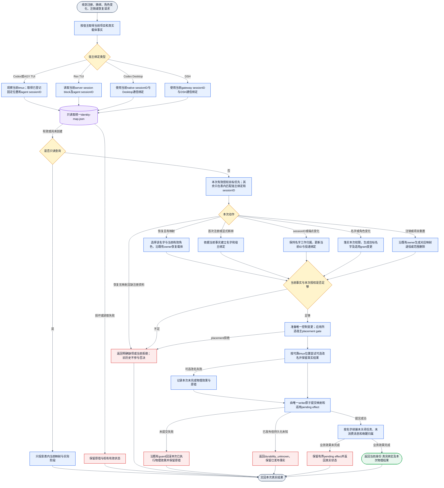

# Collab 统一身份映射与恢复

状态：正式源合同；候选验收、安装、激活和运行回执分开记录。历史实现计划保留为证据，不把文件存在当作行为完成。

## 目标与唯一真源

所有宿主通过 `<Collab state root>/identity-map.json` 注册、改变、换绑和恢复身份。默认文件为 `~/.collab/identity-map.json`。名字承载工作归属；current anchor 是该名字的唯一持有者；sessionID承载当前执行。恢复只从此文件选择身份。旧identity归档、route历史、项目journal、旧operation、tmux显示名和iTerm布局不得成为第二个身份选择源。

当前用户有效授权可以创建或替换目标映射。旧名字、旧注册和历史歧义不能否决新授权。文件缺失只表示没有映射，可沿首次注册/显式新绑建立；文件损坏或读写失败返回原错，不回退历史或伪造空表成功。

这是一个控制资源，不是旧恢复结果的镜像。实现须复用现有typed binding/control writer及有界pending effect，将旧恢复入口切到同一资源，并删除旧选择方式。任务正文、消息和消费回执仍由各自业务owner维护，不复制到映射文件。

## 宿主绑定

| 宿主 | 当前事实 | 写入与恢复绑定 | tmux改名 |
|---|---|---|---|
| Codex TUI | 真实Codex sessionID、daemon观察到的当前tmux端点 | 映射中的固定project/tab/slot与当前载体；已登记sessionID可在同文件反查 | 是 |
| AGY TUI | 真实AGY sessionID、daemon观察到的当前tmux端点 | 同上，记录AGY和实际TUI类型，不冒充Codex | 是 |
| Rex TUI | 真实Codex sessionID、server/session/block endpoint | 当前block与agent sessionID；不要求tmux manifest位置 | 否；项目session按cwd目录名命名 |
| Codex Desktop | 真实native sessionID/thread与既有Desktop通信端点 | 直接登记sessionID；换载体时更新当前ID绑定；按表恢复 | 否；不要求tmux事实 |
| DSH | 真实gateway sessionID与既有DSH API目标 | 直接登记DSH sessionID；变化时更新绑定；按表恢复 | 否；不要求tmux/native字段 |

第一次注册写表。sessionID、端点、名字或角色变化时，由唯一writer提交当前绑定。只读query只返回已持久结果，不补注册、不迁移、不重放。

tmux物理显示名由唯一可靠manifest中的 `tab_id`、`pane_order` 和逻辑名字组成。
位置来自真实布局。无可靠位置时保留当前物理标签，普通池序号和 `peer-n` 数字只用于
逻辑名字分配。tmux内Jenny/master使用项目固定位置1。Rex绑定当前block，session名
使用项目cwd末级目录，peer的身份、角色或任务变化在当前block上完成。

iTerm2只负责显示。它的manifest用`tab_id + pane_order`排列和对应pane，不能解析可变session名。Collab保存已登记的固定位置；恢复不读取外部manifest，也不从iTerm当前布局决定身份。Desktop和DSH不为兼容此表虚构tmux位置。

profile在注册/显式重绑时从真实tmux端点反查runtime启动参数，记录实际值；不要求Codex自报，不按模型猜测，不保存整条可能含敏感数据的命令行。没有profile不增加恢复准入门禁。

## 完整行为DAG

下图是一次公开请求的SESE对象流。不同结果保留真实类型，统一交回。图内没有重试回边；下一次请求是下一次执行。

图中的普通恢复没有旧identity扫描、旧pane归属裁决、旧session显示名继承、project journal重建身份、历史歧义待决或第二次人工确认。journal的写、读和维护入口全部移除；任务、消息、订阅与真实消费回执由业务owner保存在当前state.json中。首次注册不伪装成历史恢复。

## 统一映射内容

下面是可读字段合同。最终机器字段复用实现计划选定的现有typed owner，不建立并行控制模型。认证秘密不写入设计样例。

| 内容 | 保存事实 | 消费者 |
|---|---|---|
| 项目与应用范围 | canonical project、app scope | 所有身份查询和换绑，防跨项目串绑 |
| 工作归属 | name、worker_id、有效role/grant | 名字、权限和任务交接owner |
| 宿主类型 | codex_tui、agy_tui、codex_desktop、dsh | 选择对应绑定规则；不按模型或历史推测 |
| 当前agent session | 真实Codex/AGY/native/gateway sessionID及适用thread | 当前身份获取、恢复和ID更新 |
| 固定TUI位置 | tmux已登记tab_id、slot；Rex为当前block | tmux布局续接；Rex按block续接，不要求tmux位置 |
| 当前通信绑定 | 原typed transport和端点 | 投递owner，不从日志重建；endpoint generation 已退役 |
| 实际profile | 从tmux反查得到的实际runtime profile；可缺省 | 下次启动恢复，不作为身份权限 |
| 已登记session关联 | 名字下已登记的sessionID及宿主类型 | 仅在同一文件内反查；旧项不能否决新授权 |
| 未完成交接引用 | 原有有界pending effect | 原业务owner完成后清除，不复制任务/消息正文 |

## 已确认生命周期关系

- 普通名字池耗尽后继续分配未占用的 `peer-n`，新注册不因历史占用失败。
- 人工指定任意已有名字时，新 holder 替换该名字 current；旧 holder 不即时
  获得 companion 名字，只在下次普通 context 时注册可用名。
- Frank 会话被授权顶替 Bob 时，Bob 任务接续当前 Bob holder；Frank 源任务仍归
  Frank，不因 actor/session 相同跟随搬迁。升为 Jenny 的 R5 同样保留 Bob 原任务。
- daemon 重启或 agent sessionID 变化时，只有当前事实唯一才自动续接；事实缺失
  或冲突返回具体缺项，不用历史记录复活已被替换 holder。
- 自动探测失败、静态 error、ask 或 unknown 不计入 idle，不触发重派。daemon
  确认 identity lost 后等待 15 分钟；当前 holder 回归或合法同名接替结束等待。
- 15 分钟到期且有合法 idle 时发出邀请；新 owner 接受并 daemon 提交后 ownership
  才转移。接受前原 holder 回归继续原任务，未接受邀请撤回。
- 人类明确退役普通名字时立即释放名字，未完成任务立即具备重派资格；全忙时等待
  合法容量，不强派。
- 未消费消息和任务唤醒跟随当前归属；已消费历史与真实回执不重放，旧结果交当前
  task owner 评估，不恢复旧 owner。

## 映射示例

这是设计样例，不是当前机器名册。

| 项目 | 名字 | 宿主 | 当前sessionID | 固定位置/绑定 | 物理显示名 |
|---|---|---|---|---|---|
| routecodex | Jenny/master | Codex TUI | codex-A | routecodex / 1 | routecodex_1_Jenny |
| routecodex | Alice/peer | AGY TUI | agy-B | routecodex / 2 | routecodex_2_Alice |
| appsdk | Bob/peer | Codex Desktop | native-C | native sessionID | 不改tmux |
| appsdk | Carol/peer | DSH | gateway-D | gateway sessionID | 不改tmux |

## 实现与验收边界

用户指定实现次序：先移除旧身份选择、历史扫描和恢复fallback，再实现新的唯一映射路径。不先搭新旧双路径，不保留兼容恢复器，不以feature flag或旧日志补偿。各宿主仅在绑定适配上不同。删除与替换之间源码可以暂时未闭合，但未闭合候选不得安装；业务任务、消息和真实消费历史不属于待删除的身份恢复代码。

先完整计划及项目图/gate，再用真实公开入口取得RED，之后修改唯一owner。覆盖四宿主注册写表、ID变化换绑、只读表恢复、旧历史不可用/冲突不阻断授权、文件缺失/损坏、Jenny1号、跨项目隔离、改名/提交失败及旧入口删除。完整milestone验收后进行一次整体独立Review，再由Jenny接收候选并负责main集成。保护旧dirty主树和其他owner资源；正式安装逐次取得用户批准，daemon由用户自行激活。
