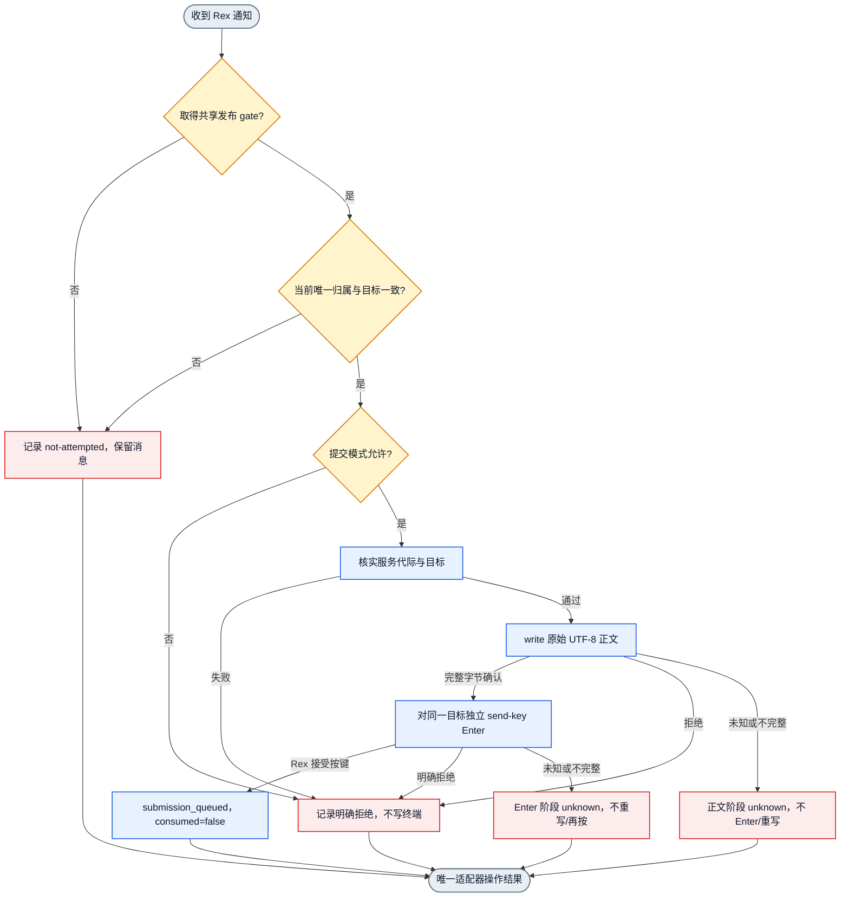
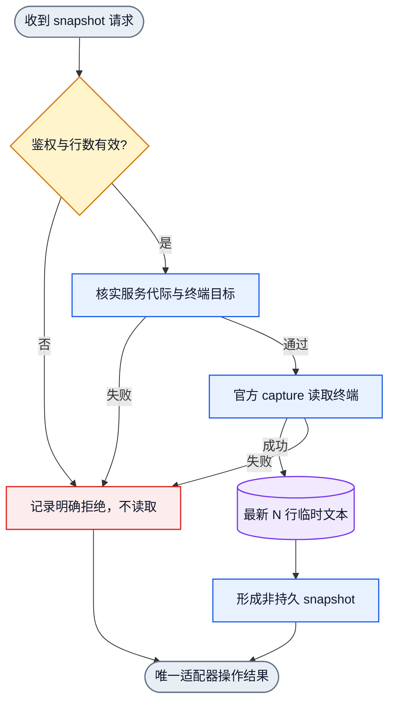
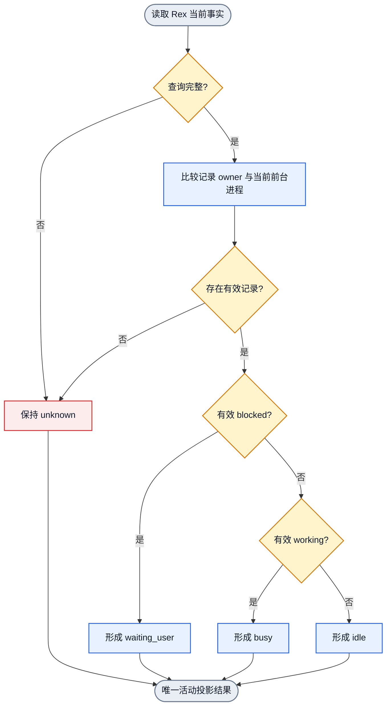

# Rex 与 Collab 适配 Ontology

状态：current behavior design。本文是
[Rex 完整语义模型](rex-project-agent-lifecycle-architect-20261110.md) 的从属
Adapter 技术视图，只记录 Rex adapter、snapshot 和活动观察细节。对象所有权、
身份、block 当前归属和生命周期由整篇模型及各既有 owner 定义；本文不建立
第二套 ontology，也不把设计文件当作运行证据。

## 边界

Rex terminal endpoint 是通信地址。Collab agent sessionID 是身份执行载体。
两者不能互相替代。Rex 的输入排队、snapshot 读取和程序状态观察分别有独立
语义；任何一项都不证明消息已接收、消费或回复。

用户已确认 Rex block 本身是 anchor。Window/layout 描述 block 的组织和位置；
split 创建新 block，既有 block 的 resize/move/swap 不改变其身份。Rex
server/session 是定位和核实上下文，不是 block anchor 的替代身份。

有效 Rex current binding 必须引用实际 block，并携带执行操作所需的完整 typed
endpoint。沿既有 binding 条款，一个实际 block 在官方核实的 server 内最多只有
一个 current identity；后来的成功控制提交替换旧归属。缺 block 是事实采集或恢复
失败，不是有效的无 block 状态，也不触发 Desktop fallback。Block 替换和 route
退旧资格由 binding owner 在同一控制提交边界完成，adapter 只使用调用方给出的
完整目标。Rex object/API 的 locator 作用域和跨 window/session 移动能力，仍以
已核实的 Rex 行为为准，不从 anchor 定义额外推导。

已确认的关系：有效 current binding 到 Rex block anchor 为 1..1；一个 Rex
block anchor 到 current identity owner 为 0..1。用户另已批准同一项目内每个
活动 Rex 名字唯一对应一个 current holder/anchor。用户现已确认：权威事实确认
实际 block 不存在时，退役与它绑定的名字；持久身份及业务责任仍保留。查询失败、
不可达或 unknown 不算 block 不存在，不能据此退役。名字能否重用不由此推定。
block 仍存在但被另一身份成功替换时，旧名字的处理仍待协调。Timed detach 按既有
批准解除 execution 和 anchor、保留名字；它与名字必须有 current anchor 的兼容方式
仍待协调。不能擅自加入自动创建或分配另一个 block 的行为。

## 对象

| 对象 | 身份 | 关键属性 | 唯一 owner | 可观察入口 |
| --- | --- | --- | --- | --- |
| Rex block anchor | Rex block entity | block identity；当前所属 window/layout 可变化 | Rex；current owner 由 binding owner 保存 | `session.inspect` 布局与 block inventory、官方 block API |
| Rex endpoint locator | server + service generation + session + block | host、instance、cwd；用于查找/核实 block anchor | binding owner 与 Rex adaptor | 官方 CLI 参数、typed binding |
| 通知提交 | 一次通知消息对一次 terminal body write 和一次独立 Enter | 原始正文、正文排队字节、Enter 接受 | `collab/src/adapters/rex.rs` | write 与 send-key receipt、fixture invocation |
| 临时 snapshot | endpoint + 请求行数 + 一次 capture | 最新文本行、传输类型、非持久 | Rex adaptor 与 snapshot handler | `collab snapshot TARGET_ID` |
| 程序状态记录 | 一条 Rex program-status record | id、state、kind、owner、updated_at | adaptor 解码，monitor 投影 | `program_status`、activity view |
| foreground owner | 当前前台进程 | pid、name | 官方 `terminal.process` | process query |
| 通知拒绝 | selected transport + 原始错误 | transport 标签、native detail | `notification_rejected_label` | 通知响应 |

## 行为

### 通知提交

`（已选择完整 endpoint，通知正文） -> （正文 write 完整） -> （同一 server/session/block 的独立 Enter 被接受） -> （submission_queued，不消费）`

- 通知 owner 先尝试获取与绑定发布共用的 host register gate。占用时返回
  not-attempted，保留 durable 消息，不产生 wake 或终端输入。
- 持 gate 重读 identity-map，要求收件人、scope、完整 transport 与唯一的
  server+block current owner 一致。旧缓存、缺失 current 和重复归属都不投递。
- 校验、记录本次 selected binding、一次同步 sink 及本次结果在同一 gate
  边界内完成。sink 期间释放 State；换绑须等待本次调用返回才能发布。
  gate 由通知 owner 持有，adapter 不再次获取它。
- 正文按 UTF-8 原样写入，不把回车字节当作 Enter 键。
- 正文 write 必须确认完整 UTF-8 字节数。拒绝、短写或结果 unknown 时不得执行 Enter、重写正文或切换目标。
- 正文完整后，对同一 server/session/block 调用一次官方 `send-key enter`。Enter 明确被接受才记为 `submission_queued`；失败或结果 unknown 不得重写正文或再次 Enter。
- `submission_queued` 只表示独立 Enter 操作被 Rex 接受，不表示 TUI 已处理、程序已读取或消息已消费。
- 正文阶段和 Enter 阶段分别保留 `known-not-delivered` / `unknown` 及实际阶段。正式 receive/consumption 由 notification-consumption owner 提交。
- 已接受或 unknown 的尝试保留原 binding 和原结果；换绑不能撤回已排队输入，
  也不能将旧结果记到新身份。后续旧身份尝试在通知入口被拒绝。

### Snapshot 读取

`（已鉴权目标，1..200 行） -> （最新 N 行文本 snapshot，无输入副作用）`

- 只调用官方 `capture`，使用 text、`--unwrap --trim`。
- 返回空文本合法；失败不回退为空快照。
- 不修改 identity、presence、activity、消息、订阅或消费回执。

### 活动投影

`（当前状态记录，当前 foreground owner） -> （busy|idle|waiting_user|unknown）`

- owner 的 pid 和 name 必须同时匹配当前 foreground。
- 过期或不完整 owner 的状态不参与活动判定。
- 有效 `blocked` 优先映射 waiting_user；有效 `working` 映射 busy。
- 有效 `idle`、`done`、`error`、未知或缺失 state 映射 idle。
- 无有效记录、查询失败或证据缺口保持 unknown。

### 拒绝标签

`（selected transport，底层错误） -> （REX_NOTIFICATION_REJECTED: 原错）`

Rex 标签只由通知结果映射 owner 生成，adapter 和 CLI 不重复包装。

## 关系

| 关系 | 方向 | 基数 | 约束 |
| --- | --- | --- | --- |
| endpoint 承载通知提交 | endpoint -> submission | 1:N | submission 只写已核实 endpoint |
| endpoint 支持 snapshot | endpoint -> snapshot | 1:N | snapshot 只读 |
| 状态记录属于 foreground | foreground -> status record | 1:N | pid/name 同时匹配才有效 |
| 通知提交产生拒绝 | submission -> rejection | 0..1 | 拒绝保留原错 |
| 项目名字的 current holder/anchor | project stable name -> current holder/anchor | 1..1 under approved B1; interaction with timed detach and replacement unresolved; confirmed absent block retires name relation | 活动名字唯一对应 current holder/anchor；确证对应 block 不存在时退役名字，unknown 不退役。该 absence 结论不决定 timed detach 或 replacement 后的名字-anchor 关系 |
| Rex block 的布局归属 | block -> window -> layer/layout leaf | 按 Rex inspect 的实际实体关系；layout leaf 引用 block | resize/move/swap 可改变布局关系但不改 block anchor；split 创建新 block anchor |
| 实际 block anchor 的当前身份 | actual block anchor -> current identity | 0..1 current owner | 沿既有 binding 条款以官方核实 server 为作用域；后来成功绑定替换旧 owner。旧 owner 的名字、身份、历史与责任保留；其名字唯一 current anchor 的 B1 关系如何与 replacement/timed detach 共存待协调，不推导自动分配 |
| block 不存在时的名字生命周期 | Rex 权威 block inventory -> 对应名字关系 | 确证不存在时退役；unknown 时保持 | 仅退役对应名字关系；保留持久身份、任务、消息和资源责任；不推定名字重用；block 仍存在时不适用此退役行为 |
| timed detach | persistent name/peer -> current execution binding | execution binding 1 -> 0; anchor relation semantics unresolved | 按既有批准解除 execution 和 anchor、保留名字和业务；与名字唯一 current anchor 的兼容方式待协调；block 确证不存在时另走名字退役 |

## 通知提交图

## Snapshot 图

## 活动状态图

## 执行 DAG

可执行对象流由
[`collab-rex-adaptor.graph.json`](../dagpipe/collab-rex-adaptor.graph.json)
维护。该图保持单入口、单出口和线性 SESE；本 ontology 解释节点语义，
DAGPipe CLI 只校验拓扑与绑定，不证明运行行为。
