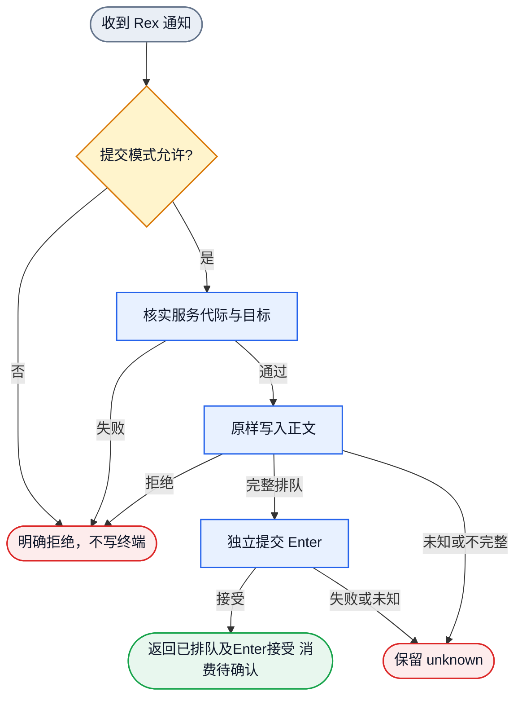
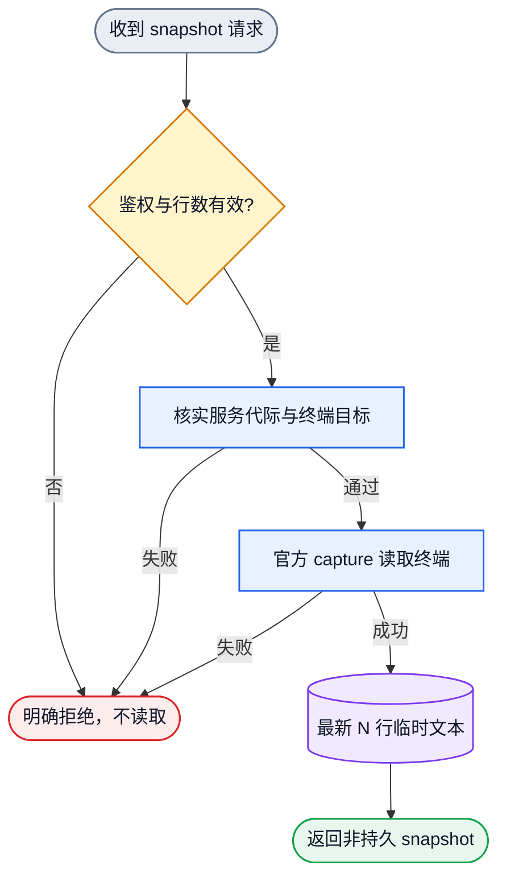
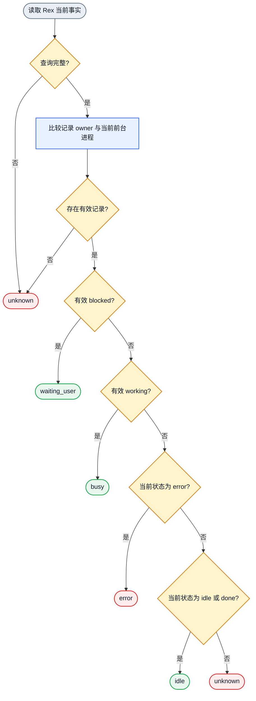

# Rex 与 Collab 适配 Ontology

状态：正式源合同；程序绑定和真实运行证据分别记录。本文记录对象、状态、关系和
可执行 DAG，不新增全局规则，也不把设计文件当作运行证据。

## 边界

Rex terminal endpoint 是通信地址。Collab agent sessionID 是身份执行载体。
两者不能互相替代。Rex 的输入排队、snapshot 读取和程序状态观察分别有独立
语义；任何一项都不证明消息已接收、消费或回复。

## 对象

| 对象 | 身份 | 关键属性 | 唯一 owner | 可观察入口 |
| --- | --- | --- | --- | --- |
| Rex endpoint | server + service generation + session + block | host、instance、cwd | binding owner 与 Rex adaptor | 官方 CLI 参数、typed binding |
| Rex session 名 | 项目 cwd 末级目录 | session 名、当前项目 | Rex session owner | 官方 session/block 查询 |
| 通知提交 | 一次消息对一次正文写入和独立 Enter 提交 | 原始正文、排队字节、输入阶段、Enter 结果 | `collab/src/adapters/rex.rs` | write receipt、submission receipt、fixture invocation |
| 临时 snapshot | endpoint + 请求行数 + 一次 capture | 最新文本行、传输类型、非持久 | Rex adaptor 与 snapshot handler | `collab snapshot TARGET_ID` |
| 程序状态记录 | 一条 Rex program-status record | id、state、kind、owner、updated_at | adaptor 解码，monitor 投影 | `program_status`、activity view |
| foreground owner | 当前前台进程 | pid、name | 官方 `terminal.process` | process query |
| 通知拒绝 | selected transport + 原始错误 | transport 标签、native detail | `notification_rejected_label` | 通知响应 |

## 行为

### 通知提交

`（已选择 endpoint，通知正文） -> （正文排队，独立 Enter 被接受，submission_queued）`

- 正文按 UTF-8 原样写入。完整排队后，通过官方 `send-key enter` 提交。
- 正文写入与 Enter 分别保留实际结果。正文排队后 Enter 失败时，返回
  `Unknown` 和 `WriteQueued` 阶段，保留原错和已发生的写入事实。
- 成功回执包含 `text_queued`、`enter_accepted`、`submission_queued` 和
  `consumed=false`。读取、执行和消费各沿所属回执确认。

上述提交路径已在当前 `origin/main` 的 Rex adaptor 中存在。本轮候选组合和真实
前端回执按各自实际完成阶段记录。

### Snapshot 读取

`（已鉴权目标，1..200 行） -> （最新 N 行文本 snapshot，无输入副作用）`

- 只调用官方 `capture`，使用 text、`--unwrap --trim`。
- 返回空文本合法；失败不回退为空快照。
- 不修改 identity、presence、activity、消息、订阅或消费回执。

### 活动投影

`（当前状态记录，当前 foreground owner） -> （busy|idle|waiting_user|error|unknown）`

- owner 的 pid 和 name 必须同时匹配当前 foreground。
- 过期或不完整 owner 的状态不参与活动判定。
- 有效 `blocked` 优先映射 waiting_user；有效 `working` 映射 busy。
- 有效 `idle`、`done` 映射 idle，静态界面仍须依据当前特征区分 idle、ask 和 error。
- 有效 `error` 映射 error，不映射 idle；未知或缺失 state 映射 unknown。
- 无有效记录、查询失败、owner 不匹配或证据缺口保持 unknown。

### Session 命名

`（项目 cwd，身份或角色变化） -> （cwd 末级目录命名的 Rex session，当前 block 继续承载执行）`

- 创建项目 session 时使用项目 cwd 末级目录名。
- 用户明确指定其他名称时按用户指令；peer 不因身份、角色或任务自动改名。
- Rex 使用当前 block endpoint，不要求也不推导 tmux pane 位置 1。
- 身份和角色变化更新 Collab current binding，不改写 Rex session 名或移动 block。

### 拒绝标签

`（selected transport，底层错误） -> （REX_NOTIFICATION_REJECTED: 原错）`

Rex 标签只由通知结果映射 owner 生成，adapter 和 CLI 不重复包装。

## 关系

| 关系 | 方向 | 基数 | 约束 |
| --- | --- | --- | --- |
| endpoint 承载通知提交 | endpoint -> submission | 1:N | submission 只写已核实 endpoint |
| endpoint 支持 snapshot | endpoint -> snapshot | 1:N | snapshot 只读 |
| 状态记录属于 foreground | foreground -> status record | 1:N | pid/name 同时匹配才有效 |
| Rex session 对应 project cwd | Rex session -> project cwd | 每个项目session对应一个项目cwd | session 名由 cwd 末级目录确定，明确用户改名除外 |
| 通知提交产生拒绝 | submission -> rejection | 0..1 | 拒绝保留原错 |
| Collab 身份使用 endpoint | identity binding -> endpoint | 0..1 current | 不因 Rex 观察失败重建身份 |

## 通知提交图

## Snapshot 图

## 活动状态图

## 执行 DAG

可执行对象流由
[`collab-rex-adaptor.graph.json`](../dagpipe/collab-rex-adaptor.graph.json)
维护。该图保持单入口、单出口和线性 SESE；本 ontology 解释节点语义，
DAGPipe CLI 只校验拓扑与绑定，不证明运行行为。
