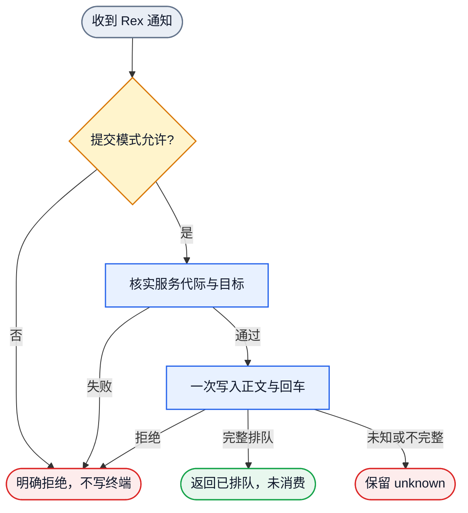
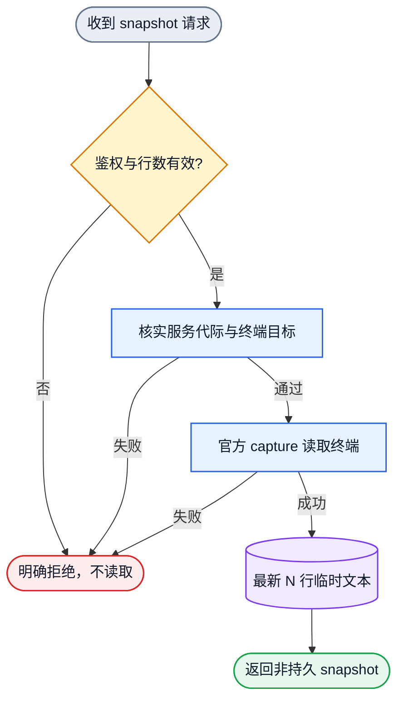
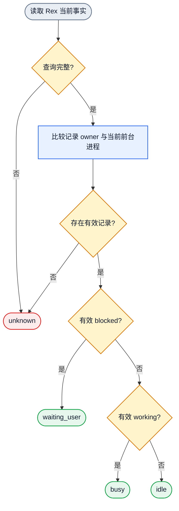

# Rex 与 Collab 适配 Ontology

状态：current behavior design。本文记录现有行为的对象、状态、关系和
可执行 DAG，不新增全局规则，也不把设计文件当作运行证据。

## 边界

Rex terminal endpoint 是通信地址。Collab agent sessionID 是身份执行载体。
两者不能互相替代。Rex 的输入排队、snapshot 读取和程序状态观察分别有独立
语义；任何一项都不证明消息已接收、消费或回复。

## 身份映射的 current 与 previous

本节记录用户确认的身份映射语义。实现仍需经过隔离公开回归和真实 daemon
启动验收；文档本身不代表 live 已恢复。

| 轴 | 定义 | Owner 与观察 |
| --- | --- | --- |
| Object: identity slot | `identity_key` 标识稳定名字；`current` 是唯一当前绑定；`previous` 是最多一个历史引用，不是第二个当前绑定 | `BindingControlStore`；启动公开入口读取 identity map |
| Behavior: validate/start | current 与 previous 指向相同路由事实是有效的历史形状；启动只从 current 和有效 pending effect 恢复，不因二者相同而拒绝或重写 map。字段缺失、未知字段、错误类型和其他真实不变量仍显式失败 | `IdentityBindingSlot::validate` 与 startup recovery；绑定单测及隔离 `collab serve` 启动回归 |
| Relation: history reference | slot.previous -> historical binding，基数 0..1；可与 slot.current 指向同一事实，不参与身份选择、路由或当前归属 | `reference_previous` 的交接消费者；`active_values` 只投影 active current |

Approved clause `identity-map-current-previous-separation`:

- Scenario: daemon loads a structurally valid identity map whose current and
  previous contain the same route facts but may contain different retained
  compatibility metadata.
- Trigger: identity-map validation during daemon startup.
- Allowed: preserve both serialized values and start from current.
- Forbidden: reject the map only because current and previous route facts match;
  select previous as another identity; rewrite the map during startup.
- State: `active current + historical previous -> same active current + same
  historical previous`.
- Owner: Collab binding-map/startup implementation.
- Approval: approved by the user in the current conversation.
- Governance: `appsdk-collab-startup-recovery`, node `发现待恢复绑定`;
  relation gate `current_previous_are_not_competing_bindings`.
- Allow case: `repeated_current_previous_route_facts_do_not_block_startup_or_rewrite_map`.
- Deny case: malformed fields and unsupported schema still fail before socket
  readiness in `malformed_identity_maps_fail_before_socket_readiness_and_stay_unchanged`.
- Observation: isolated public `collab serve` fixture and unchanged map bytes.

### 固定池耗尽后的稳定身份名

固定名字池耗尽后，Collab 可分配规范 `peer-<正整数>` 稳定名。该名称是
identity slot 的名字，不是固定展示位置。此类 slot 的 `display_slot` 为
`null`；已有 map 中的 null 必须原样读取，启动不得为了展示补造数字槽。

| 轴 | 定义 | Owner 与观察 |
| --- | --- | --- |
| Object: generated identity name | 名称符合 `peer-N`，其中 N 是无前导零的正十进制整数且可解析为 `u64` | `name_resolution::display_slot`；identity-map startup fixture |
| Behavior: validate/start | 规范动态名有效且没有固定展示槽；畸形动态名、任意未知名拒绝；固定展示名的既有数值槽仍须与名字一致 | `IdentityBindingSlot::validate`；名字单测和隔离 `collab serve` |
| Relation: identity name to display slot | 固定名 -> 一个固定数字槽；`peer-N` -> 无固定数字槽；动态名不因 display metadata 被改写 | binding slot；启动前后 map 字节比较 |

- Scenario: 固定名字池耗尽后分配的 peer 稳定名保存在身份映射中。
- Trigger: daemon 启动验证该 identity slot。
- Allowed: 接受规范 `peer-N` 和 `display_slot: null`，按原值恢复。
- Forbidden: 将仅允许固定名字池作为启动条件；给动态名分配固定展示槽；
  放行 `peer-0`、前导零、溢出、其他畸形名或任意未知名字。
- State: `valid peer-N + null slot -> same valid peer-N + null slot`。
- Owner: Collab name resolution and binding-map validation.
- Approval: follows the existing AppSDK dynamic-name allocation contract.
- Gate: `appsdk-collab-startup-recovery`, node `发现待恢复绑定`.
- Allow case: `generated_peer_identity_starts_and_preserves_map`.
- Deny case: `malformed_generated_name` and
  `binding_slot_tests::generated_name_rejects_a_fixed_display_slot`.
- Observation: isolated public `collab serve` readiness and unchanged map bytes.

## 对象

| 对象 | 身份 | 关键属性 | 唯一 owner | 可观察入口 |
| --- | --- | --- | --- | --- |
| Rex endpoint | server + service generation + session + block | host、instance、cwd | binding owner 与 Rex adaptor | 官方 CLI 参数、typed binding |
| 通知提交 | 一次通知消息对一次 terminal write | 原始正文、追加 CR、排队字节 | `collab/src/adapters/rex.rs` | write receipt、fixture invocation |
| 临时 snapshot | endpoint + 请求行数 + 一次 capture | 最新文本行、传输类型、非持久 | Rex adaptor 与 snapshot handler | `collab snapshot TARGET_ID` |
| 程序状态记录 | 一条 Rex program-status record | id、state、kind、owner、updated_at | adaptor 解码，monitor 投影 | `program_status`、activity view |
| foreground owner | 当前前台进程 | pid、name | 官方 `terminal.process` | process query |
| 通知拒绝 | selected transport + 原始错误 | transport 标签、native detail | `notification_rejected_label` | 通知响应 |

## 行为

### 通知提交

`（已选择 endpoint，通知正文） -> （一次 write 排队正文与 CR，submission_queued，不消费）`

- 正文按 UTF-8 原样保留，只在末尾追加一个 `0x0D`。
- write 字节数不匹配、超时、EOF 或坏 JSON 都是 unknown，不补 Enter、不重发。
- 完整排队只表示输入进入 terminal，不表示程序读取或消息消费。

### Snapshot 读取

`（已鉴权目标，1..200 行） -> （最新 N 行文本 snapshot，无输入副作用）`

- 只调用官方 `capture`，使用 text、`--unwrap --trim`。
- 返回空文本合法；失败不回退为空快照。
- 不修改 identity、presence、activity、消息、订阅或消费回执。

### 活动投影

`（当前状态记录，当前 foreground owner） -> （busy|idle|waiting_user|unknown）`

- owner 的 pid 和 name 必须同时匹配当前 foreground。
- 过期或不完整 owner 的状态不参与活动判定。
- 有效 `blocked` 优先映射 waiting_user；有效 `working` 映射 busy。
- 有效 `idle`、`done`、`error`、未知或缺失 state 映射 idle。
- 无有效记录、查询失败或证据缺口保持 unknown。

### 拒绝标签

`（selected transport，底层错误） -> （REX_NOTIFICATION_REJECTED: 原错）`

Rex 标签只由通知结果映射 owner 生成，adapter 和 CLI 不重复包装。

## 关系

| 关系 | 方向 | 基数 | 约束 |
| --- | --- | --- | --- |
| endpoint 承载通知提交 | endpoint -> submission | 1:N | submission 只写已核实 endpoint |
| endpoint 支持 snapshot | endpoint -> snapshot | 1:N | snapshot 只读 |
| 状态记录属于 foreground | foreground -> status record | 1:N | pid/name 同时匹配才有效 |
| 通知提交产生拒绝 | submission -> rejection | 0..1 | 拒绝保留原错 |
| Collab 身份使用 endpoint | identity binding -> endpoint | 0..1 current | 不因 Rex 观察失败重建身份 |

## 通知提交图

## Snapshot 图

## 活动状态图

## 执行 DAG

可执行对象流由
[`collab-rex-adaptor.graph.json`](../dagpipe/collab-rex-adaptor.graph.json)
维护。该图保持单入口、单出口和线性 SESE；本 ontology 解释节点语义，
DAGPipe CLI 只校验拓扑与绑定，不证明运行行为。
