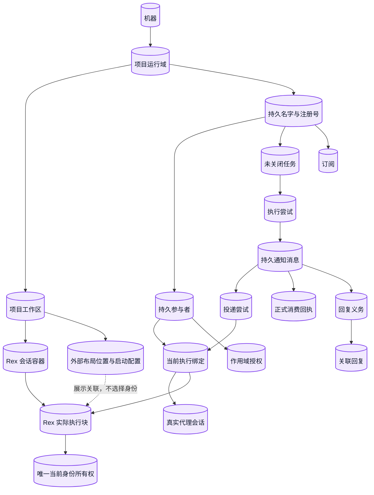
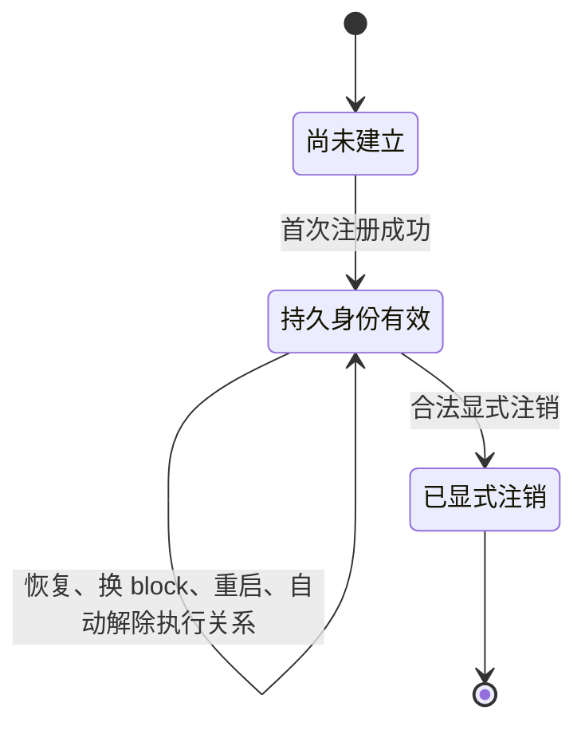
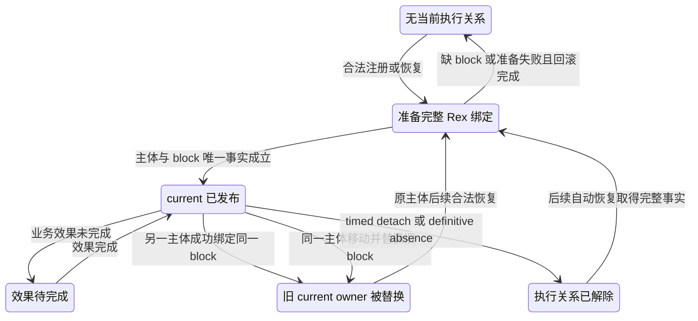
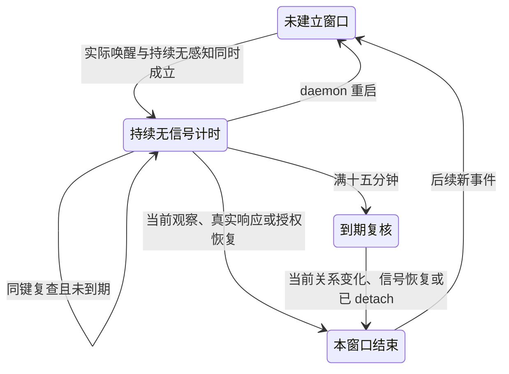
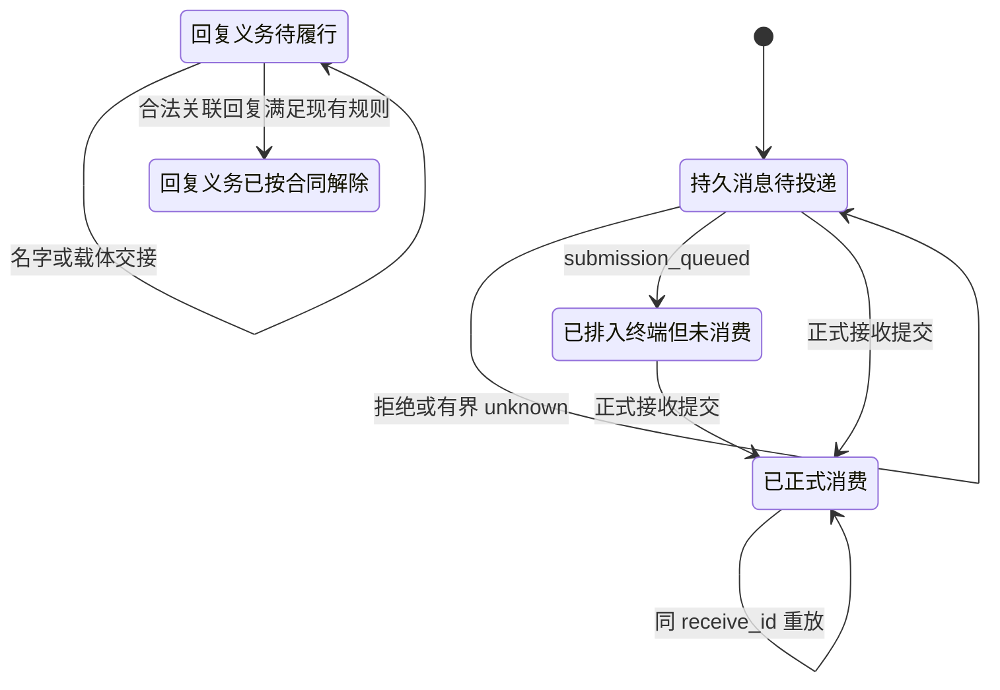
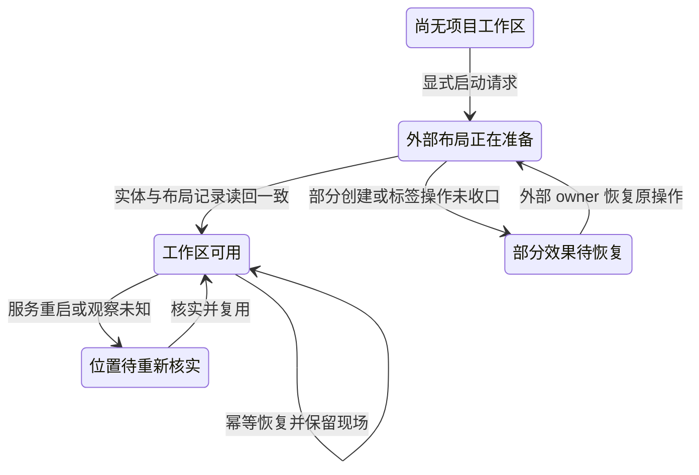
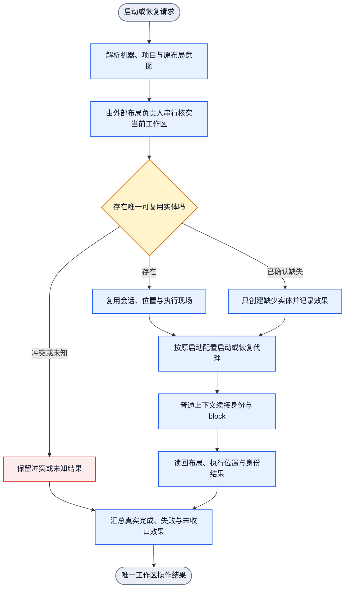

# Rex 完整替换 tmux+iTerm2：架构闭环 2026-11-10

## 1. 范围与结论

本文是 Rex replacement 的唯一整体语义模型。它统一对象、关系、行为、状态、
有限事件 DAG、效果保留和语义条款到 owner 的追溯。图、用例名称和图校验都只
证明结构与绑定；只有真实公开入口和真实前端回执才能证明对应行为。

最终目标：真实 Rex agent 在普通 `collab context` 下自动绑定身份。另一参与者
能向它发送消息。目标 agent 被通知后自主正式 `recv`、执行任务并发送关联回复。
发送方正式消费回复。同一项目 session 内的多个 peer 按各自 block 隔离。
workspace、start/resume、profiles、跨机器及 tmux+iTerm2 对照属于完整目标。

最新用户决定优先于旧设计和旧恢复解释：

1. Rex 身份必须绑定实际 block。
2. 一个实际 block 同时只有一个 current identity。
3. 后来的成功绑定顶替旧绑定；旧关系不再是该 block 的投递目标。
4. Rex 中运行的 agent 不应缺 block。缺 block 是事实采集或恢复缺口，
   不是合法的无 block 绑定，也不是 Desktop fallback 理由。
5. 持久身份、任务、消息和历史不因当前 block ownership 替换而删除。
6. 权威事实确认 Rex block 不存在时，退役对应名字关系。暂时不可观察、
   查询失败或 unknown 不触发退役。持久身份和业务责任保留，且名字重用
   不由此推定。该规则尚未解决 timed detach 和 block replacement 后名字
   与 anchor 基数的兼容关系。

本文取代旧有 “可选 locator”“占用 block 拒绝” 和
“daemon 重启延续 15 分钟窗口” 的冲突语义。现有 block-binding 事务计划要求：
先在 gate 内确定本次申请主体，再在同一候选集合中撤销同一实际 Rex 服务内该
block 的其他 current，写入新 current 及必要待办，并由现有
`BindingControlStore::commit` 一次发布完整集合。主体选择与 block 替换必须
分开；无法确定持久主体时，不得借 “后来胜出” 随机选择旧任务归属。

## 2. 真源与输入

| 来源 | 本次采用的约束 |
|---|---|
| 当前 `goal.md` 首节 | Rex identity must bind a block; one block has one current identity; later successful binding replaces the old; missing block is a defect; no blockless or Desktop fallback; confirmed block absence retires its name relation |
| `stale-name-recovery-20261110/.appsdk/requirements.json` 的 `req-collab-identity` v4 | 仅精确终结或不存在的当前载体可自动释放；未结责任不阻止执行关系退役；业务责任保留；名字和注册号语义不阻塞注册 |
| 同 ledgers 的 `req-collab-session-endpoint` v1 | Rex session 是通信节点；block 是精确执行位置；block 缺失不能证明通信 session 或 agent 不存在，但不能产生合法 current Rex binding |
| 同 ledgers 的 `req-collab-communication-notifications` v6 | 任何两个已注册对象可直接发送普通消息；保留真实 sender、精确地址、原消息关联和阶段回执；发送不产生任务或管理权限 |
| 同 ledgers 的 `req-collab-timed-detach` v1 | 已派发执行持续无感知且有实际唤醒无响应满 15 分钟才 detach；重启重新计时；保留名字、注册号、任务、消息和资源；不自动重投 accepted/unknown |
| 当前任务 goal 的 workspace 验收段 | 每机器每项目一个 Rex workspace、每 agent 一个 block、一个外部 layout owner、并发 create、rename、migration、profiles、start/resume、跨机器及真实前端对照仍是有效范围 |

需求账本版本分散，版本号不等于权威。上述行为以直接用户决定和对应 owner
记录的原始文本为准。workspace 和跨机器没有独立 `req-*` ID，不缩减任务范围；
只把当前接口、配置与真实证据缺口如实保留为 required/unverified。

已记录样本只用于定位，不证明当前运行状态：agent session
`01a1c473-41b6-7481-82d4-e2499ac2490a`、Rex session
`session:01a1baae-5766-7724-92d9-59a846daaf02`、block
`block:01a1c455-1e66-73b5-a116-3f10212ab620`。旧安装版普通 context 曾选择
`desktop_bridge`；这是红样本，不是当前候选结论。

## 3. 事实分层与结果词典

以下事实必须分开：

1. 持久工作归属：peer、名字、注册号、任务、消息、回复义务和资源责任。
2. 当前身份选择：`identity-map.json` 中的 active current。
3. 当前执行载体：agent session、current binding 和 typed execution anchor。
4. Rex 宿主位置：server instance、session、window、block。
5. 投递与动作证据：中心入队、终端写入排队、正式 receive、消费、回复。
6. 展示与布局：项目标签、slot、window 分组和 profile。

任一低层事实不能替代另一层。block 存在不等于 agent idle；terminal input
`submission_queued` 不等于消息被消费；消息被消费不等于任务执行完成；
名字相同不继承旧 master grant；endpoint 不可达不删除持久身份。

操作结果统一为 `success`、`rejected`、`failed`、`cancelled`、`unknown`、
`partial` 或 `pending`。它们是本次操作结果，不是额外 peer 状态。一次有限事件
从入口到唯一出口必须闭合；失败分支只分类或读回，不执行成功副作用。

## 4. Object：对象目录

“约束”同时给出 must-have 与 must-not-have。生命周期描述对象本身，不借用
其他对象的运行状态。

| 引用 | 对象 | 同一性与范围 | 唯一 owner | 关键约束与观测 |
|---|---|---|---|---|
| O01 | machine | 既有 federation machine identity | machine/federation owner | 每机独立 daemon、身份和 mailbox；qualified address 与真实回执观测 |
| O02 | project | 本机 canonical project/app scope | scope/project runtime owner | cwd 选择项目；显示名和 worktree 路径不是持久主体 |
| O03 | workspace | `(machine, project)` 的布局关系 | 外部 layout owner | 正常目标 1 个当前 Rex workspace；不写入 identity-map |
| O04 | persistent peer | 项目/app 内持久工作主体 | `binding_slot.rs`、`binding_store.rs`、既有 worker owner | block 或名字关系退役不自动注销持久主体；身份和业务责任保留。block 仍存在但 owner 被另一身份替换时，旧名字的具体处理仍待确认 |
| O05 | name / registration number | scope 内稳定工作地址与注册号，指向持久工作主体 | `name_state`、`name_resolution`、identity owner | 权威确认 Rex block 不存在时退役对应名字关系；查询失败或 unknown 不算不存在。名字重用不由此推定。名字到 current holder/anchor 的既有基数与 timed detach、block replacement 的兼容方式仍待协调 |
| O06 | agent session | 真实宿主 agent sessionID | `identity.rs`、宿主事实采集 | Rex session/block 不得冒充 agent sessionID；同 session 文本可对应多候选 |
| O07 | Rex server | 官方 CLI 核实的 host/instance 与服务代际 | `adapters/rex.rs` | 提供 block anchor 的定位与观测作用域；地址是连接位置，不猜 socket 或用旧日志选择 |
| O08 | Rex session | server 内的 workspace/通信容器 | Rex；外部 layout owner 映射 | 可含多个 window；是通信和定位上下文，不是 peer anchor |
| O09 | Rex window | session 内的 tab 与布局容器 | Rex；外部 layout owner | 组织 block 的展示布局；标签、焦点和位置不选择身份 |
| O10 | Rex block / Rex anchor | 一个实际 terminal block 实体；以 Rex 提供的 block identity 标识 | Rex；current ownership 由 binding owner 保存 | 用户确认 block 本身是 Rex anchor。block 在 layout 中的位置是可变关系，不是 block identity；split 创建另一个 block/anchor |
| O11 | current execution binding | 持久主体到当前 transport 与执行关系 | `binding_slot.rs`、`binding_store.rs`、`identity_context` | 一个有效 Rex current execution 必须关联一个实际 block。Timed detach 按既有决定解除 execution 和 anchor、保留名字；其与名字必须有 current anchor 的兼容方式待协调。权威确认 block 不存在时退役对应名字关系及 current；unknown 不退役 |
| O12 | execution anchor reference | current binding 对宿主 anchor 的 typed reference | 既有 binding/adaptor owner | Rex anchor 就是 block 本身；server/session 用于定位与核实，cwd 承载项目事实，不把 locator 误称为 block identity；旧 observation 不能写后继 |
| O13 | task | 既有 board task ID | board owner | 状态、证据、资源和 merge/cleanup 责任不因换 carrier 重建 |
| O14 | execution attempt | 一次任务执行的 attempt 与 generation | ticket/board execution owner | attempt、carrier、wake 和 response 需 typed 关联；accepted/unknown 不自动变可重投 |
| O15 | message | 持久 message ID 与 mailbox 归属 | `state.rs::Message`、send/mailbox owner | sender、正文、收件人、correlation 保持；投递状态不等于任务状态 |
| O16 | delivery attempt | 一次对精确目标 binding 的 adapter 调用 | notification owner | 保留实际目标及正文写入、Enter 提交阶段；任一阶段 unknown 后不盲发、不换 transport |
| O17 | receipt | adapter、receive、执行等阶段回执 | 产生该事实的 owner | 不同阶段不可混用；`receive_id` 重放同一批消费 |
| O18 | reply obligation | 原 message ID 对应的持久回复义务 | `ReplyObligation`、mailbox owner | 不镜像到正文；名字或 carrier 交接后仍保持关联 |
| O19 | subscription | 既有 subscription ID 与 owner | subscription/timer owner | 基础直收与有限周期分开；恢复不重置计数 |
| O20 | grant | typed authority grant | authority owner | name/role 标签不是 grant；同主体恢复保留，跨主体不继承 |
| O21 | layout slot | 外部 manifest 的固定位置与 binding ID | 外部 tm-layout owner | slot 不由名字序号、agent session 或 block ID 推算 |
| O22 | profile | 用户已有启动或展示配置引用 | 外部 layout/launch owner | 必须逐项映射；无等价能力要显式报告 |
| O23 | pending effect | 已发布控制后的有界业务待办 | `PendingEffect` 与既有完成器 | 保留原目标和阶段；不是第二身份真源 |

## 5. Relation：方向、基数与交接边界

| 引用 | 关系 | 基数与方向 | 唯一性与交接 |
|---|---|---|---|
| R01 | machine -> project runtime | 1 -> 0..N | 跨机不共用本地 runtime |
| R02 | `(machine, project)` -> workspace | 1 -> 0..1 current | 外部 layout owner 串行 ensure |
| R03 | workspace -> Rex session | 1 -> 1 current，准备中可为 0 | 由既有布局记录提交，不由 identity-map 决定 |
| R04 | Rex session -> Rex window | 1 -> 0..N | window 是 session 内布局容器，不承载 peer identity |
| R05 | Rex window -> layout layers -> Rex block | 按 Rex inspect 返回的实际实体归属；layout leaf 引用一个 block | block 可改变布局位置；位置变化不改变 block/anchor identity；split 新建的 leaf 使用新 block identity |
| R06 | persistent peer <-> current name | 当前 1:1；历史可交接 | 名字标识持久工作主体，不保证该主体当前持有执行 anchor；名字移动与持久控制提交同属 identity gate |
| R07 | project stable name -> current holder/anchor | 1 -> 1 under approved B1; interaction with timed detach and block replacement unresolved; confirmed absent block retires name relation | 每个活动名字唯一对应 current holder/anchor。权威确认对应 Rex block 不存在时退役名字关系；unknown 不改变关系。该退役不注销持久主体、不清理任务消息等责任，也不推定名字重用。此新增 absence 语义不决定 timed detach 或 block replacement 后的关系基数 |
| R08 | current binding -> agent session | 1 -> 1，按宿主 | session 续接更新全部未关闭 task carrier |
| R09 | current binding -> execution anchor | 1 -> 1 current；无 current/detached 时为 0 | Rex 绑定引用实际 block anchor，并携带定位/核实所需的 Rex server/session 等上下文；旧 generation 隔离。这里描述绑定本身，不豁免 R07 的名字唯一 anchor 关系 |
| R10 | execution anchor -> peer | 0..1 current owner | 一个 anchor 只有一个 current owner；Rex block 的 current 作用域沿既有 Rex binding 条款 |
| R11 | name -> unclosed tasks | 1 -> 0..N | closed task 保留历史 carrier；名字交接保留 ID/状态/证据 |
| R12 | task -> execution attempts | 1 -> 0..N | attempt 的旧结果不能推进新 generation |
| R13 | attempt -> wake message | 1 -> 0..N typed links | 必须保存实际关联，不能按正文反推 |
| R14 | message -> delivery attempts | 1 -> 0..N | 每次 attempt 指向实际目标 binding |
| R15 | receive receipt -> messages | 1 -> 0..N | 消费与 receipt 原子；重放不二次消费 |
| R16 | original message -> replies | 1 -> 0..N | 使用 `in_reply_to`；不等于特定 attempt 已响应 |
| R17 | message -> reply obligation | 1 -> 0..1 | 随名字持有者交接，不因消费丢失 |
| R18 | peer/name -> subscriptions | 1 -> 0..N | 保留 ID、计数和周期，只更新适用 carrier |
| R19 | subject -> grant | 1 -> 0..N | 同主体续接保留；新主体不继承旧 master/CEO |
| R20 | layout slot -> agent placement | 1 -> 0..1 current | 授权晋升可保留非第一 slot |
| R21 | layout operation -> profile | 1 -> 0..1 selected | 解析和应用结果由外部 launch owner 读回 |
| R22 | actual Rex block anchor -> current identity | 0..1 current owner | 沿既有 Rex binding 条款在官方核实的 server 作用域内唯一；后来成功绑定替换旧 owner。该基数规则与“block 是 anchor”的对象定义分开 |
| R23 | replaced block owner -> persistent identity | 1 -> 1 still persistent | 持久身份及业务责任保留。block replacement 令新主体成为仍存在 block 的唯一 current owner；它不等于 block disappearance，不触发 R07 的 absence 退役。旧名字在 replacement 后的具体关系仍待确认；不得删除旧身份或推导自动创建/分配另一 block |

跨文件交接不宣称文件系统全局 ACID。现有机制在 identity gate 下发布 current，
记录有界 pending effects，再由任务、mailbox、subscription 和 notification owner
按原目标完成。未完成时公开 `pending`/`partial`；后台继续，不要求 agent
手工重跑 context。

### 5.1 中文关系图

该图说明对象关系，不是事件执行 DAG，也不要求 SESE。

## 6. Behavior：状态、输入、输出与副作用

### 6.1 身份、block 绑定与名字

| 行为 | `(状态, 输入)` | 输出与下一状态 | 允许效果 / 禁止效果 |
|---|---|---|---|
| B00 Rex block layout 变化 | 已存在 block anchor；Rex resize/move/swap 或 split 操作 | 对既有 block 执行 resize/move/swap 后，block identity 保持、layout placement 更新；split 返回新 block identity，原 block 保持 | layout position、focused block、window label 不充当 anchor identity；新 split block 不复用原 block anchor。该条描述 Rex 对象行为，不改变 Collab 的 current-binding key |
| B01 首次注册 | 无当前主体；完整真实宿主 facts | 新主体、current binding、名字/注册号，或 typed rejection | Rex 必须含实际 block；缺 block 返回 `missing_facts`，不得发布半绑定或落 Desktop |
| B02 普通恢复 | 持久主体；session、live host fact 和实际 block 可核实 | 同身份续接；current 就绪或通信待恢复 | 复用名字、任务、订阅和同主体 grant；不重新 onboarding |
| B03 同主体换 block | 唯一主体；新 block 已核实 | 新 current；旧 block ownership superseded | 保留身份和业务；旧 block 不再接收该主体的新投递 |
| B04 不同主体绑定已占用 block | 输入主体明确；目标 block 有旧 current owner | 后成功者成为该 block 唯一 current owner；旧 owner 的持久身份和业务历史保持 | 在同一实际 Rex 服务内比较；不要求额外 takeover 批准；不把 occupied block 单独作为拒绝原因。替换后如何保持旧名字唯一 current anchor 的 B1 关系，尚待裁决；不自动分配或创建 block |
| B05 明确授权恢复 | 用户明确指定主体；当前 facts 可承载 | 授权覆盖分支；必要效果 pending | 历史歧义不否决有效授权；不增加手工 block 证明或额外 fencing |
| B06 普通 selector 冲突 | session 候选无法唯一消解主体，或 block facts 不属实际 server | `IDENTITY_MAP_AMBIGUOUS` 或 typed fact rejection；原状态 | 不按顺序、标签、cwd 或日志猜；不能选择错误主体后顶替 |
| B07 明确名字交接 | 明确授权；目标名字由其他主体持有 | 名字换持有者；原主体获其他名字 | 未关闭工作和未消费消息按名字交接；grant 与 credential 不继承 |
| B08 名字池耗尽 | 新主体；默认名字全占用 | 稳定自由名与注册号 | 容量不是失败终点；重复 context 不重复分号 |
| B09 标签准备失败 | binding 未发布；部分标签已改 | 回滚成功为 failed；回滚失败为 partial | 只回滚本次标签；不发布半准备 binding |
| B10 发布后效果失败 | current 已发布；任务/mailbox/route 未完成 | `pending`/`partial`；保留已发布事实 | 原目标和错误进入 pending effect；旧 route 不得继续作为 current 投递来源；不伪报完全未发生 |
| B11 Query | 任意可读状态 | 纯投影 | 不 Register、不恢复、不消费、不写唤醒 |
| B12 显式注销 | 已认证主体；现有注销合同 | 显式 retired identity | 与 timed detach/automatic absence 分开；不关闭宿主 |

Rex session 是通信节点，block 是执行位置。缺 block 不证明 Rex session
不存在，也不能释放 agent 身份或转入 Desktop。它只表示当前 Rex 绑定事实不完整，
因此不能发布合法 current binding。

用户于 2026-11-12 确认 Rex block 本身就是 anchor。Window 和 layout 组织
block，但不构成 block 的身份。Split 会创建一个新的 block，因此形成不同
anchor；调整大小、移动或交换既有 block 的布局位置，不改变该 block 本身。
Rex 的当前 inspect 结构为 server -> session -> window -> layer/layout tree，
布局 leaf 引用 block ID。官方 CLI 也支持在同一 session 的不同 window 间移动
或交换既有 block。Rex server/session 是查找和核实 block 的定位上下文，不应与
anchor 对象混为一谈。现有 binding 仍保存执行操作所需的 typed Rex endpoint。
Block 对象定义、block 当前 owner 基数、稳定名字到 holder/anchor 的基数是三条
不同关系。前两条已有明确语义；稳定名字每项唯一对应 current holder/anchor 也已
批准，但它与占用 block 被另一身份替换、以及 timed detach 解除 anchor 的交互
尚未协调。此处不把这种冲突误写成 block 身份或布局位置问题，也不改变既有
server 作用域。

普通 selector 仍先收集主体候选。`S` 是当前 scope 中匹配 agent session 的
active-current 主体集合，`A` 是实际 block 当前 owner 集合。无唯一主体时返回
ambiguity；不能先按 occupied block 拒绝。主体唯一且输入完整时，后成功绑定
顶替该 block 的旧 current owner。旧 owner 的身份、名字、任务、消息、grant
历史和责任不删除，但它不再是该 block 的投递目标。previous、archive 和显示标签
不参与选择。若该名字按已批准关系仍须有唯一 current holder/anchor，则 replacement
完成后如何保持该关系尚无已批准的兼容行为；不得自行搬迁持久身份、自动挑选其他
block 或创建新 block。

纯 block 替换的实现边界同时固定：不得调用 `PendingEffectKind::Retire`，不得
清除 credential 或业务 worker，不得把被替换主体写入 `source_names` 或 handoff
previous worker；这些是显式注销或真实名字交接的机制。旧 current 进入 previous
只保留参考，不参与投递或恢复。同一次集合提交只清理明确失效的旧 Register/Name
待办，无关待办保持；旧 route 用精确 route-retired 投影退出资格，旧 effect 执行
前核对当前 map。

### 6.2 投递、消费、执行与回复

| 行为 | `(状态, 输入)` | 输出 / 下一状态 | 允许效果 / 禁止效果 |
|---|---|---|---|
| B13 中心入队 | 合法 send/reply 请求 | durable message ID | 仅证明 daemon 接受并持久化 |
| B14 Rex 通知提交 | 精确目标 binding、支持输入模式、原正文 | 正文写入后，再独立执行 Enter；Enter 被 Rex 接受后为 `submission_queued`，但不代表消费 | 原正文按 UTF-8 写入；正文写入完整后对同一 server/session/block 执行一次官方 Enter。正文阶段失败或结果不完整时不执行 Enter；Enter 阶段失败时不重写正文 |
| B15 通知未知 | 正文写入或 Enter 阶段 timeout、EOF、坏回执或结果不确定 | `unknown`，保留已知阶段事实与原尝试目标 | 不盲重发正文、不重复 Enter、不切 transport；不伪报 submission 或消费 |
| B16 正式接收 | 当前合法调用者、receive_id | ReceiveReceipt、消息 read | payload 读取与消费提交走 mailbox owner；context/inbox 不消费 |
| B17 重放接收 | 同 receive_id 和作用域 | 原批次结果 | 不二次消费或重放新消息 |
| B18 任务开始/结果 | 精确 task attempt 与 execution proof | task phase 变化或旧执行拒绝 | 消费消息不自动 start；旧 block/generation 不更新新执行 |
| B19 关联回复 | 合法 sender、真实 `in_reply_to` | 新回复消息；按现有规则解除义务 | 普通合法回复不等于某个特定 attempt 已响应 |
| B20 发送方消费回复 | 正式 recv | 回复消费回执 | 与“回复已发送”分开验收 |
| B21 迟到回执 | 原 delivery/attempt/execution ref | 记录原事实；不影响新 current | 不复活旧 owner，不标记新执行完成 |
| B22 普通跨角色/项目消息 | 两个已注册对象 | 持久消息和投递阶段 | 不按 role/project 限制；不要求 master 转发；发送不产生 task 或 authority |
| B23 multi-peer 同 session 隔离 | 同 Rex session 的不同 block/current binding | 每条消息只到精确目标 block | 不同 peer 不共享当前 block ownership；目标缺失不得投给其他 peer |

### 6.3 生命周期、absence 与 timed detach

观察键为：

`K = (attempt_id, execution_generation, anchor_kind, anchor_id)`

它必须关联既有 binding 与宿主语境，不能在消费时从当前 map 倒填。

| 行为 | `(状态, 输入)` | 输出 / 下一状态 | 效果 |
|---|---|---|---|
| B24 可感知 | current；可信当前观察 | 保留；清除同键窗口 | 不改消息消费或任务状态 |
| B25 建立窗口 | 已派发 attempt、实际唤醒、持续无感知且无响应 | 为 K 建立进程内单调窗口 | 仅 adapter 调用意图不算唤醒；known-not-delivered 不建立 |
| B26 窗口内复查 | 同 K、未满 15 分钟 | 保留 | 轮询不重置，不重复制造唤醒 |
| B27 获得信号 | 可信观察、真实响应或授权恢复 | 退出窗口 | 无关旧世代信号不能清除新窗口 |
| B28 到期 | 同 K 满 15 分钟 | 重读 current 后 detach 或保留 | 过期前换绑则不解除新 current |
| B29 timed detach | 到期且复核成立 | 按已批准行为解除执行关系与 anchor，保留身份、名字和业务责任 | 不自动重投。它与“每个活动名字唯一对应 current holder/anchor”的兼容方式仍待协调；不得推导名字到仍存在 block 的 anchor 关系必然保留 |
| B30 definitive block absence | Rex 权威事实精确确认该实际 block 不存在 | 退役对应名字关系及该 block 的 current 执行关系 | 持久 peer 身份与任务、消息、claim、merge、订阅和资源责任全部保留；探测失败、不可达或 unknown 不触发退役；名字重用不由此推定 |
| B31 daemon restart | 持久 current 与业务存在 | 重新观察；窗口从零开始 | 不重放旧副作用，不重置订阅计数，不重新 Register |
| B32 重新绑定 | detached 或 superseded；合法恢复 | 新 current | 旧 K 关闭；迟到事件只属于旧执行 |
| B33 维护失败/unknown | probe 失败、权限拒绝、读回不完整 | retained、unknown 或 cleanup-open | 不删除身份，不伪造 Missing，不终止宿主 |

Rex block definitive absence、timed detach 和显式 unregister 是三个不同分支：

- definitive block absence 仅在 Rex 权威事实确认实际 block 不存在时，退役对应名字关系和 current 执行关系；持久主体及业务责任保留。探测失败和 unknown 不等于不存在。
- timed detach 按已批准行为解除执行关系与 anchor，同时保留名字、注册号和全部业务责任；它本身不证明 block 不存在。该行为与名字必须有 current anchor 的兼容方式仍待协调。
- 确认 Rex block 不存在时退役对应名字关系；该结论不说明 timed detach 后仍存在 block 时名字关系如何处理。
- 显式 unregister 才可结束持久身份生命周期，且不关闭宿主。

## 7. 按对象分开的状态图

通知与绑定发布共用既有 host `register_gate`。Rex 通知在取得该 gate 后，
从 current map 核对精确收件人、完整 transport 及 server/block 唯一占用，
然后才记录唤醒并调用一次 sink。gate 忙时本次不投递，消息仍持久保留；
不得使用旧 worker 缓存绕过，也不得把 stale cache 自动改投另一 block。
通知使用非阻塞取锁，避免与 wire/reset 的锁顺序互相等待。sink 调用期间
不持有业务 State 锁。已接受或 unknown 的结果仍属于原投递，不因换绑重发。
此边界保证提交顺序，不声称能撤回 Rex 已接收的输入。

以下为状态图，允许循环。它们不是单次事件 DAG。

### 7.1 持久身份

### 7.2 当前 block ownership 与执行关系

### 7.3 无信号观察窗口

### 7.4 消息与回复义务

回复发送与发送方消费是后续独立事实。

### 7.5 Workspace / 启动恢复

## 8. 有限事件 DAG 语义

每张事件图只有一个输入和一个输出。分支通过 typed outcome 汇聚到唯一出口；
失败后的节点只分类或读回，不执行成功副作用。重试、下一轮维护和下一次消息
都是新的事件实例，不得从输出连回入口。

### 8.1 事件路径

| 引用 | 入口 -> 有限节点 -> 唯一出口 | owner / 结果 |
|---|---|---|
| E01 context | 请求 -> 解析范围 -> 现有服务 -> 读名字/current -> 分类普通/授权 -> 提交控制 -> 完成交接 -> 适用通信 -> 角色环境投影 -> context 结果 | context/identity/name/pending-effect owner；success/rejected/pending/partial/unknown |
| E02 身份绑定 | 当前 facts -> 收集主体与 block 候选 -> 裁决唯一主体/授权 -> 准备标签 -> 构造候选集合并撤销同服务 block 旧 current -> 原子发布 current 与旧待办收敛 -> 任务/mailbox/route 投影 -> 身份结果 | `binding_slot`、`binding_store`、`identity_context`、name/notification owner |
| E03 binding 恢复 | 当前 binding -> 核实适用端点 -> 恢复所选 adaptor 观察/收件 -> 恢复原订阅 -> 就绪或局部待恢复结果 | binding owner；Rex monitor 不伪装 DSH reconciliation |
| E04 名字交接 | 当前名字与请求 -> 分类占用/授权 -> 控制提交 -> 任务/mailbox/订阅交接 -> 名字结果 | name、board、mailbox owner |
| E05 单次 Rex 操作 | admit/notify/observe/snapshot/recover -> 选择输入 -> 校验完整 block facts -> 核实 server/session/block -> 执行最小动作 -> 分类输入阶段 -> 提交 owner -> 操作回执 | `adapters/rex.rs`、notification、presence、binding owner |
| E06 正式消费 | recv 请求 -> 核实消息接收归属 -> 读取正文 -> 提交消费与 ReceiveReceipt -> 消费结果 | mailbox/notification-consumption owner；错误保持原错且不消费 |
| E07 生命周期 | typed lifecycle 请求 -> 解析目标 -> 准入操作 -> 执行互斥分支 -> 读回 -> 生命周期结果 | `peer_lifecycle.rs`；含 unknown/partial/cleanup-open |
| E08 一次维护 | tick -> 读当前候选 -> 分类真实观察与进程窗口 -> 复核 current -> 执行 absence 或 timed detach -> 维护结果 | timers、peer lifecycle、dispatch/binding owner |
| E09 发送 | send 请求 -> 地址与 caller 解析 -> 中心持久入队 -> 适用通知 -> 消息与投递阶段结果 | send/message owner；不含目标自主执行 |
| E10 回复 | reply 请求 -> 核对 sender 与原消息 -> 持久化回复与义务 -> 适用通知 -> 回复发送结果 | send/reply owner；发送方消费另起 E06 |
| E11 workspace | start/resume -> 外部布局 owner 核实/创建/复用 -> launch/profile -> 普通 context -> 组合读回 -> 唯一 workspace 结果 | 外部布局/launch owner；Collab 只提供自身回执 |

E01 的本人角色投影要求唯一 current。项目诊断列表保留没有 current 的持久
peer，其当前角色、transport 和端点观测为 null/unknown，当前执行有效性为
false。任务、消息及 grant 记录保留。该状态不表示存在无 block 的有效 Rex
绑定，也不允许 previous 或业务缓存恢复旧投递资格。实际 map 错误仍显式返回。

2026-11-12 用户报告 runtime 通知正文留在输入框，没有 Enter 提交。C10 的
单次 write 正文加 CR 目前只证明字节排队；真实 Codex TUI 提交仍为 UNVERIFIED。
该故障须通过真实前台复现、适配器修复和相同入口验收关闭，不能由 raw receiver
或既有 PR 的通过状态替代。最终输入机制依据本次真实观察补正。

Rex block 替换在 E02 的候选集合和控制提交内完成，不是 name handover，
Retire 或第二条 route 写路径。它只改变 current binding 及其精确 route 投影；
任务、消息、grant、subscription 和资源 owner 不接管被替换主体的数据。
事件图中的 operator 名称表示设计责任边界，不代表这些 operator 已在运行时注册
或 gate 已执行。

### 8.2 Workspace 设计图

下面是最小 design-only 事件图。入口来自既有外部布局/启动 owner，不表示
Collab 新增 `workspace` 命令、manifest 或状态注册表。

节点 owner：

| 节点 | 输入 / 输出 | owner |
|---|---|---|
| 解析工作区请求 | machine/project、start/resume、profile -> intent | 外部 layout/launch owner |
| 核实当前工作区 | intent、原 manifest -> reusable/absent/unknown/conflict | 外部 layout owner |
| 复用或补齐实体 | 上一步 -> 精确 session/window/block 与效果 | 外部 owner 调 Rex 正式能力 |
| 启动或恢复代理 | 实体、profile -> preserved/started/failed/unknown | 原 launch owner |
| 普通身份续接 | agent 内真实环境 -> context 结果 | Collab context |
| 组合读回 | Rex 实体、布局、context -> 分阶段结果 | 外部 owner 汇总，Collab 提供自身回执 |

外部依赖至少包括：既有 manifest 的 Rex 字段与兼容读取、同项目 ensure 序列化、
profile 解析、部分创建与回滚回执、真实前端验收。缺少这些接口时，不得在
Collab 内另建 workspace manifest、chunk lock 或 launch 服务。

## 9. Workspace 与布局的确定语义

1. 正常目标为每机器每项目一个当前 Rex session，多 agent 使用不同 block。
2. Rex block 本身是 anchor。Window/layer/layout 组织和摆放 block；位置变化
   不改变 block identity，也不选择身份或替代 current binding。Split 创建新
   block/anchor；resize、move、swap 保留原 block/anchor。一个有效 Rex current
   binding 必须指向一个实际 block。用户已批准每个项目内已分配名字唯一对应一个
   current holder/anchor；该关系与不同身份替换占用 block、timed detach 的结果
   如何共存仍待裁决，不能从 block 定义推导自动分配或创建新 block。
3. Split 保留原 block，并创建具有新 block identity 的 block；resize、move、
   swap 改变既有 block 的布局关系，不据此更换 anchor。
4. 旧共享 session 不因规范收敛自动强迁移；整个共享 session 不能由单个项目改名。
5. 专属项目 session 可随项目显示名同步标签，canonical project scope 不变。
6. 并发 start 由外部 owner 在创建前后复读同一记录。unknown 不能直接再创建实体。
7. resume 先核实精确实体；busy、waiting_user 和现有现场保持。
8. 用户 profile 必须逐项映射；无等价能力时公开差异，不静默丢弃。
9. 迁移不删除旧 tmux/iTerm2 现场；活动或未交付现场按实际 owner 处理。
10. Collab 只读布局关联可以扩展 Rex，但不能成为身份恢复必要条件。

## 10. 效果与保留矩阵

符号：保留＝原事实保持；更新＝仅更新该操作拥有的 current 关系；新建＝首次
合法创建；隔离＝旧事实保留但不得作用于新执行。

| 操作 | 身份/名字 | binding/block ownership | 任务/attempt | 消息/回执/义务 | 订阅/grant/资源 | 宿主与布局 |
|---|---|---|---|---|---|---|
| register | 新建主体；分配名字/编号 | 新建 current；block 必须实际存在且完整 | 仅首注册事务效果 | 基础接收；不消费 | 默认直收；不隐式授 master | 只做合同准备 |
| recover | 保留 | 核实现有关系和实际 block；可达性单列 | 保留未关闭工作 | 保留原消息与义务 | 保留订阅进度和同主体 grant | 不强制重启或改布局 |
| same-subject block move | 保留 | 原子替换 current；旧 block 隔离 | 更新合法 carrier | 原消息保持 | 不重置周期，不扩权 | 不关闭旧宿主 |
| other-subject block binding | 双方身份保留 | 后成功者成为 block 唯一 owner；旧名字的 B1 current-anchor 关系如何维持待裁决 | 各自任务和 attempt 保留 | 旧 owner 不再接收该 block 新消息；历史保留 | 不继承旧 grant | 不从替换动作推导自动创建新 block；不删除或关闭旧宿主与布局现场 |
| name handover | 名字换持有者；原主体另取名 | 双主体 current 按授权更新 | 名字下未关闭工作交接 | 未消费随名字；已消费保持 | 不继承 grant；资源责任保留 | 只准备本次标签 |
| timed detach | 保留名字和注册号 | 已批准行为仅解除执行和 anchor；与 B1 current-anchor 基数待协调 | 保留；不自动重投 | 全部保留 | 全部责任保留；窗口结束 | 不终止 block/session/server |
| definitive block absence | 保留持久主体；退役对应名字关系 | 退役该 block 的 current 执行关系 | 保留 | 保留 | 全部业务责任保留；不推定名字重用 | 不授权批量清理宿主；unknown 不退役 |
| restart | 保留 | 从当前控制恢复；观察重建 | 保留 | 保留真实回执 | 保留 ID/计数；窗口清零 | 用户管理 daemon |
| late receipt | 保留 | 不复活旧 owner | 只关联原 attempt | 保存原阶段事实 | 不改 grant 或资源 | 无布局效果 |
| layout operation | 保留 | 成功启动后由 context 合法关联 | 保留现场 | 无消费效果 | 不改 grant、周期或业务资源 | 外部 owner 创建/复用/回滚并读回 |

物理标签准备与身份发布不能假装跨 owner ACID。外部 owner 提供精确阶段与回滚
回执；identity owner 只在必需准备完成后发布。发布后失败使用 pending effects。

## 11. 语义条款到 owner 与观测

下表是设计追溯，不是运行时证明。`required/unverified` 表示还没有对应公开行为
回执；“既有 gate”只说明存在相关入口，不自动升级为组合候选的 PASS。

| 条款 | 场景、允许/禁止及状态效果 | 图节点/边 | 现有源码 owner | 合法/非法观测 | gate 状态 |
|---|---|---|---|---|---|
| C01 身份与地址分离 | Rex 准入；允许 agent session + Rex endpoint；禁止互相替代 | E02 收集 -> 分类；E05 校验 | `main_context.rs`、`identity.rs`、`adapters/rex.rs` | 正常无 provide；缺字段不落 Desktop | 既有 required-fields/context/rex public；组合仍待验 |
| C02 实际 block 必需 | 合法 current Rex binding；必须含实际 block；缺 block 拒绝发布 | E02 收集 -> 准备；E05 校验 | `binding_slot.rs`、`identity_context`、Rex adaptor | 完整 facts 成功；缺 block 为 missing/typed error，无 map 写入 | block-binding plan 已落盘；实现与公开组合为 required/unverified |
| C03 block 唯一 current owner | 同实际 server block；lookup 先确定申请主体，集合 commit 后成功者替换旧 owner；禁止双 current | E02 裁决 -> 候选集合 -> 原子发布 | `binding_slot.rs::lookup/commit`、`binding_store.rs`、`binding_control` | 两身份同 block 后只有一个 deliverable；旧 pending effect/route 不继续投递 | required/unverified；公共替换、并发与旧投影 RED 尚未完成 |
| C04 单 current binding | 同主体换 block/transport；旧 current 失效 | E02 发布；E03 refresh | binding/identity/Rex monitor | 保身份，新 block 生效，旧事件拒绝 | 既有 selector 单测；公开组合和调用者证明缺口 |
| C05 授权恢复优先 | 用户指定恢复；允许替换历史 carrier；禁止旧历史先行否决 | E01/E02 分类 -> 授权 -> 提交 | `identity_context`、intent/auth owner | 冲突下指定主体恢复；普通非法请求仍拒绝 | 根规则已批准；公开分支需组合核对 |
| C06 名字续接 | 同名换 session；更新未关闭 carrier；禁止重建任务 | E04 提交 -> 同步 | name/board owner | open task carrier 更新；closed 历史保持 | 既有 name_runtime/board gates；组合待验 |
| C07 名字交接与 grant | 明确覆盖；移交名字下工作；禁止继承旧 master | E04、E02 授权 | name、authority、mailbox owner | 授权 takeover 保留任务消息；普通同名不获 master | 既有 takeover/promotion；真实 successor 待验 |
| C08 名字池 | 默认池满；允许稳定自由名；禁止容量拒绝 | E04 分类 -> 提交 | `binding_slot.rs`、`name_resolution` | full pool 可注册；重复 context/重启稳定 | 本地 name-pool 记录存在；组合待验 |
| C09 阶段事实分离 | 通知/接收；允许记录实际阶段；禁止 queued=consume | E05 classify -> commit；E06 consume | Rex adaptor、notification、mailbox | queued 无 receipt；正式 recv 后有 receipt | 既有 public consumer；自主 LLM 仍缺 |
| C10 Rex notify 两阶段提交 | 精确 binding；完整正文写入后执行一次独立 Enter；两阶段结果分别分类 | E05 正文写入 -> Enter 提交 -> 分类 -> 回执 | `collab/src/adapters/rex.rs` | 正文完整后调用 Enter；正文失败不 Enter；Enter 失败不重写正文；接收/消费仍由正式 receive 独立证明 | 真实 Codex TUI 已证伪 body+CR 单写；候选适配器及真实提交仍 required/unverified |
| C11 普通消息自由 | 任意两注册对象可 send；保留认证和回执；不产生 task/authority | E09/E10/E06 | address/federation/send owner | 跨 role/project send+reply；冒充拒绝 | 既有 federation/address gates；真实入口待验 |
| C12 multi-peer block 隔离 | 同 session 不同 block；允许并发；禁止串投/串收 | E02 发布；E05 目标；E06 消费 | Rex adaptor、binding、notification owner | 两 peer 各自消费并关联回复；目标缺失不投他人 | required/unverified；Jenny 误投修正依赖 |
| C13 timed detach | 无感知+实际唤醒无响应满 15 分钟；重启清零；解除执行关系与 anchor，保留名字和责任；禁止自动重投 | E08 classify -> recheck -> detach | timers、peer lifecycle、dispatch owner | timed detach 与 B1 名字-anchor 基数关系待协调；block 确证不存在时按 C14 退役名字 | required；attempt-wake-response 关联缺口 |
| C14 definitive block absence | Rex 权威确认实际 block 不存在；退役对应名字关系和执行关系；保留持久主体及全部业务责任；unknown 不退役 | E07 分支；E08 absence | `peer_lifecycle.rs`、identity/name owner | block 存在时保留；确证不存在时名字关系退役且责任保留；unknown 时不退役 | 语义已由用户确认；gate owner/公共观测仍须核实，public absent/retired 未验 |
| C15 迟到事件隔离 | 旧 execution ref；保留原事实；禁止推进新执行 | E08 复核；E05 commit；task start/result | dispatch/task/binding owner | 旧 block response 不满足新 attempt | caller execution 区分仍缺 |
| C16 重启 | daemon 重跑；恢复业务；窗口清零 | E03、startup、E08 | startup、timers、binding owner | 名字/任务/订阅/receipt 保持；旧 14 分钟不延续 | 普通重启 gates；timed reset 未实现 |
| C17 workspace 幂等 | start/resume；复用唯一实体；禁止 unknown 后重复启动 | E11 核实 -> 复用/补齐 -> 启动 | 外部 layout/launch owner | 并发一 workspace；busy/waiting_user 保持 | 外部接口与真实前端证据缺失 |
| C18 跨机地址 | qualified send；按 machine.project.name；禁止标签寻址 | E09/E10/E06 federation 分支 | address/federation owner | 两侧发送、回复、消费；断连不重复消费 | 历史 physical 证据；当前配置缺口 |
| C19 partial 真实呈现 | 标签/控制/业务阶段失败；保留已发生效果 | E02 准备 -> 提交 -> 效果；E11 汇总 | pending-effect、外部 layout owner | 回滚失败为 partial；发布后为 pending | 既有部分 gate；Rex 物理标签依赖外部 owner |

本表没有新增限制性政策。若后续提出全局 session 唯一、额外恢复认证、普通断连
超时、自动杀旧 block 或强制布局迁移，应作为 candidate，不得从本模型推导。

## 12. 验收矩阵与真实路径

### 12.1 公开入口与状态

| 场景 | RED | GREEN |
|---|---|---|
| Rex 普通环境 | 无 `--provide` 时 `missing_facts` 或 `desktop_bridge` | `registered=true`、`transport.kind=rex` |
| Rex 缺 block | 发布无 block 的 valid current 或落 Desktop | typed missing/recovery failure，无半绑定 |
| 两身份同 block | 两个 current owner 都可作为投递目标 | 后成功者有唯一 current ownership，旧 owner 不再接收该 block 新消息 |
| 同主体移动 block | 旧 block 与新 block 同时可投递 | 新 current 生效，旧 anchor generation 失效 |
| 两 peer 同 session | 串投、串收或串回复 | 各 block 独立通知、消费和关联回复 |
| 默认名字池满 | `NAME_POOL_FULL` | 新注册成功并返回名字/注册号 |
| timed detach | 每轮查询重置、重启延续或提前 detach | 同观察键、15 分钟边界、重启清零、保留业务 |
| Rex block absence | 查询失败或 unknown 被当成不存在；清空主体业务责任 | 仅权威确证 block 不存在时退役对应名字关系和执行关系；主体及责任保留 |
| 普通跨角色/项目消息 | 按 role/project 拒绝或强制 master 转发 | 真实 sender、精确地址、持久回执和关联回复 |
| 已消费/未消费消息 | 重放或丢失 | 已消费历史保持，未消费随名字保留 |

### 12.2 真实 agent 黑盒

1. 在真实 Rex LLM agent 中运行普通 `collab context`，不传 `--provide`。
2. 另一个真实参与者发送带唯一内容的消息，并用至少两个 peer/block 覆盖隔离。
3. 目标 agent 被通知后自主运行正式 `recv`。
4. 目标执行请求并发送 `--in-reply-to` 关联回复。
5. 发送方正式消费回复。
6. 保留 Rex 前端、current binding、block ownership、各阶段投递、消费和回复证据。

脚本 receiver、外部 CLI 消费、手工 `--provide`、terminal echo、构建和 fixture
不能替代真实 LLM agent 路径。真实前端测试仍需覆盖 workspace、start/resume、
rename、partial failure、跨机器和 tmux+iTerm2 对照。

## 13. 变更、集成与资源边界

1. 按现有 mandatory block-binding 事务计划更新受影响 selector、控制提交、旧
   待办/route 投影和图描述；真实实现与证据仍待执行。
2. 保留主线 PR152 的 adapter/monitor 修复；组合时删除重复旧实现。
3. 补齐 block replacement、multi-peer 隔离、timed detach、absence retention
   和真实前端路径的公开行为证据。
4. 运行受影响 context、Rex、name、stale、workspace 与兼容回归。
5. 作者自检后做一次完整 milestone 独立 review。
6. 按交付合同 merge、push 并核对远端。
7. 安装、daemon 激活和跨机器 live 仍按用户逐次批准执行。

任何步骤失败都保留原错和未完成状态。候选、图通过、CI 或 review PASS 分别只
证明其对应范围，不表示生产已激活或完整替换已完成。
