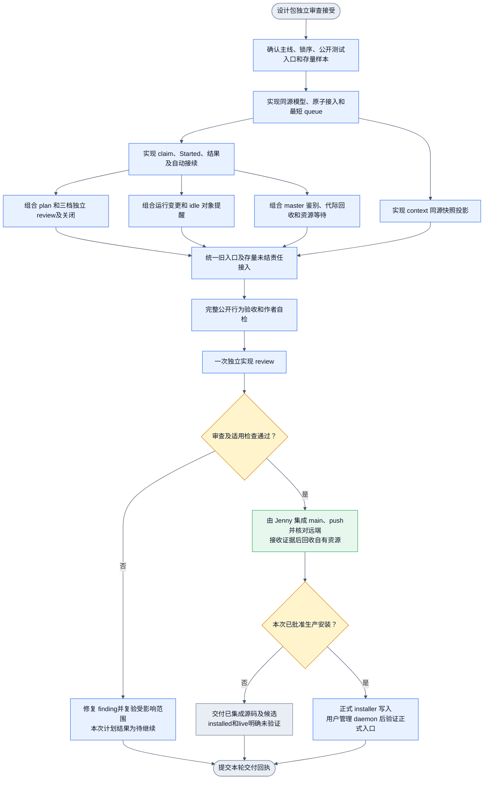

# Collab 工单系统可执行实施计划

本计划属于 collab-ticket-design-20261107。Jenny 负责实施组织与最终交付。本设计聊天负责设计包接收、目标对齐和独立设计 review。具体代码由 Jenny 安排 peer/worker。Planner 与实现者及最终 Reviewer 保持独立。

## 状态、目标与可用增量

状态为 DESIGN_REVIEW_ACCEPTED，可按本计划启动实现。独立审查原始结果为 `/Users/fanzhang/.agents/task-notes/collab-ticket-design-20261107/final-review-result.json`，设计 owner 已核对退出码及证据并接受。产品实现与 live 验收仍待执行。

用户最终可用行为：建单进入 daemon 即分配最短 slot queue；需要 plan 的任务先规划；执行和独立 review 自动转交；idle 自动接续；master 一次 context 看下属运行和队列；失联经 master 鉴别后安全回收；关闭权归 master；运行变更与 idle 对象提醒符合最新用户要求。

本轮实现分可用增量推进：先交付唯一事务与自动队列，再组合阶段和独立审查，再组合通知、回收、快照及存量兼容。增量是开发接续边界，完整目标验收不缩减。重大 milestone 的一次独立实现 review 在全部目标完成作者自检与公开入口验收后进行。

输入文件：`../dagpipe/collab-ticket-current-20261107.md`、`../dagpipe/collab-ticket-flow-20261107.md` 及其四份目标机器图、`../design/collab-ticket-gap-20261107.md`、`../design/collab-ticket-implementation-design-20261107.md`。原始观察和审查来源为 `/Users/fanzhang/.agents/task-notes/collab-ticket-design-20261107/` 下的 `note.md`、`current-observation-evidence.md`、`review-task.md`、`review-result.json`。

## 需求、事实、假设与未知

已亲读 `.appsdk/requirements.json` 的 changes，并按每个 requirement 最新 result 确认有效需求。适用约束如下。

| 来源 | 关键原文及实施约束 |
| --- | --- |
| `req-minimal-governance` v1 | “治理设计必须是最小必要性”“正反都要验证”。每项新增 gate 要绑定本计划的实际失败模式；不新增无关治理表 |
| `req-minimal-command-surface` v1 | “一次交互能做完不做两次”。publish 自领、接入、master close 意图及 context 均单次请求完成必要控制动作 |
| `req-collab-identity` v1 | “必须持久化并且自动恢复”。正常 session 续接保持名字、队列和未结责任，不新增身份前置 |
| `req-collab-communication-notifications` v5 | 中心化 daemon、真实接收/消费回执、不得丢未结责任、不得臆定周期参数。复用 mailbox，未知不得报告 idle 或运行 |
| `req-command-logs` v1 | 复用既有调用日志，保留公开入口原始回执；不另建重复历史库 |
| `req-collab-daemon-restart-recovery` v1 | 恢复不得卡在未知旧实例。此次验证状态恢复语义，不授权 agent 操作生产 daemon |
| 本次用户指令 | 入最短 queue；busy 可入队；依赖只阻执行；worker idle 立即提醒 manager，manager idle 提醒巡检员，同一 worker idle 严格超过十分钟提醒双方 |

事实：主线已有 peer publish、claim、身份 slot、工作专长、指定 reviewer、原子当前状态保存、管理 context。旧树观察不能否定这些能力。事实来源和主线行号见当前状态文档。

本版明确采用的默认值：同水位轮转，同优先级 FIFO；queue 水位为全部未开始 queued 项，不含运行项。每个有效执行绑定只保留一个 active claim，不增加用户未指定的并行容量、重试次数、超时租约或重发周期。

未知：installed/live 版本与行为；manager register gate 对全部相关发布入口的覆盖；旧 fixture 的真实开始和活动证据能力；存量状态样本的阶段证据完整度。未知不能由 worker 临时换核心设计解决，按增量 A 的定向验证判定。

## 硬约束与开始条件

Jenny 先核对可用 peer、任务归属和容量，再更新现有 board，关联本计划和独占执行笔记。不可在本 Planner 会话注册、发消息或创建任务。

实现从最新 `origin/main` 创建合法独占 Git worktree，例如 `/Volumes/Intel/playground/appsdk/collab-ticket-system-20261107`，分支采用同语义 `codex/` 名称。创建前核实项目 worktree 数量及可用容量，不强删其他 owner 工作。执行前核对 pwd、Git root、status 和 owner。

主工作树 dirty、其他产品 `rust/`、`dagpipe/`、生产 `~/.collab/`、全局 binary、LaunchAgent 与宿主 pane 均在禁止修改范围。代码范围是 Collab 及受影响图、验证映射和分发文档。共享入口只由指定核心 owner 写入。禁止 LayerFS、SHA/checksum 包装、绕 hook、降低断言和虚构运行证据。

既有目标图变更或绑定只由图 owner 做一次针对性拓扑/绑定检查；正确图 → 受影响 gate → 红测 → 唯一 owner 实现 → 公开黑盒的顺序不变。

## 任务依赖 DAG

图无重试回边。finding 修复与再次验证作为后续事件继续原任务。

## 增量 A：实施前置验证与接口锁定

依赖：设计 review 接受。唯一 owner：核心 peer。允许：只读主线相关 owner、在自有 worktree 编写最小 fixture/验证；写本任务笔记和相关设计绑定。禁止：产品服务启动、全局安装、主树改动及无关全量探索。

步骤：

1. 复核当前主线相关 diff，仅更新因基线变化失效的结论。
2. 从 manager 的 `register_gate`、`binding_control.rs`、control 发布者和 timer 调用查清锁序。采用详细设计选定的 register gate → runtime State 边界。列所有进入该边界的工单 mutation、快照和 timer。证明没有 State → register gate 反向路径。
3. 阅读现有 `collab/tests/board/cli.rs`、work_roles/workflow fixture 和 Cargo 实际 target。优先复用 `appserver_two_tui_integration` 中的公开 CLI harness。确认过滤器非零。
4. 取 fixture 中现有状态作为存量样本，补 pending、invited、claimed/working、delivered、reviewed、closed 情形；不得读取或修改生产状态做实验。
5. 确认公开接收端能回传当前 claim 的 Started 和结果，可信活动 fixture 能产生 online/idle/busy/unknown。没有该能力时只补独立测试接收端，不能在生产启动中注入测试。

产物：锁序与入口结论、确定的 CLI/typed 输入示例、可复用 fixture 路径和剩余未知。受影响 gate 为身份/业务一致读取及启动真实性。

红测：暂停一次身份交接，在 control 发布和业务 handoff 之间发起工单 mutation/context；旧路径可能读取混合视图，新路径须等待合法边界或返回明确交接未完成。公开正例为普通 context 不改任务版本且保持当前身份；反例为跨范围或不可读状态返回具体错误。

判定：若 gate 覆盖完整，继续 B；若存在绕过发布者，由同一核心 owner 补该具体入口。只停一致性下游。若 fixture 缺 Started，仅停 C 的运行验收，不阻止 B 的纯队列和权限工作。回传原错、相关路径和判定信号，不改数据库或增加探测服务。

## 增量 B：唯一模型、接入去重和最短队列

依赖：A 的事务及锁序结论。唯一 owner：核心 peer。允许：`board.rs`、`proto.rs`、State/reducer、`commit.rs` 的工单专用扩展、`board_handlers.rs` admission、`work_assignment.rs` 和选定的 ticket 模块；必要 CLI wiring。禁止：通知策略、stale 裁决、外部 adapter 生命周期及其他产品。

步骤：

1. 按详细设计实现工单阶段、queue 索引、slot 引用、typed 接入回执与轮转游标。队列长度动态计算。
2. 在同一 State candidate 中完成 request 意图比较、原 task 查找、版本检查、接入和唯一当前阶段入队。
3. publish 默认自动入 daemon；自领使用本人 executor 限定。存量 dispatch 转为接入，不调用邀请调度。
4. 角色/范围匹配后计算最短 queue。busy、依赖未满足均保留候选。组内同水位轮转。
5. 扩展现有恢复读写，保持旧记录可解码；不能把缺字段解释为已完成规划或审查。

预期产物：一份工单真源及可查询 queue，无独立可写个人或团队队列。受影响 gate：原子接入、CAS、唯一阶段、候选范围和水位选择。

失败模式与红测：当前重复 ID publish/接入竞态无法返回同一接入结果；同 request ID 不同内容可能误重放；两次派发使用旧水位；busy 或依赖等待被排除导致错误分配。上述问题会重复执行或偏离用户派单要求，属于当前可达高影响边界，须保留定向并发用例。

公开黑盒正例：建立两个合法接收 slot，制造不同 queue 长度；从 CLI publish 普通单和依赖等待单，均进入最短 queue；busy slot 可接队列；同水位轮转。负例：同 ID 不同意图、过期版本、越范围指定均拒绝且队列不变。并发重复接入同一存量单，只出现一份当前 queue 项和原责任。

停止/回传：原子保存失败或恢复出现双单、双 queue 项立即停止依赖该状态的执行，保留请求与状态回执；其他无关任务继续。不得用后台去重补偿已经重复执行的任务。

## 增量 C：claim、真实开始及自动接续

依赖：B。唯一 owner：执行 peer；核心共享 State 和事件注册由核心 peer 合入。允许：`board_execution.rs`、调度模块及公开测试接收端。禁止：修改身份真源、人工制造 running、添加租约超时。

步骤：实现优先级及 FIFO 取单，跳过未满足依赖/资源项；原子 claim 和 active slot 预留；同批保存执行合同；Started 才进入 running；结果与下游阶段/slot 释放同批提交。idle、新入队到已 idle slot、依赖完成和资源释放调用同一接续入口。

产物：从 queue 到 claimed、running、结果的可重复公开流程。gate：阶段前置、单 slot 单 claim、当前 attempt/绑定校验、真实开始。

红测：竞争 claim、重复 idle、新入队时已 idle、adapter accepted 后未 Started、旧 Started、重复结果。这些可直接造成双启动或虚假运行。

公开黑盒：高优先级等待依赖，低优先级独立项在 idle 时先执行；同优先级先入先执行；busy 入队无启动；Started 前 context 为 claimed，Started 后为 running；两个并发 claim 只一个有效；重复 result 不重复释放或排下游。接收端只接受同一有效合同一次。

停止/回传：无法证明实际开始时保留 claimed/unknown，不标运行；slot 残留不能靠未授权超时释放。回传执行合同、投递/开始/结果的分层回执。

## 增量 D：plan、review 和 master 关闭

依赖：C。唯一 owner：阶段/审查 peer。允许：阶段推进、`required_review.rs`、review/close handlers 和相应策略类型。禁止：绕过独立性、把专长变成全局权限、取消必需验证/交付条件。

步骤：按合同创建 plan 和适用 plan_review；有效前置完成后排 execute；验证交付满足后排 final_review；实现三档路由及实际参与排除；记录实际角色与 subject revision；master close 保存意图，缺审自动送审，齐备后自动关闭。普通、force 和 update 终态入口统一权限。

产物：阶段完整自动转交链。gate：plan-before-execution、三档顺位、实际参与独立性、阶段授权、当前主体 PASS、master-only close。

红测：作者换 session 自审；第一组 busy 时错误降档；普通 peer 交叉审查被固定 Reviewer 权限拒绝；无计划就启动；旧 PASS 关闭新内容；peer force/update 绕关闭权。均来自当前源码差距或原 P1，不增加无消费者的额外 gate。

公开黑盒：分别配置三档候选验证合法路由；第一组 busy 只排第一组；全部缺失等待；交叉 peer 可交本单结果而不能审其他单；需要 plan 单在计划结果前不能执行；FAIL 返工，旧 PASS 失效；peer close 和 force close 拒绝；master close 一次保存意图，当前主体 PASS 和适用交付完成后自动关闭。无需 review 的合法合同不被无条件 reviewer 字段拦截。

停止/回传：必需独立候选缺失只等该阶段；不降为作者自审。交回阶段、路由、实际角色、审查主体版本与关闭判断回执。

## 增量 E：运行变更及 idle 对象提醒

依赖：C 和 A 的可信活动入口。唯一 owner：通知 peer。允许：`name_monitor.rs`、`keepalive.rs`、`notification_state.rs`、`timers.rs`、现有 mailbox 和接收关系；board mutation 接入点由核心 peer 写。禁止：新增周期、重试次数、quiet 策略、生产探测或入队通知。

步骤：建立持久 idle episode 与消息引用；运行合同变化与提醒同批保存；worker idle 提醒 manager，manager idle 提醒巡检员；严格超过 600000ms 且仍连续 idle 时同批提醒双方；Started/非 idle/绑定变化取消旧阈值。修改被替代旧批量分支，避免同一边沿双发，保留无关订阅。

产物：自动接续与对象提醒分开的行为。gate：真实 idle、严格时间边界、同事件一次消息、恢复去重和正确接收关系。

红测：当前 busy manager 延迟提醒；恰好十分钟误发；unknown/offline 被当 idle；重启重发；事务中标已提醒但消息未保存。用可控时间进行边界测试，避免真实等待十分钟增加测试成本。

公开黑盒：普通入队消息列表不增入队提醒；运行版本变更直达当前执行绑定；manager busy 时仍生成 worker idle 提醒；manager idle 发巡检员；600000ms 不发阈值，600001ms 仍 idle 发双方；阈值前 busy/Started 不发；unknown、offline、waiting_user 不发；同一事件重放及恢复后不重复。缺巡检员显示目标缺口，manager 消息仍可完成。

停止/回传：活动事实不可信时暂停该主体的 idle 调度/提醒并显示 unknown；不从终端文本猜测。交回消息 ID、生成/投递/消费分层证据和边界输入。

## 增量 F：master 鉴别、stale 回收和资源隔离

依赖：C；依赖 B 的最短 queue。唯一 owner：stewardship peer。允许：`name_stewardship.rs`、`name_state.rs`、工单 attempt gate 和既有资源等待入口。共享状态由核心 peer 合入。禁止：自动把 unavailable 判 stale、删除旧 worktree、结束宿主或任意进程、重启 daemon。

步骤：保存鉴别 request/绑定；TUI snapshot 后 master 决定；DSH/Desktop 真实发送后关联回复，满十分钟无回复形成证据；master 决定时原子撤销旧 attempt、全部未结责任回收及重入最短 queue；自领限定解除；冲突共享资源保留 queued hold；资源 owner 证实隔离后释放执行等待。正常 session handoff 不走 stale。

产物：新归属可见且旧结果失效，资源未知不导致并发副作用。gate：本次鉴别有效性、实际发送起点、master 裁决、attempt fence、全部责任回收、资源开始条件。

红测：发送失败仍启动倒计时；旧请求回复改变新判断；stale 与 Started/result/claim 并发；只回收公共单漏自建单；新 worktree 被误认为足以隔离共享外部副作用。

公开黑盒：TUI 未知经 master 决定 stale；Desktop/DSH 到期前有效回复保留，发送失败不计时，满十分钟无回复可判 stale；旧结果拒绝；全部未结单只分配一次，closed 历史不变；正常名字续接保持责任；冲突共享资源未释放时新阶段已排队但不启动，独立阶段可继续；有证据释放后自动接续。用 fixture 的可观察外部资源替身验证隔离边界，不声称该测试能停止任意生产 shell。

停止/回传：外部结果未知且无幂等/查询合同，仅停该资源下游并交 master 决定。保留旧 owner 内容，不靠杀进程恢复。交回 master 决定、attempt 变化、queue 和资源等待证据。

## 增量 G：context 同源快照

依赖：B 和 A 的读取边界；D/E/F 只影响后续增补字段。唯一 owner：投影 peer。允许：`context_projection` 的独立投影 helper、board view 类型及相应只读 CLI 输出。`part_09.rs` 共享接入点由核心 peer 写。禁止：读取时 claim、消费消息、probe、修改 revision 或另建快照真源。

步骤：在统一 gate 中复制 control 和业务投影；按管理范围生成下属 running、claimed、queue、优先级、依赖/资源等待及原执行责任；附业务 revision、相关 binding generation 和采集时间。复用 management/scope_digest，不复制整份 task 生命周期。

gate：读取一致性、可见范围、运行与排队区分、错误显式返回。红测为 control/业务 handoff 交错产生旧名字与新任务混合、读取错误变空成功、管理范围漏下属 queue。

公开黑盒：master 一次 context 得到下属当前运行与有序 queue；peer 仅看合法范围；空队列为明确空列表；损坏读取返回错误；快照读取前后业务 revision 不变。并发交接只看到合法旧视图、新视图或具体未完成状态。

停止/回传：一致性边界未成立不能交付“一致快照”称谓；普通投影字段可先实现，相关验收保留未完成。

## 增量 H：存量责任和旧入口收敛

依赖：D、E、F、G。唯一 owner：核心 peer。允许：旧 board/task/scheduler 入口和兼容适配、相关 CLI/MCP 查询投影、分发 Collab Skill、README/验证映射及受影响 DAG/map。禁止：重置生产项目、批量迁移他人状态、复活退役双路径、复制主树 dirty。

步骤：把旧入口全部接入同一权限/阶段/代际 gate；公开 `board dispatch` 接入存量；处理 pending invitation 与 accept 竞争；working 单按真实证据接入且不重启；复用有效 plan/review/delivery；缺关键历史事实显式标记，不伪造。删除本范围已被替代的邀请自动派发、claim 即运行和重复 idle 通知逻辑。

产物：一套可写工单机制，原 task ID、消息消费历史、名字责任、资源及未结交付保持。gate 为兼容无旁路与迁移不重复执行。

公开正例：逐种存量状态接入后责任/证据保留，重复接入无副作用；旧 CLI 仍可完成合法更新。反例：用旧 task update/close/scheduler 绕 plan、review、queue 或关闭权均拒绝；未接受邀请与接入并发只留一种当前承接；已运行单接入不产生第二份启动合同。

停止/回传：存量责任无法无损解释时仅停对应样本和真实下游，提交具体字段冲突给 Jenny；不修改需求迁就旧状态。

## 并行分工和共享写入

A 先完成必要边界。B 完成类型和接口后，执行 peer 可开展 C。C 稳定后 D、E、F 可并行，G 可在 B 后先实现纯投影。核心 peer 单独拥有 `state.rs`、Event 注册、`mod.rs`、`proto.rs`、`main_cli.rs`、`board_handlers.rs`、共享 `part_09.rs` 和 commit helper 的整合写入。其他 peer 提交独立模块与测试改动，由核心 owner 接入，不能各自改这些共享文件再相互覆盖。

同一 worktree 只有一个 owner。Jenny 可给 peer 独立 worktree，并按依赖合流；总数遵守项目上限。也可由一个 owner 协调互不重叠 writer，但必须明确文件分工。不得为了并发复制另一套调度器。必需 plan/review 容量优先保留。实现/观察 worker 按宿主规则用 GCM，Planner 与最终 Reviewer 保持独立。

## 验证范围和证据

实现者先确认 Cargo target 和既有 fixture，再运行定向 Collab 单测及公开 CLI 集成用例；零匹配不算通过。核心共享 State、请求模型及恢复改变后，运行相应 Collab package 受影响回归及 `cargo fmt --manifest-path collab/Cargo.toml -- --check`。验证映射和 owner 绑定变化时只更新受影响 map 并执行已有适用检查。不要顺带跑无关 AppSDK/DAGPipe 全量 release。

每个增量先留下本节失败模式对应的红测，再实现并给同入口正反证据。恢复和竞争测试验证实际提交后状态，不只断言 helper 返回值。公开接口黑盒必须穿过 CLI/Req → daemon handler → 持久状态 → 可观察结果；纯函数测试辅助定位。测试只在正式隔离 fixture 中启动自有测试进程，不接管生产 daemon。清理仅涉及自有资源；禁止任何 tmux server 关闭命令。

本 Planner 只提供计划，以上均为待执行验证。当前目标图通过的既有回执可复用；实际新增/修正图只校验一次。原 GCM 旧树观察和源码阅读不计作黑盒运行验收。

## 一次独立实现 review 与交付终点

完整 milestone 的准入是 A 至 H 所有必要行为已组合、作者排障完成、适用开发测试及公开黑盒通过。此时派一次独立实现 Reviewer，覆盖完整功能、整体架构、当前需求、DAG 与代码一致性，以及原三个 P1：实际审查角色、存量原子去重、stale 后代际和共享副作用隔离。实现者不能审自己的代码；Planner 也不担任该次 Reviewer。finding 修复只补受影响验证及 finding 复核，不对每个内部增量重复整体 review。

Jenny 在组合最新 `origin/main` 的候选上接收适用证据及独立 PASS，按项目交付合同完成 main 集成提交、push 和远端核对。若使用 PR，满足适用检查及独立 review 后按既有单用户流程合入；冲突、push 拒绝或 CI 失败停止受影响集成并保留原错。不能把候选分支或 review PASS 写成交付完成。

集成且证据移交后，当轮清理自有 worktree、临时目录和测试资源。dirty、活动或含未交付内容的资源先由 owner 核实，不强删，不动共享 base 和他人 pane。

全局安装必须另获本次用户明确批准。可先产出已验候选，禁止自动写 `~/.cargo/bin`、全局 Skill 或 LaunchAgent。批准安装后仅用正式 installer 写入；daemon 的关闭、启动或替换仍由用户管理。用户完成生命周期动作后，才可使用正式安装入口补受影响 live 验收。

最终回执分别列：已集成源码与远端状态、可使用的公开入口及行为证据、候选位置、资源收口、installed/live 是否验证。未获安装批准时，源码交付可完成，installed/live 保持未验证；不得把它伪装成生产可用。设计聊天在完整设计包通过独立 review 后，按既有授权把这份计划和证据交给 Jenny，不能发送旧缺项包。
